# Introdução

## Finalidade e critério de seleção dos diagramas

Este documento apresenta os modelos do sistema DITEC Assistência Técnica, terceiro entregável sugerido pela disciplina: a modelagem em UML, escolhida conforme a pertinência, e o modelo entidade-relacionamento, do nível conceitual ao físico (PROJETO E DESENVOLVIMENTO DE SOFTWARE, [s. d.]). Seguindo a recomendação da disciplina de não desenhar todos os diagramas da linguagem, mas os que respondem a uma pergunta do projeto, foram elaborados os que se justificam pelo domínio, conforme o Tabela 1.

| Diagrama | Pergunta que responde | Seção |
|--------------------------|---------------------------------------------------------|-----------------|
| Arquitetura | Quais são os blocos do sistema e como se comunicam? | 2 |
| Casos de uso | O que cada perfil de usuário pode fazer? | 3 |
| Atividades | Como são os fluxos de agendamento, diagnóstico e execução? | 4 |
| Sequência | Como os componentes colaboram nos quatro cenários principais? | 5 |
| Estados | Quais são os estados da OS e as transições válidas? | 6 |
| Classes | Quais são as classes de domínio e as relações entre elas? | 7 |
| Entidade-relacionamento | Como os dados são organizados e protegidos no banco? | 8 |

Table: Diagramas elaborados e a pergunta que cada um responde {#tbl-criterio}

Fonte: Elaborado pelos autores (2026), com base em Projeto e Desenvolvimento de Software ([s. d.]).

Os diagramas de componentes e de implantação foram substituídos pela figura de arquitetura da 2, que reúne as duas visões em um só desenho, por se tratar de um sistema com poucos blocos.

## Método e notação

Os modelos foram elaborados **a partir do código-fonte e do banco de dados existentes**, na versão e58a3d2 (EQUIPE DITEC, 2026a), e não de um projeto anterior: os diagramas de atividades, sequência e estados refletem o comportamento do código, e o modelo de dados foi extraído de uma instância MySQL/MariaDB em que as migrações V1 e V2 foram aplicadas. A notação UML segue a especificação da versão 2.5.1 (OBJECT MANAGEMENT GROUP, 2017). Os diagramas de casos de uso, atividades, estados, classes, arquitetura e entidade-relacionamento conceitual foram desenhados com Graphviz (o de classes é descrito em um arquivo de texto, `classes.mmd`, e convertido em Graphviz por um script), e os de sequência e o modelo lógico, com Mermaid; os arquivos-fonte de todos eles estão na pasta `diagramas`, que acompanha esta entrega, e podem ser alterados e regenerados.

O diagrama de estados e as tabelas da 6 foram gerados diretamente a partir da enumeração `StatusOS`, e o dicionário de dados da 8.3, dos metadados do banco, o que reduz o risco de divergência entre o documento e o sistema.

# Arquitetura do sistema {#sec-arq}

O sistema é composto por um front-end estático (HTML, CSS e JavaScript), publicado no GitHub Pages, e por uma API REST em Java 21 com Spring Boot 3.5, executada em contêiner Docker no Render e conectada a um banco MySQL, com o esquema versionado pelo Flyway. A API consulta o serviço externo Google Gemini para o assistente virtual e, quando ele está indisponível, responde com texto de perguntas frequentes. A Figura 1 mostra os blocos e os fluxos.

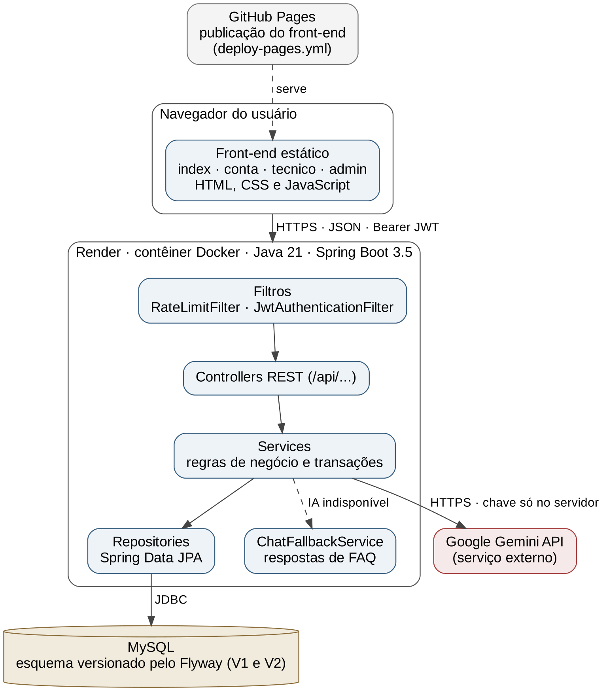{#fig-arq}

A arquitetura segue o estilo REST em camadas descrito por Fielding (2000): o cliente é separado do servidor, a comunicação é sem estado (a identidade é transportada no token JWT) e as camadas internas se comunicam em um único sentido. A Tabela 2 resume a responsabilidade de cada camada.

| Camada | Componentes | Responsabilidade |
|-------------------|---------------------------------------|------------------------------------------|
| Apresentação | `index.html`, `conta.html`, `tecnico.html`, `admin.html`, `script.js`, `dashboard-shared.js`, `os-equipe.js`, `config.js` | Interface do visitante, do cliente, do técnico e do administrador; chamadas à API; validações de conforto do usuário |
| Filtros | `RateLimitFilter`, `JwtAuthenticationFilter` | Limite de requisições por origem e rota; identificação do usuário pelo token |
| Controllers | Classes `*Controller` em `/api/...` | Receber a requisição, validar o formato (Bean Validation) e delegar ao serviço |
| Serviços | `AgendamentoService`, `OrdemServicoService`, `AuthService`, `ChatService`, `RegrasNegocioService`, `ProtocoloService` e outros | Regras de negócio, transições de estado, orquestração e transações |
| Persistência | Repositórios Spring Data JPA; entidades; migrações `V1__schema.sql` e `V2__rastreamento_os.sql` | Acesso e integridade dos dados |
| Integrações | `GeminiClient`, `ChatFallbackService` | Chamada à Google Gemini API com contingência de FAQ |
| Tratamento de erros | `GlobalExceptionHandler` | Resposta padronizada para os erros 401, 403, 404, 409, 422, 502 e 500 |

Table: Camadas da arquitetura e suas responsabilidades {#tbl-camadas}

Fonte: Elaborado pelos autores (2026), a partir do código-fonte (EQUIPE DITEC, 2026a).

As decisões de arquitetura que explicam esse desenho (API separada do front-end, JWT sem estado, regras de negócio no servidor, migrações versionadas e IA chamada pelo servidor) estão registradas, com o motivo e a consequência de cada uma, no Apêndice D.

# Modelo de casos de uso {#sec-cu}

## Diagramas

Os 22 casos de uso foram divididos em dois diagramas, para manter a legibilidade. A Figura 2 reúne os casos de uso do visitante e do cliente (CU01 a CU11), e a Figura 3, os do técnico e do administrador (CU06 e CU09, que são comuns, e CU12 a CU22). O serviço externo Google Gemini aparece como ator secundário do CU04.

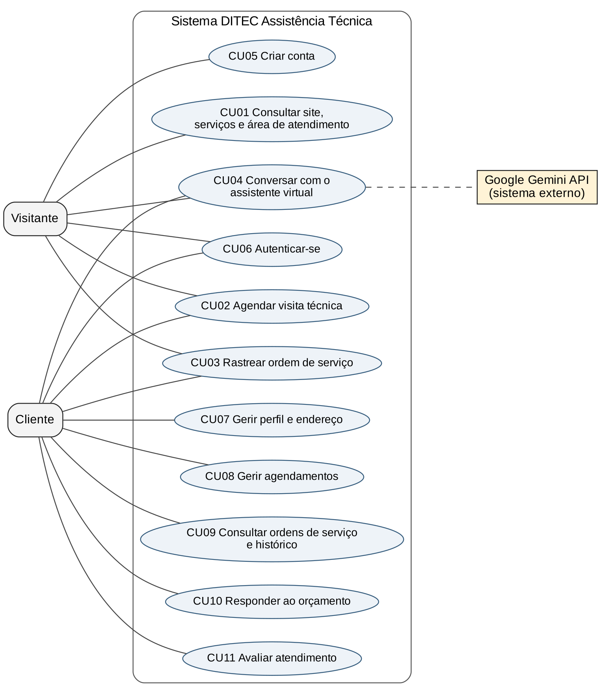{#fig-cu1}

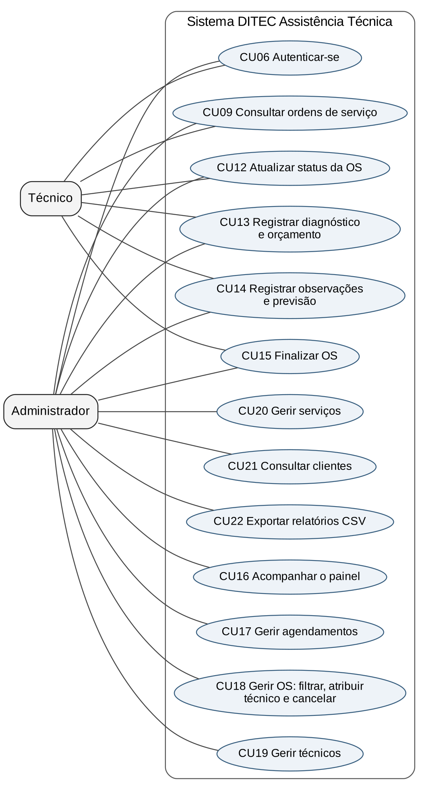{#fig-cu2}

## Catálogo de casos de uso

A Tabela 3 relaciona os casos de uso aos atores e aos requisitos funcionais que realizam. A rastreabilidade completa, até endpoint, tela, tabela e teste, está na matriz de rastreabilidade do Apêndice F.

| ID | Caso de uso | Atores | RF | Objetivo |
|--------|-------------------------|-------------------|----------|--------------------------------------|
| CU01 | Consultar o site, os serviços e a área de atendimento | Visitante, Cliente | RF14, RF23 | Conhecer o catálogo de serviços e verificar se o CEP ou bairro é atendido. |
| CU02 | Agendar visita técnica | Visitante, Cliente | RF05, RF06 | Escolher data e horário livres e solicitar a visita, com ou sem conta. |
| CU03 | Rastrear ordem de serviço | Visitante, Cliente | RF09 | Consultar o andamento da OS informando protocolo e telefone. |
| CU04 | Conversar com o assistente virtual | Visitante, Cliente, serviço externo de IA | RF15 | Obter respostas sobre serviços, garantia e agendamento. |
| CU05 | Criar conta | Visitante | RF01 | Cadastrar-se como cliente. |
| CU06 | Autenticar-se | Cliente, Técnico, Administrador | RF02, RF03 | Entrar no sistema e ser identificado pelo perfil. |
| CU07 | Gerir perfil e endereço | Cliente | RF04 | Consultar e atualizar os dados pessoais e o endereço. |
| CU08 | Gerir agendamentos | Cliente | RF07, RF08 | Listar, alterar e cancelar os próprios agendamentos. |
| CU09 | Consultar ordens de serviço e histórico | Cliente, Técnico, Administrador | RF10 | Visualizar as OS acessíveis ao perfil e a respectiva linha do tempo. |
| CU10 | Responder ao orçamento | Cliente | RF25 | Aprovar ou recusar o orçamento enviado pelo técnico. |
| CU11 | Avaliar atendimento | Cliente | RF13 | Atribuir nota e comentário a um atendimento concluído. |
| CU12 | Atualizar o status da OS | Técnico, Administrador | RF11 | Avançar a OS pelas etapas permitidas. |
| CU13 | Registrar diagnóstico e orçamento | Técnico, Administrador | RF24 | Documentar o diagnóstico e o valor a ser aprovado. |
| CU14 | Registrar observações e previsão | Técnico, Administrador | RF26, RF27 | Anotar observações (internas ou visíveis) e informar a previsão de conclusão. |
| CU15 | Finalizar OS | Técnico, Administrador | RF12 | Registrar valor, pagamento, peças e descrição e ativar a garantia. |
| CU16 | Acompanhar o painel administrativo | Administrador | RF16 | Visualizar indicadores consolidados. |
| CU17 | Gerir agendamentos da operação | Administrador | RF18 | Listar, confirmar e atribuir técnico a agendamentos. |
| CU18 | Gerir OS: filtrar, atribuir técnico e cancelar | Administrador | RF19, RF28, RF29 | Supervisionar as OS, redistribuí-las e cancelá-las com motivo. |
| CU19 | Gerir técnicos | Administrador | RF20 | Criar, editar e ativar ou inativar técnicos. |
| CU20 | Gerir serviços | Administrador | RF21 | Manter o catálogo de serviços. |
| CU21 | Consultar clientes | Administrador | RF17 | Listar os clientes cadastrados. |
| CU22 | Exportar relatórios CSV | Administrador | RF22 | Obter relatórios de agendamentos, OS, avaliações e chatbot. |

Table: Casos de uso do sistema {#tbl-cu}

Fonte: Elaborado pelos autores (2026).

## Especificação dos principais casos de uso

Os sete casos de uso abaixo foram especificados em detalhe por serem os mais críticos do fluxo principal, do agendamento à entrega. Cada especificação indica o ator, as condições, o fluxo principal, as alternativas e exceções, e as regras e requisitos associados. Os códigos HTTP são os devolvidos pela API.

| Item | Descrição |
|-------------------------|---------------------------------------------------------------------------|
| Atores | Visitante ou cliente |
| Pré-condição | Nenhuma; a conta é opcional |
| Fluxo principal | 1. O usuário informa a data na seção de agendamento. 2. O sistema lista os horários livres da grade (RF05). 3. O usuário escolhe o horário e informa nome, telefone, aparelho, defeito, endereço e bairro. 4. O sistema valida as regras (RN01 a RN05). 5. O sistema grava o agendamento PENDENTE, a OS AGENDADO e o evento de abertura, e gera o protocolo (RN08). 6. O sistema exibe o protocolo ao usuário |
| Fluxos alternativos | A1. O CEP ou o bairro não é atendido: a página avisa antes do envio (RF23). A2. O aparelho é a gás: o agendamento recebe prioridade (RN07). A3. O usuário está autenticado: o agendamento é associado ao seu cadastro |
| Exceções | E1. Bairro não atendido, domingo, horário fora da grade ou telefone inválido: 422 com a mensagem da regra. E2. Horário já ocupado: 409. E3. Mais de 10 pedidos por hora pela mesma origem: 429 (RN17) |
| Pós-condição | Agendamento PENDENTE e OS AGENDADO com o mesmo protocolo |
| Rastreabilidade | RF05, RF06, RF23; RN01 a RN08; testes T01 a T03 e T05 (RF06); RF05 e RF23 sem teste automatizado (Apêndice F) |

Table: Especificação do CU02 — Agendar visita técnica {#tbl-cu02}

Fonte: Elaborado pelos autores (2026), a partir do código-fonte (EQUIPE DITEC, 2026a).

| Item | Descrição |
|-------------------------|---------------------------------------------------------------------------|
| Atores | Visitante ou cliente |
| Pré-condição | Possuir o protocolo e o telefone do atendimento |
| Fluxo principal | 1. O usuário informa o protocolo e o telefone na seção de rastreamento. 2. O sistema valida o formato do protocolo (DITEC-AAAA-NNNNNN). 3. O sistema localiza a OS e confere os 8 últimos dígitos do telefone. 4. O sistema devolve o status, a etapa e os eventos visíveis ao cliente |
| Fluxos alternativos | A1. Há observações internas na OS: não aparecem na resposta (RN13) |
| Exceções | E1. Formato de protocolo inválido: 422. E2. Protocolo inexistente ou telefone divergente: 404 com a mesma mensagem nos dois casos, para não revelar quais protocolos existem. E3. Mais de 20 consultas em 5 minutos pela mesma origem: 429 |
| Pós-condição | Nenhuma alteração de dados |
| Rastreabilidade | RF09; RN13, RN17; testes T01, T04, T06 a T08, T24 e T34 |

Table: Especificação do CU03 — Rastrear ordem de serviço {#tbl-cu03}

Fonte: Elaborado pelos autores (2026), a partir do código-fonte (EQUIPE DITEC, 2026a).

| Item | Descrição |
|-------------------------|---------------------------------------------------------------------------|
| Atores | Cliente |
| Pré-condição | Estar autenticado e ser o dono de uma OS em AGUARDANDO_APROVACAO |
| Fluxo principal | 1. O cliente consulta a OS e vê o diagnóstico e o valor do orçamento. 2. O cliente aprova o orçamento. 3. O sistema grava orcamento_aprovado como verdadeiro, move a OS para EM_MANUTENCAO e registra o evento |
| Fluxos alternativos | A1. O cliente recusa: o sistema grava orcamento_aprovado como falso e cancela a OS sem custo, pois o diagnóstico é gratuito (RN19, RN20) |
| Exceções | E1. A OS não é do cliente: 403. E2. A OS não está em AGUARDANDO_APROVACAO: 422. E3. Mais de 10 respostas por hora: 429 |
| Pós-condição | OS em EM_MANUTENCAO (aprovação) ou CANCELADO (recusa) |
| Rastreabilidade | RF25; RN19, RN20; testes T19 e T22 |

Table: Especificação do CU10 — Responder ao orçamento {#tbl-cu10}

Fonte: Elaborado pelos autores (2026), a partir do código-fonte (EQUIPE DITEC, 2026a).

| Item | Descrição |
|-------------------------|---------------------------------------------------------------------------|
| Atores | Técnico e administrador |
| Pré-condição | Estar autenticado; a OS é atribuída ao técnico ou ainda não tem técnico (RN15) |
| Fluxo principal | 1. O usuário seleciona a OS e o novo status entre os permitidos. 2. O sistema verifica a matriz de transições (RN09). 3. O sistema verifica as exigências do destino: diagnóstico para sair de EM_DIAGNOSTICO (RN18) e valor do orçamento para AGUARDANDO_APROVACAO (RN19). 4. O sistema grava o status, registra o evento na linha do tempo e atualiza o status do agendamento |
| Fluxos alternativos | A1. O técnico atua em OS sem técnico: assume a OS (RN15). A2. O administrador cancela: informa o motivo (RN20) |
| Exceções | E1. Transição fora da matriz, inclusive pular etapa ou regredir: 422. E2. Pedido de CONCLUIDO por esta rota: 422 (RN10). E3. OS de outro técnico: 403. E4. Técnico tenta cancelar: 403. E5. Início do atendimento com o agendamento ainda PENDENTE: 422 (RN21) |
| Pós-condição | OS no novo status, com evento registrado e agendamento sincronizado |
| Rastreabilidade | RF11, RF29; RN09 a RN11, RN15, RN18 a RN21; testes T18 a T21, T30, T31 e T33 |

Table: Especificação do CU12 — Atualizar o status da OS {#tbl-cu12}

Fonte: Elaborado pelos autores (2026), a partir do código-fonte (EQUIPE DITEC, 2026a).

| Item | Descrição |
|-------------------------|---------------------------------------------------------------------------|
| Atores | Técnico e administrador |
| Pré-condição | A OS está em andamento e não concluída |
| Fluxo principal | 1. O usuário registra o diagnóstico (obrigatório), o valor do orçamento (de 0 a 999.999,99) e a previsão. 2. O sistema grava os dados e registra os eventos de diagnóstico e orçamento. 3. Para enviar o orçamento ao cliente, o usuário move a OS para AGUARDANDO_APROVACAO |
| Fluxos alternativos | A1. Não há custo adicional: o orçamento é omitido e a OS segue para a manutenção |
| Exceções | E1. Diagnóstico vazio: 422. E2. Valor fora da faixa: 422. E3. OS em AGUARDANDO_APROVACAO: o orçamento não pode ser alterado enquanto aguarda a resposta (RF24). E4. OS concluída: 422 |
| Pós-condição | OS com diagnóstico e orçamento registrados |
| Rastreabilidade | RF24; RN18, RN19; testes T19, T22 e T23 |

Table: Especificação do CU13 — Registrar diagnóstico e orçamento {#tbl-cu13}

Fonte: Elaborado pelos autores (2026), a partir do código-fonte (EQUIPE DITEC, 2026a).

| Item | Descrição |
|-------------------------|---------------------------------------------------------------------------|
| Atores | Técnico e administrador |
| Pré-condição | A OS está em EM_TESTES |
| Fluxo principal | 1. O usuário informa o valor final, a forma de pagamento e a descrição do serviço. 2. O sistema valida os dados. 3. O sistema aplica 5% de desconto se o pagamento for em Pix ou dinheiro (RN11). 4. O sistema define a garantia de 90 dias (RN12), a data de conclusão e o status CONCLUIDO, e registra o evento |
| Fluxos alternativos | A1. Concluída a OS, o usuário a move para AGUARDANDO_RETIRADA ou ENTREGUE pela rota de status |
| Exceções | E1. OS fora de EM_TESTES: 422. E2. Valor negativo, forma de pagamento inválida ou descrição ausente: 422 |
| Pós-condição | OS CONCLUIDO, com garantia, valor e desconto registrados; o cliente pode avaliar o atendimento |
| Rastreabilidade | RF12; RN10 a RN12; teste T19 |

Table: Especificação do CU15 — Finalizar OS {#tbl-cu15}

Fonte: Elaborado pelos autores (2026), a partir do código-fonte (EQUIPE DITEC, 2026a).

| Item | Descrição |
|-------------------------|---------------------------------------------------------------------------|
| Atores | Administrador |
| Pré-condição | Estar autenticado como administrador |
| Fluxo principal | 1. O administrador filtra as OS por status, técnico, protocolo ou cliente (RF19). 2. Atribui um técnico ativo a uma OS ainda não concluída (RF28). 3. O sistema grava a atribuição, registra o evento e sincroniza o agendamento |
| Fluxos alternativos | A1. Cancelamento: o administrador informa o motivo e move a OS para CANCELADO (RF29, RN20) |
| Exceções | E1. Técnico inativo: recusado (RN23). E2. OS concluída, entregue ou cancelada: troca de técnico recusada (RN23). E3. Cancelamento sem motivo: 422. E4. Perfil diferente de administrador: 403 |
| Pós-condição | OS atribuída a outro técnico ou cancelada, com o evento registrado |
| Rastreabilidade | RF19, RF28, RF29; RN20, RN23; testes T21 e T26 |

Table: Especificação do CU18 — Gerir OS: filtrar, atribuir técnico e cancelar {#tbl-cu18}

Fonte: Elaborado pelos autores (2026), a partir do código-fonte (EQUIPE DITEC, 2026a).

| Item | Descrição |
|-------------------------|---------------------------------------------------------------------------|
| Atores | Administrador |
| Pré-condição | Existe agendamento PENDENTE ou AGENDADO |
| Fluxo principal | 1. O administrador lista os agendamentos, com os aparelhos a gás primeiro (RN07). 2. Confirma um agendamento PENDENTE, que passa a AGENDADO. 3. Atribui um técnico ativo ao agendamento. 4. O sistema aplica o técnico à OS vinculada e ao agendamento |
| Fluxos alternativos | A1. Agendamento cancelado ou concluído: a atribuição é recusada |
| Exceções | E1. Confirmação de agendamento que não está PENDENTE: 422. E2. Perfil diferente de administrador: 403 |
| Pós-condição | Agendamento AGENDADO, com técnico, permitindo o início do atendimento (RN21) |
| Rastreabilidade | RF18; RN07, RN21; RF18 sem teste automatizado específico (verificado por revisão de código); T18 verifica a RN21 |

Table: Especificação do CU17 — Gerir agendamentos da operação {#tbl-cu17}

Fonte: Elaborado pelos autores (2026), a partir do código-fonte (EQUIPE DITEC, 2026a).

# Diagramas de atividades {#sec-ativ}

Os fluxos de trabalho foram divididos em três diagramas, que juntos cobrem o ciclo de vida do atendimento: agendamento (da escolha do horário à atribuição do técnico), diagnóstico e orçamento, e execução, finalização e entrega. As decisões (losangos) correspondem às regras de negócio e às respostas HTTP descritas nas especificações.

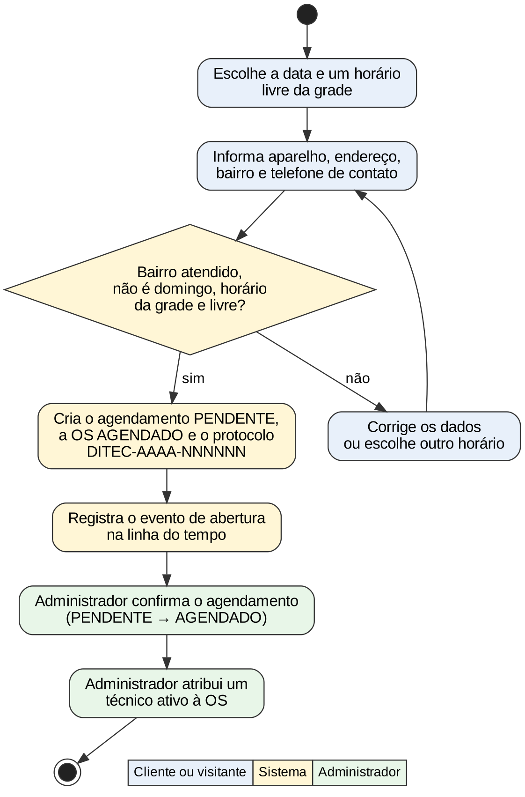{#fig-ativ1}

O fluxo da Figura 4 mostra que a validação das regras de agendamento é o ponto de decisão do processo: dados inválidos devolvem o usuário à etapa de preenchimento, sem criar registros. O administrador atua depois da criação, ao confirmar o agendamento e atribuir o técnico.

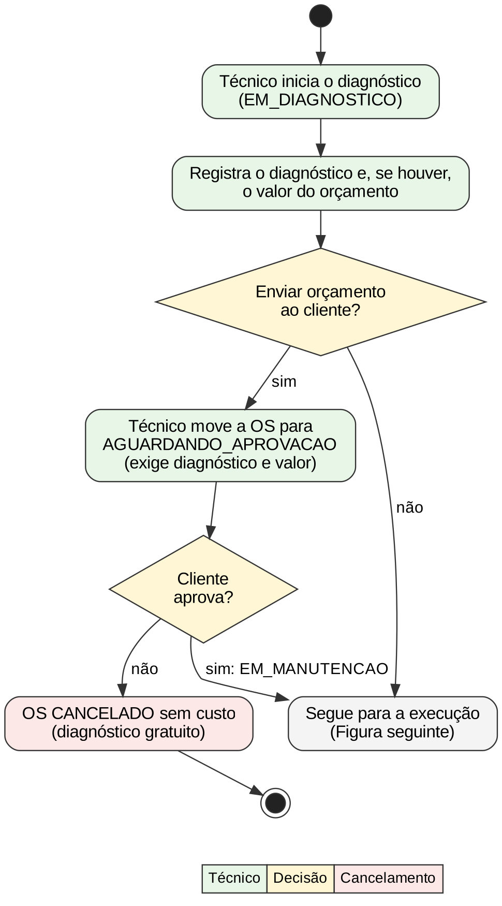{#fig-ativ2}

Na Figura 5, a decisão "Enviar orçamento ao cliente?" separa o caso sem custo adicional do caso com aprovação. A recusa do cliente encerra o atendimento sem cobrança, conforme a regra de que o diagnóstico é gratuito (RN19).

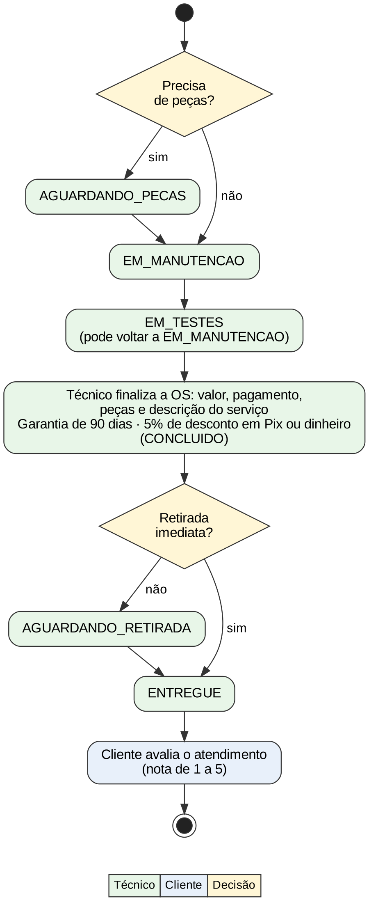{#fig-ativ3}

A Figura 6 trata do ciclo da manutenção: a OS pode alternar entre EM_MANUTENCAO e AGUARDANDO_PECAS, e entre EM_MANUTENCAO e EM_TESTES, e só pode ser finalizada a partir de EM_TESTES. Depois da conclusão, a retirada pode ser imediata ou aguardar o cliente, e a avaliação é feita ao final.

# Diagramas de sequência {#sec-seq}

Os quatro diagramas de sequência mostram a colaboração entre o usuário, o front-end, a API e o banco de dados nos cenários de maior valor para o negócio.

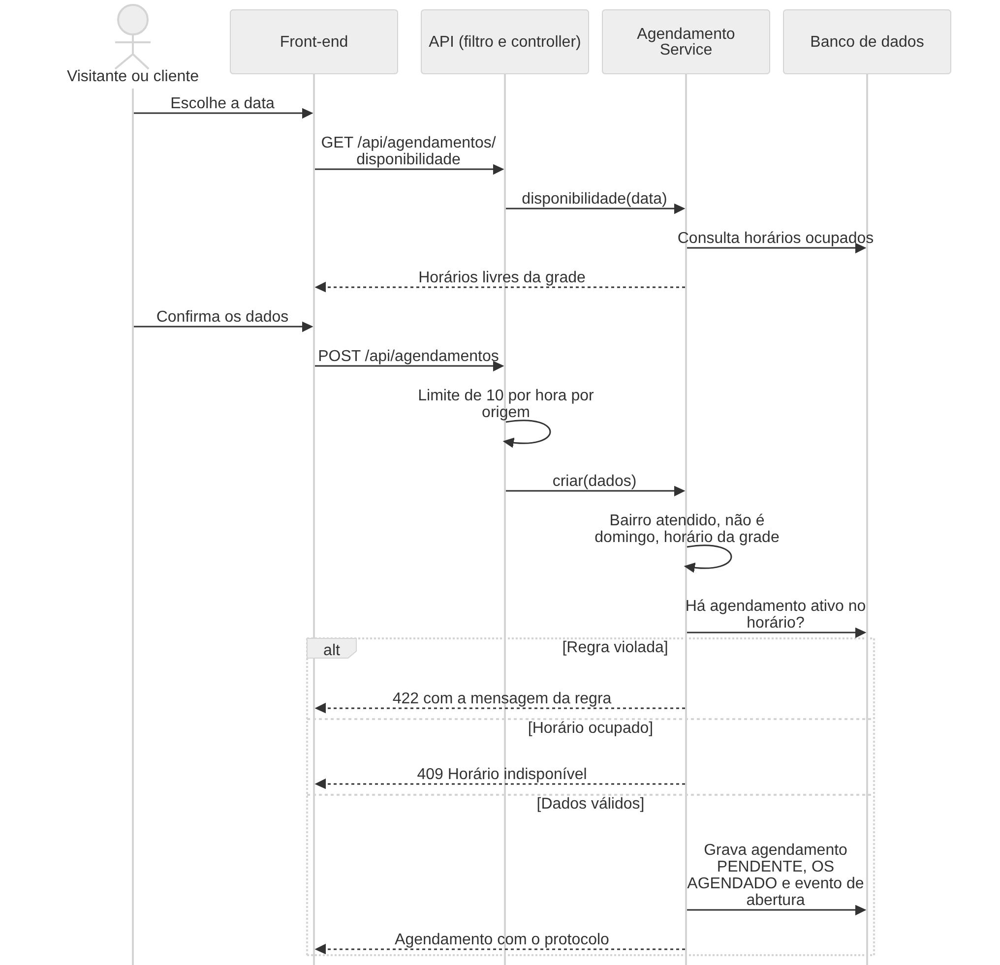{#fig-seq1}

A Figura 7 mostra as duas chamadas do agendamento: a consulta de disponibilidade e a criação. O limite de 10 pedidos por hora é verificado no filtro, antes do serviço, e as três saídas possíveis (regra violada, horário ocupado, dados válidos) correspondem aos códigos 422, 409 e à criação do protocolo.

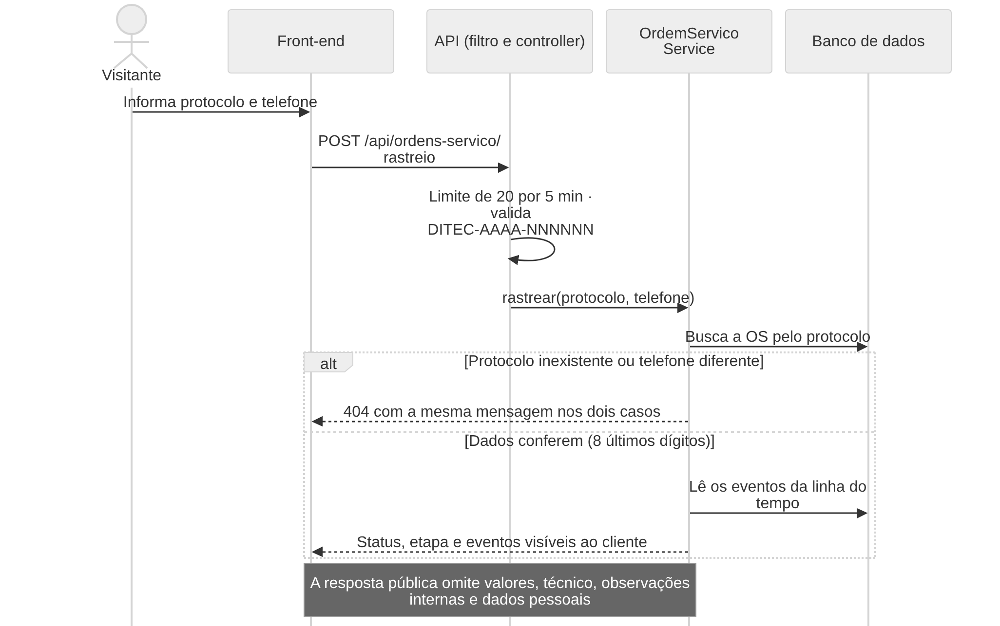{#fig-seq2}

Na Figura 8, a resposta é a mesma para protocolo inexistente e para telefone divergente (404), decisão de segurança que impede descobrir, por tentativa, quais protocolos existem (RN13).

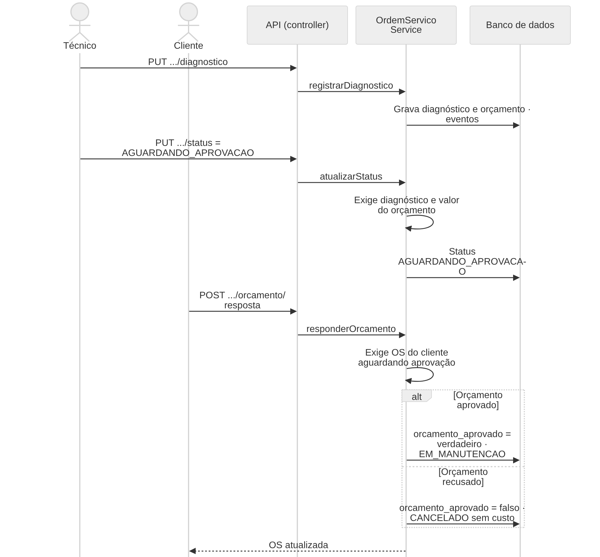{#fig-seq3}

A Figura 9 relaciona dois atores e três chamadas: o técnico registra o diagnóstico e envia o orçamento, e o cliente o aprova ou recusa. O serviço verifica, em cada passo, as pré-condições (diagnóstico, valor e dono da OS).

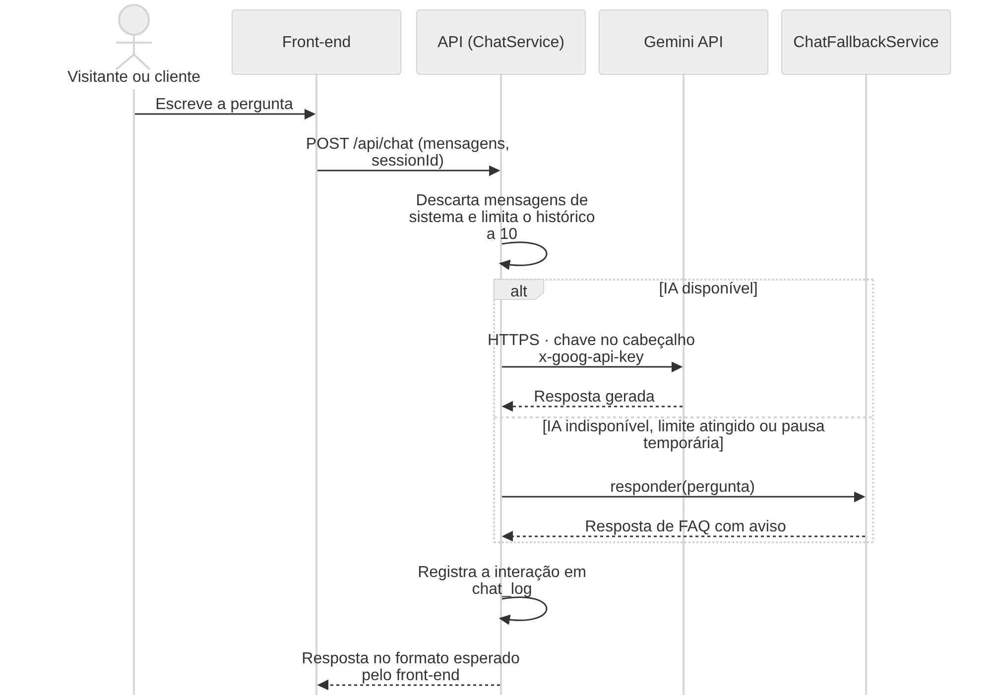{#fig-seq4}

A Figura 10 mostra que a chave da IA é usada somente pelo servidor, que também limita o histórico a 10 mensagens, descarta mensagens de sistema vindas do navegador e recorre à resposta automática de perguntas frequentes quando a IA está indisponível, o limite foi atingido ou há pausa temporária. Em qualquer caso a interação é registrada em `chat_log`.

# Diagrama de estados da ordem de serviço {#sec-est}

A OS é a entidade com o ciclo de vida mais rico do sistema: 10 estados e 19 transições, aplicados pelo método `StatusOS.podeTransicionarPara`. A Figura 11 foi gerada a partir da própria enumeração, e a Tabela 12 lista os estados, a etapa mostrada no indicador do rastreamento e o status equivalente do agendamento, mantido em sincronia a cada mudança.

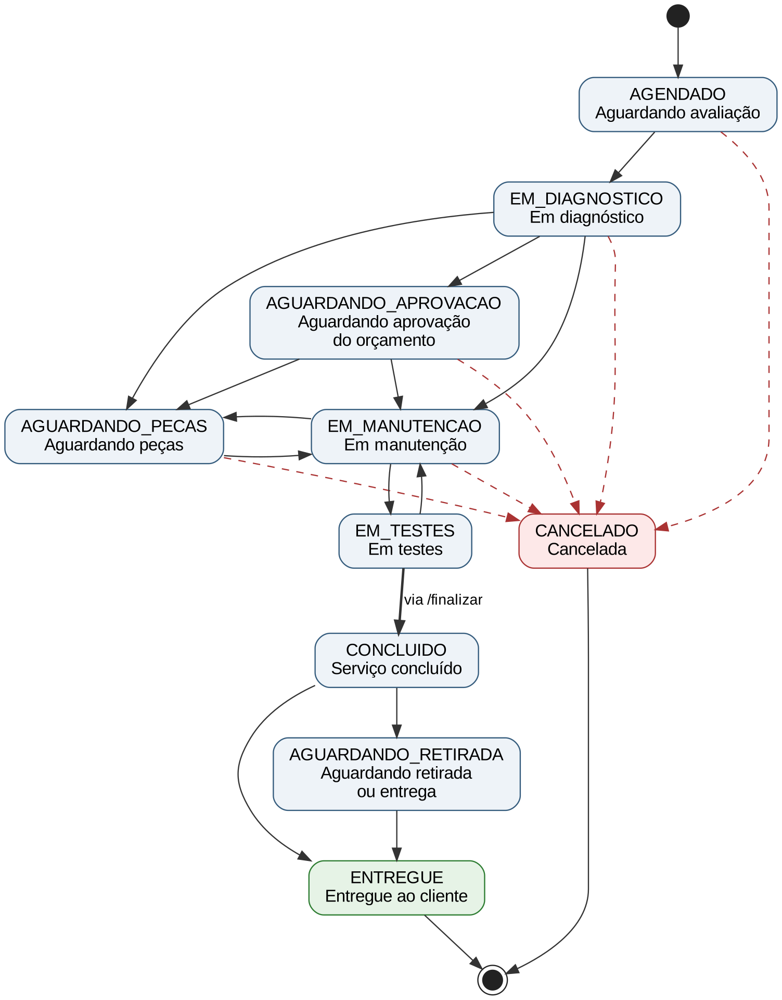{#fig-est}

| Status da OS | Rótulo exibido | Etapa | Transições permitidas | Status do agendamento |
|--------------------------|--------------|--------|-----------------------------|-----------------------|
| `AGENDADO` | Aguardando avaliação | 0 | `EM_DIAGNOSTICO`, `CANCELADO` | `AGENDADO` |
| `EM_DIAGNOSTICO` | Em diagnóstico | 1 | `AGUARDANDO_APROVACAO`, `AGUARDANDO_PECAS`, `EM_MANUTENCAO`, `CANCELADO` | `EM_ATENDIMENTO` |
| `AGUARDANDO_APROVACAO` | Aguardando aprovação do orçamento | 1 | `AGUARDANDO_PECAS`, `EM_MANUTENCAO`, `CANCELADO` | `EM_ATENDIMENTO` |
| `AGUARDANDO_PECAS` | Aguardando peças | 2 | `EM_MANUTENCAO`, `CANCELADO` | `EM_ATENDIMENTO` |
| `EM_MANUTENCAO` | Em manutenção | 2 | `AGUARDANDO_PECAS`, `EM_TESTES`, `CANCELADO` | `EM_ATENDIMENTO` |
| `EM_TESTES` | Em testes | 3 | `EM_MANUTENCAO`, `CONCLUIDO` | `EM_ATENDIMENTO` |
| `CONCLUIDO` | Serviço concluído | 4 | `AGUARDANDO_RETIRADA`, `ENTREGUE` | `CONCLUIDO` |
| `AGUARDANDO_RETIRADA` | Aguardando retirada/entrega | 4 | `ENTREGUE` | `CONCLUIDO` |
| `ENTREGUE` | Entregue ao cliente | 5 | — (estado final) | `CONCLUIDO` |
| `CANCELADO` | Cancelada | -1 | — (estado final) | `CANCELADO` |

Table: Matriz de transições do status da OS (19), etapa do indicador visual e status equivalente do agendamento {#tbl-transicoes}

Fonte: Elaborado pelos autores (2026).

As principais regras do diagrama são: (a) CONCLUIDO só é alcançado pela rota de finalização, a partir de EM_TESTES (RN10); (b) ENTREGUE e CANCELADO são estados finais (RN09); (c) o cancelamento é possível a partir de AGENDADO, EM_DIAGNOSTICO, AGUARDANDO_APROVACAO, AGUARDANDO_PECAS e EM_MANUTENCAO, mas não de EM_TESTES (AM1 do Apêndice B); e (d) sair de EM_DIAGNOSTICO exige diagnóstico registrado (RN18). A análise de alcançabilidade realizada na revisão técnica confirmou que os 10 estados são alcançáveis e que não há estado intermediário sem saída (EQUIPE DITEC, 2026c).

# Diagrama de classes {#sec-cla}

O diagrama de classes (Figura 12) representa as classes de domínio (entidades persistentes e enumerações) e não os controllers, serviços e repositórios, que pertencem à arquitetura. As entidades aparecem sem os campos de controle (datas de criação e atualização), que constam do dicionário de dados da 8.3; a enumeração `TipoEventoOS` e a `StatusConta` são referenciadas, mas não detalhadas. Cada entidade corresponde a uma tabela do banco; os nomes de atributos são os do código, em notação de objetos (`senhaHash`, `dataHora`), e os das colunas, em notação do banco (`senha_hash`, `data_hora`).

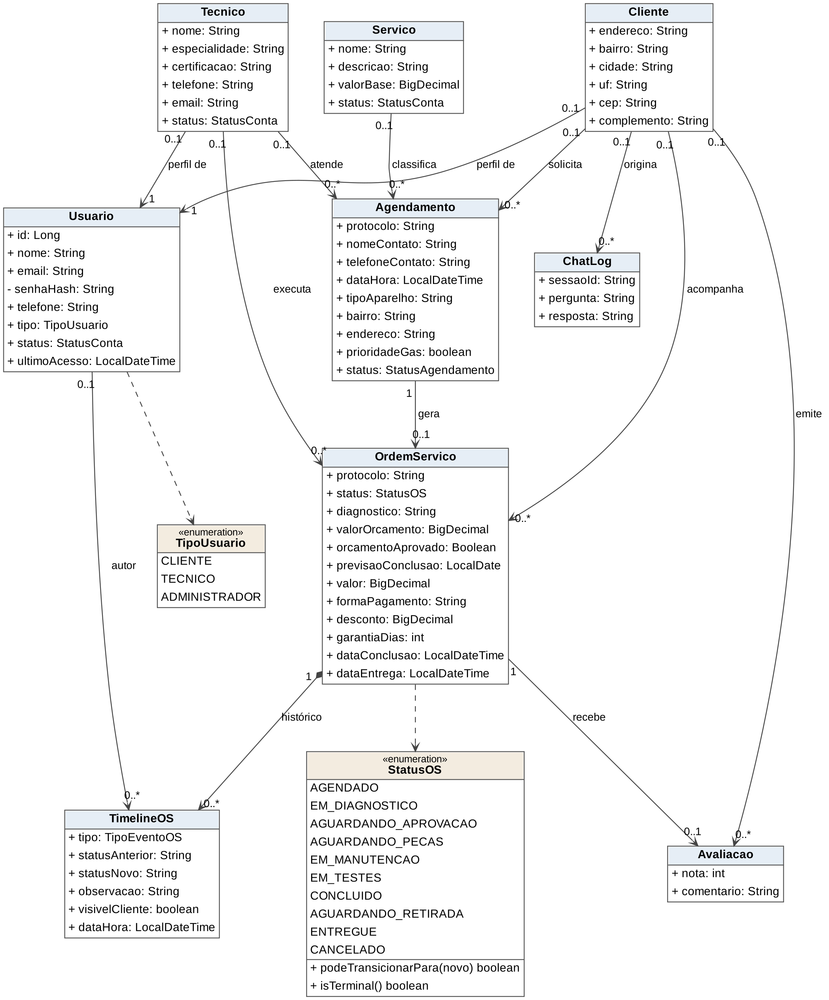{#fig-cla}

Os pontos de modelagem a destacar são:

a) `Usuario` concentra a identidade (e-mail, senha com hash e perfil) e é especializado por composição em `Cliente` e `Tecnico`, que o referenciam como perfil, e não por herança, o que simplifica o mapeamento relacional;

b) `Agendamento` gera no máximo uma `OrdemServico`, e ambos compartilham o mesmo protocolo (RN08);

c) `TimelineOS` pertence a uma única OS, em composição, e registra o histórico de status, diagnóstico, observações, atribuições e previsões, com a indicação de visibilidade ao cliente;

d) `StatusOS` encapsula a matriz de transições, de modo que a regra fica em um só lugar e é testada isoladamente (`StatusOSTest`).

# Modelo entidade-relacionamento {#sec-er}

O modelo de dados é apresentado em três níveis, conforme a disciplina: conceitual (entidades e relacionamentos, independente de tecnologia), lógico (tabelas, chaves e relacionamentos) e físico (tipos, restrições e índices no MySQL).

## Modelo conceitual {#sec-conc}

A Figura 13 mostra as nove entidades e as cardinalidades mínima e máxima de cada relacionamento. A leitura de uma linha como "Agendamento gera (1,1)–(0,1) Ordem de serviço" é: cada ordem de serviço nasce de exatamente um agendamento, e um agendamento gera no máximo uma ordem de serviço.

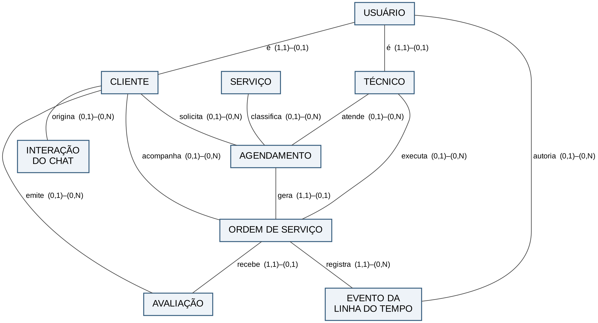{#fig-conc}

As relações com cardinalidade mínima zero (por exemplo, `Cliente` e `Agendamento`) decorrem de duas decisões do domínio: o visitante pode agendar sem conta, de modo que o agendamento pode não ter cliente, e a exclusão de um cliente, de um técnico ou de um serviço não apaga o histórico, razão pela qual essas chaves estrangeiras usam `ON DELETE SET NULL`.

## Modelo lógico {#sec-log}

A Figura 14 apresenta o modelo lógico, com as tabelas, as chaves primárias (PK), as chaves estrangeiras (FK) e as chaves únicas (UK). A Tabela 13 resume o esquema relacional.

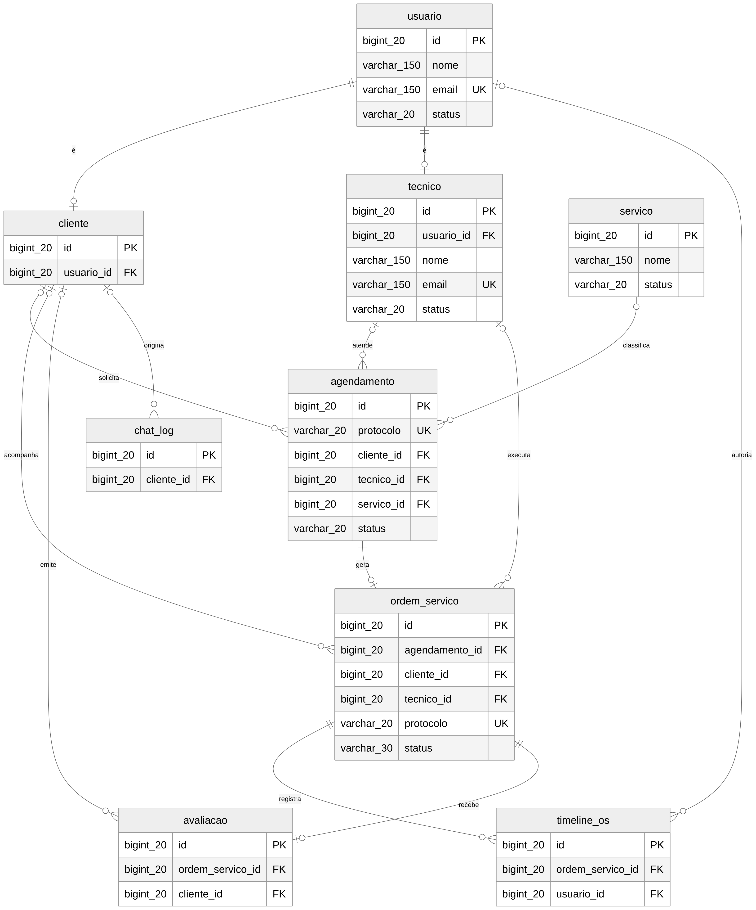{#fig-log}

| Tabela | Chave primária | Chaves estrangeiras | Chaves únicas | Colunas |
|----------------|------------|---------------------------------------|------------------------|----------|
| `agendamento` | `id` | `cliente_id → cliente(id)`; `servico_id → servico(id)`; `tecnico_id → tecnico(id)` | `protocolo` | 16 |
| `avaliacao` | `id` | `cliente_id → cliente(id)`; `ordem_servico_id → ordem_servico(id)` | `ordem_servico_id` | 6 |
| `chat_log` | `id` | `cliente_id → cliente(id)` | — | 6 |
| `cliente` | `id` | `usuario_id → usuario(id)` | `usuario_id` | 8 |
| `ordem_servico` | `id` | `agendamento_id → agendamento(id)`; `cliente_id → cliente(id)`; `tecnico_id → tecnico(id)` | `agendamento_id`, `protocolo` | 23 |
| `servico` | `id` | — | — | 5 |
| `tecnico` | `id` | `usuario_id → usuario(id)` | `email`, `usuario_id` | 8 |
| `timeline_os` | `id` | `ordem_servico_id → ordem_servico(id)`; `usuario_id → usuario(id)` | — | 10 |
| `usuario` | `id` | — | `email` | 9 |

Table: Esquema relacional do banco de dados (versões V1 e V2 aplicadas) {#tbl-esquema}

Fonte: Elaborado pelos autores (2026).

O modelo é, em geral, próximo da terceira forma normal: cada tabela descreve uma única entidade, e as listas de valores (status, tipos) são controladas por restrições CHECK, e não por tabelas auxiliares. Há, porém, três redundâncias que merecem registro: (a) `agendamento` guarda os dados de contato (`nome_contato`, `telefone_contato`) além do vínculo com `cliente`, o que é necessário porque o visitante não tem conta; (b) `ordem_servico` guarda `valor`, `desconto` e `forma_pagamento`, que são valores históricos da finalização e não devem mudar se o catálogo de serviços for alterado; e (c) `tecnico` repete `nome` e `email` de `usuario`, redundância que o grupo pode eliminar em uma evolução futura, ao custo de alterar as consultas e a migração.

## Modelo físico {#sec-fis}

O modelo físico é o definido pelas migrações Flyway `V1__schema.sql` (esquema inicial) e `V2__rastreamento_os.sql` (rastreamento completo da OS). Os dados desta seção foram extraídos de uma instância MySQL/MariaDB na qual as duas migrações foram aplicadas em sequência.

### Resumo das migrações

A V1 cria as 9 tabelas e 83 colunas; a V2 é incremental (não recria tabelas nem apaga dados) e acrescenta 8 colunas: cinco em `ordem_servico` (`diagnostico`, `valor_orcamento`, `orcamento_aprovado`, `previsao_conclusao` e `data_entrega`) e três em `timeline_os` (`tipo`, `usuario_id` e `visivel_cliente`). A V2 também amplia o domínio de status da OS para 10 valores, converte o antigo `EM_ATENDIMENTO` em `EM_MANUTENCAO`, inclusive no histórico, e cria dois índices (`idx_os_criado_em` e `idx_timeline_os_data`). O total é de 91 colunas em 9 tabelas. As limitações conhecidas da V2 (reversão manual incompleta, falha com valor negativo preexistente e comando `DROP CHECK` específico do MySQL) estão descritas no Apêndice E.

### Dicionário de dados

O dicionário abaixo descreve as 91 colunas, na ordem em que aparecem no banco. As colunas incluídas pela V2 estão assinaladas na descrição. As restrições CHECK de cada tabela estão indicadas abaixo da respectiva tabela e reunidas na Tabela 24.

::::: {.dic}
#### Tabela `agendamento` (16 colunas)

| Coluna | Tipo | Nulo | Padrão | Restrições | Descrição |
|---------------|----------------|------|--------------|-------------------|------------------------------|
| `id` | BIGINT | Não | — | PK; AUTO_INCREMENT | Identificador do agendamento |
| `protocolo` | VARCHAR(20) | Sim | NULL | UNIQUE | Protocolo DITEC-AAAA-NNNNNN (único) |
| `cliente_id` | BIGINT | Sim | NULL | FK → cliente(id), ON DELETE SET NULL | Cliente, quando há conta (opcional) |
| `nome_contato` | VARCHAR(150) | Sim | NULL | — | Nome informado para contato |
| `telefone_contato` | VARCHAR(20) | Sim | NULL | — | Telefone informado para contato |
| `tecnico_id` | BIGINT | Sim | NULL | FK → tecnico(id), ON DELETE SET NULL | Técnico atribuído (opcional) |
| `servico_id` | BIGINT | Sim | NULL | FK → servico(id), ON DELETE SET NULL | Serviço do catálogo (opcional) |
| `data_hora` | DATETIME | Não | — | — | Data e horário da visita |
| `tipo_aparelho` | VARCHAR(100) | Não | — | — | Aparelho a ser atendido |
| `descricao_problema` | VARCHAR(500) | Sim | NULL | — | Descrição do defeito |
| `bairro` | VARCHAR(100) | Não | — | — | Bairro do atendimento |
| `endereco` | VARCHAR(255) | Não | — | — | Endereço do atendimento |
| `status` | VARCHAR(20) | Não | 'PENDENTE' | — | PENDENTE, AGENDADO, EM_ATENDIMENTO, CONCLUIDO ou CANCELADO |
| `prioridade_gas` | TINYINT(1) | Não | 0 | — | Indica aparelho a gás (prioridade) |
| `criado_em` | DATETIME | Não | CURRENT_​TIMESTAMP | — | Data e hora de criação |
| `atualizado_em` | DATETIME | Não | CURRENT_​TIMESTAMP | — | Data e hora da última atualização |

Table: Dicionário de dados da tabela agendamento {#tbl-dic-agendamento}

Fonte: Elaborado pelos autores (2026).

::: {.cks}
Restrições CHECK: `ck_agendamento_status`: `status in ('PENDENTE','AGENDADO','EM_ATENDIMENTO','CONCLUIDO','CANCELADO')`.
:::

#### Tabela `avaliacao` (6 colunas)

| Coluna | Tipo | Nulo | Padrão | Restrições | Descrição |
|---------------|----------------|------|--------------|-------------------|------------------------------|
| `id` | BIGINT | Não | — | PK; AUTO_INCREMENT | Identificador da avaliação |
| `ordem_servico_id` | BIGINT | Não | — | FK → ordem_servico(id), ON DELETE CASCADE; UNIQUE | OS avaliada (única: uma avaliação por OS) |
| `cliente_id` | BIGINT | Sim | NULL | FK → cliente(id), ON DELETE SET NULL | Cliente autor (opcional) |
| `nota` | TINYINT | Não | — | — | Nota de 1 a 5 |
| `comentario` | VARCHAR(500) | Sim | NULL | — | Comentário opcional |
| `criado_em` | DATETIME | Não | CURRENT_​TIMESTAMP | — | Data e hora da avaliação |

Table: Dicionário de dados da tabela avaliacao {#tbl-dic-avaliacao}

Fonte: Elaborado pelos autores (2026).

::: {.cks}
Restrições CHECK: `ck_avaliacao_nota`: `nota between 1 and 5`.
:::

#### Tabela `chat_log` (6 colunas)

| Coluna | Tipo | Nulo | Padrão | Restrições | Descrição |
|---------------|----------------|------|--------------|-------------------|------------------------------|
| `id` | BIGINT | Não | — | PK; AUTO_INCREMENT | Identificador da interação |
| `cliente_id` | BIGINT | Sim | NULL | FK → cliente(id), ON DELETE SET NULL | Cliente, quando autenticado (opcional) |
| `sessao_id` | VARCHAR(64) | Não | — | — | Identificador da sessão de chat |
| `pergunta` | TEXT | Não | — | — | Pergunta do usuário |
| `resposta` | TEXT | Não | — | — | Resposta fornecida |
| `data_hora` | DATETIME | Não | CURRENT_​TIMESTAMP | — | Data e hora da interação |

Table: Dicionário de dados da tabela chat_log {#tbl-dic-chat_log}

Fonte: Elaborado pelos autores (2026).

#### Tabela `cliente` (8 colunas)

| Coluna | Tipo | Nulo | Padrão | Restrições | Descrição |
|---------------|----------------|------|--------------|-------------------|------------------------------|
| `id` | BIGINT | Não | — | PK; AUTO_INCREMENT | Identificador do cliente |
| `usuario_id` | BIGINT | Não | — | FK → usuario(id), ON DELETE CASCADE; UNIQUE | Usuário titular do perfil (relação 1:1) |
| `endereco` | VARCHAR(255) | Sim | NULL | — | Logradouro e número |
| `bairro` | VARCHAR(100) | Sim | NULL | — | Bairro |
| `cidade` | VARCHAR(100) | Sim | NULL | — | Cidade |
| `uf` | CHAR(2) | Sim | NULL | — | Unidade da federação |
| `cep` | VARCHAR(9) | Sim | NULL | — | CEP |
| `complemento` | VARCHAR(100) | Sim | NULL | — | Complemento do endereço |

Table: Dicionário de dados da tabela cliente {#tbl-dic-cliente}

Fonte: Elaborado pelos autores (2026).

#### Tabela `ordem_servico` (23 colunas)

| Coluna | Tipo | Nulo | Padrão | Restrições | Descrição |
|---------------|----------------|------|--------------|-------------------|------------------------------|
| `id` | BIGINT | Não | — | PK; AUTO_INCREMENT | Identificador da OS |
| `agendamento_id` | BIGINT | Não | — | FK → agendamento(id), ON DELETE CASCADE; UNIQUE | Agendamento de origem (único) |
| `cliente_id` | BIGINT | Sim | NULL | FK → cliente(id), ON DELETE SET NULL | Cliente titular (opcional) |
| `tecnico_id` | BIGINT | Sim | NULL | FK → tecnico(id), ON DELETE SET NULL | Técnico responsável (opcional) |
| `protocolo` | VARCHAR(20) | Não | — | UNIQUE | Protocolo da OS (único) |
| `descricao_problema` | VARCHAR(500) | Sim | NULL | — | Descrição do defeito |
| `diagnostico` | TEXT | Sim | NULL | — | Diagnóstico técnico (incluída na V2) |
| `valor_orcamento` | DECIMAL(10,2) | Sim | NULL | — | Valor do orçamento enviado ao cliente (incluída na V2) |
| `orcamento_aprovado` | TINYINT(1) | Sim | NULL | — | Resposta do cliente: verdadeiro, falso ou nulo (sem resposta) (incluída na V2) |
| `previsao_conclusao` | DATE | Sim | NULL | — | Data prevista de conclusão (incluída na V2) |
| `status` | VARCHAR(30) | Não | 'AGENDADO' | — | Um dos 10 status do ciclo de vida da OS |
| `valor` | DECIMAL(10,2) | Sim | NULL | — | Valor final cobrado, já com o desconto |
| `forma_pagamento` | VARCHAR(30) | Sim | NULL | — | Forma de pagamento registrada na finalização |
| `desconto` | DECIMAL(5,2) | Sim | 0.00 | — | Fração de desconto aplicada (0,05 equivale a 5%) |
| `pecas_utilizadas` | TEXT | Sim | NULL | — | Peças utilizadas no reparo |
| `descricao_final` | TEXT | Sim | NULL | — | Descrição do serviço realizado |
| `data_inicio` | DATETIME | Sim | NULL | — | Início do diagnóstico |
| `data_conclusao` | DATETIME | Sim | NULL | — | Data e hora da conclusão |
| `data_entrega` | DATETIME | Sim | NULL | — | Data e hora da entrega ao cliente (incluída na V2) |
| `garantia_dias` | INT | Sim | 90 | — | Prazo de garantia em dias (padrão 90) |
| `nota_fiscal_numero` | VARCHAR(50) | Sim | NULL | — | Número do comprovante (não há emissão de NF-e) |
| `criado_em` | DATETIME | Não | CURRENT_​TIMESTAMP | — | Data e hora de criação |
| `atualizado_em` | DATETIME | Não | CURRENT_​TIMESTAMP | — | Data e hora da última atualização |

Table: Dicionário de dados da tabela ordem_servico {#tbl-dic-ordem_servico}

Fonte: Elaborado pelos autores (2026).

::: {.cks}
Restrições CHECK: `ck_os_garantia`: `garantia_dias >= 0`; `ck_os_status`: `status in ('AGENDADO','EM_DIAGNOSTICO','AGUARDANDO_APROVACAO','AGUARDANDO_PECAS','EM_MANUTENCAO','EM_TESTES','CONCLUIDO','AGUARDANDO_RETIRADA','ENTREGUE','CANCELADO')`; `ck_os_valor`: `valor is null or valor >= 0`; `ck_os_valor_orcamento`: `valor_orcamento is null or valor_orcamento >= 0`.
:::

#### Tabela `servico` (5 colunas)

| Coluna | Tipo | Nulo | Padrão | Restrições | Descrição |
|---------------|----------------|------|--------------|-------------------|------------------------------|
| `id` | BIGINT | Não | — | PK; AUTO_INCREMENT | Identificador do serviço |
| `nome` | VARCHAR(150) | Não | — | — | Nome do serviço |
| `descricao` | VARCHAR(500) | Sim | NULL | — | Descrição do serviço |
| `valor_base` | DECIMAL(10,2) | Sim | NULL | — | Valor de referência |
| `status` | VARCHAR(20) | Não | 'ATIVO' | — | Situação: ATIVO ou INATIVO |

Table: Dicionário de dados da tabela servico {#tbl-dic-servico}

Fonte: Elaborado pelos autores (2026).

::: {.cks}
Restrições CHECK: `ck_servico_status`: `status in ('ATIVO','INATIVO')`.
:::

#### Tabela `tecnico` (8 colunas)

| Coluna | Tipo | Nulo | Padrão | Restrições | Descrição |
|---------------|----------------|------|--------------|-------------------|------------------------------|
| `id` | BIGINT | Não | — | PK; AUTO_INCREMENT | Identificador do técnico |
| `usuario_id` | BIGINT | Não | — | FK → usuario(id), ON DELETE CASCADE; UNIQUE | Usuário de login do técnico (1:1) |
| `nome` | VARCHAR(150) | Não | — | — | Nome do técnico |
| `especialidade` | VARCHAR(100) | Sim | NULL | — | Área de especialidade |
| `certificacao` | VARCHAR(100) | Sim | NULL | — | Certificação profissional |
| `telefone` | VARCHAR(20) | Sim | NULL | — | Telefone do técnico |
| `email` | VARCHAR(150) | Não | — | UNIQUE | E-mail do técnico (único) |
| `status` | VARCHAR(20) | Não | 'ATIVO' | — | Situação: ATIVO ou INATIVO |

Table: Dicionário de dados da tabela tecnico {#tbl-dic-tecnico}

Fonte: Elaborado pelos autores (2026).

::: {.cks}
Restrições CHECK: `ck_tecnico_status`: `status in ('ATIVO','INATIVO')`.
:::

#### Tabela `timeline_os` (10 colunas)

| Coluna | Tipo | Nulo | Padrão | Restrições | Descrição |
|---------------|----------------|------|--------------|-------------------|------------------------------|
| `id` | BIGINT | Não | — | PK; AUTO_INCREMENT | Identificador do evento |
| `ordem_servico_id` | BIGINT | Não | — | FK → ordem_servico(id), ON DELETE CASCADE | OS à qual o evento pertence |
| `tipo` | VARCHAR(20) | Não | 'STATUS' | — | Tipo do evento: ABERTURA, STATUS, DIAGNOSTICO, ORCAMENTO, OBSERVACAO, ATRIBUICAO ou PREVISAO (incluída na V2) |
| `status_anterior` | VARCHAR(30) | Sim | NULL | — | Status antes do evento |
| `status_novo` | VARCHAR(30) | Não | — | — | Status após o evento |
| `observacao` | VARCHAR(500) | Sim | NULL | — | Texto do evento |
| `alterado_por` | VARCHAR(150) | Não | — | — | Nome de quem realizou a alteração |
| `usuario_id` | BIGINT | Sim | NULL | FK → usuario(id), ON DELETE SET NULL | Usuário responsável (opcional) (incluída na V2) |
| `visivel_cliente` | TINYINT(1) | Não | 1 | — | Indica se o evento é exibido ao cliente (incluída na V2) |
| `data_hora` | DATETIME | Não | CURRENT_​TIMESTAMP | — | Data e hora do evento |

Table: Dicionário de dados da tabela timeline_os {#tbl-dic-timeline_os}

Fonte: Elaborado pelos autores (2026).

::: {.cks}
Restrições CHECK: `ck_timeline_tipo`: `tipo in ('ABERTURA','STATUS','DIAGNOSTICO','ORCAMENTO','OBSERVACAO','ATRIBUICAO','PREVISAO')`.
:::

#### Tabela `usuario` (9 colunas)

| Coluna | Tipo | Nulo | Padrão | Restrições | Descrição |
|---------------|----------------|------|--------------|-------------------|------------------------------|
| `id` | BIGINT | Não | — | PK; AUTO_INCREMENT | Identificador do usuário |
| `nome` | VARCHAR(150) | Não | — | — | Nome completo |
| `email` | VARCHAR(150) | Não | — | UNIQUE | E-mail de login (único) |
| `senha_hash` | VARCHAR(255) | Não | — | — | Hash BCrypt da senha |
| `telefone` | VARCHAR(20) | Sim | NULL | — | Telefone de contato |
| `tipo` | VARCHAR(20) | Não | — | — | Perfil: CLIENTE, TECNICO ou ADMINISTRADOR |
| `status` | VARCHAR(20) | Não | 'ATIVO' | — | Situação da conta: ATIVO ou INATIVO |
| `data_cadastro` | DATETIME | Não | CURRENT_​TIMESTAMP | — | Data e hora do cadastro |
| `ultimo_acesso` | DATETIME | Sim | NULL | — | Data e hora do último login |

Table: Dicionário de dados da tabela usuario {#tbl-dic-usuario}

Fonte: Elaborado pelos autores (2026).

::: {.cks}
Restrições CHECK: `ck_usuario_status`: `status in ('ATIVO','INATIVO')`; `ck_usuario_tipo`: `tipo in ('CLIENTE','ADMINISTRADOR','TECNICO')`.
:::

Total: 91 colunas em 9 tabelas.

:::::

### Chaves estrangeiras, restrições e índices

A integridade referencial usa duas ações de exclusão: `CASCADE`, quando o registro filho não tem sentido sem o pai (perfis de usuário, eventos da linha do tempo, avaliação e a OS de um agendamento), e `SET NULL`, quando o histórico deve ser preservado (cliente, técnico e serviço).

| Tabela | Restrição | Coluna | Referencia | ON DELETE |
|----------------|--------------------------|-------------------|--------------------------|--------------|
| `agendamento` | `fk_agendamento_cliente` | `cliente_id` | `cliente`(`id`) | SET NULL |
| `agendamento` | `fk_agendamento_servico` | `servico_id` | `servico`(`id`) | SET NULL |
| `agendamento` | `fk_agendamento_tecnico` | `tecnico_id` | `tecnico`(`id`) | SET NULL |
| `avaliacao` | `fk_avaliacao_cliente` | `cliente_id` | `cliente`(`id`) | SET NULL |
| `avaliacao` | `fk_avaliacao_os` | `ordem_servico_id` | `ordem_servico`(`id`) | CASCADE |
| `chat_log` | `fk_chatlog_cliente` | `cliente_id` | `cliente`(`id`) | SET NULL |
| `cliente` | `fk_cliente_usuario` | `usuario_id` | `usuario`(`id`) | CASCADE |
| `ordem_servico` | `fk_os_agendamento` | `agendamento_id` | `agendamento`(`id`) | CASCADE |
| `ordem_servico` | `fk_os_cliente` | `cliente_id` | `cliente`(`id`) | SET NULL |
| `ordem_servico` | `fk_os_tecnico` | `tecnico_id` | `tecnico`(`id`) | SET NULL |
| `tecnico` | `fk_tecnico_usuario` | `usuario_id` | `usuario`(`id`) | CASCADE |
| `timeline_os` | `fk_timeline_os` | `ordem_servico_id` | `ordem_servico`(`id`) | CASCADE |
| `timeline_os` | `fk_timeline_usuario` | `usuario_id` | `usuario`(`id`) | SET NULL |

Table: Chaves estrangeiras (13) e ação referencial de exclusão {#tbl-fks}

Fonte: Elaborado pelos autores (2026).

| Tabela | Restrição | Condição |
|----------------|------------------------|------------------------------------------------------------|
| `agendamento` | `ck_agendamento_status` | `status in ('PENDENTE','AGENDADO','EM_ATENDIMENTO','CONCLUIDO','CANCELADO')` |
| `avaliacao` | `ck_avaliacao_nota` | `nota between 1 and 5` |
| `ordem_servico` | `ck_os_garantia` | `garantia_dias >= 0` |
| `ordem_servico` | `ck_os_status` | `status in ('AGENDADO','EM_DIAGNOSTICO','AGUARDANDO_APROVACAO','AGUARDANDO_PECAS','EM_MANUTENCAO','EM_TESTES','CONCLUIDO','AGUARDANDO_RETIRADA','ENTREGUE','CANCELADO')` |
| `ordem_servico` | `ck_os_valor` | `valor is null or valor >= 0` |
| `ordem_servico` | `ck_os_valor_orcamento` | `valor_orcamento is null or valor_orcamento >= 0` |
| `servico` | `ck_servico_status` | `status in ('ATIVO','INATIVO')` |
| `tecnico` | `ck_tecnico_status` | `status in ('ATIVO','INATIVO')` |
| `timeline_os` | `ck_timeline_tipo` | `tipo in ('ABERTURA','STATUS','DIAGNOSTICO','ORCAMENTO','OBSERVACAO','ATRIBUICAO','PREVISAO')` |
| `usuario` | `ck_usuario_status` | `status in ('ATIVO','INATIVO')` |
| `usuario` | `ck_usuario_tipo` | `tipo in ('CLIENTE','ADMINISTRADOR','TECNICO')` |

Table: Restrições CHECK (11) do banco de dados {#tbl-checks}

Fonte: Elaborado pelos autores (2026).

| Tabela | Índice | Colunas | Tipo |
|----------------|----------------------------------|----------------------------------|----------------|
| `agendamento` | `fk_agendamento_servico` | `servico_id` | Não único |
| `agendamento` | `fk_agendamento_tecnico` | `tecnico_id` | Não único |
| `agendamento` | `idx_agendamento_cliente` | `cliente_id` | Não único |
| `agendamento` | `idx_agendamento_data_hora` | `data_hora` | Não único |
| `agendamento` | `idx_agendamento_status` | `status` | Não único |
| `agendamento` | `idx_agendamento_telefone_contato` | `telefone_contato` | Não único |
| `agendamento` | `uq_agendamento_protocolo` | `protocolo` | Único |
| `avaliacao` | `fk_avaliacao_cliente` | `cliente_id` | Não único |
| `avaliacao` | `uq_avaliacao_os` | `ordem_servico_id` | Único |
| `chat_log` | `fk_chatlog_cliente` | `cliente_id` | Não único |
| `chat_log` | `idx_chatlog_data` | `data_hora` | Não único |
| `chat_log` | `idx_chatlog_sessao` | `sessao_id` | Não único |
| `cliente` | `idx_cliente_bairro` | `bairro` | Não único |
| `cliente` | `uq_cliente_usuario` | `usuario_id` | Único |
| `ordem_servico` | `idx_os_cliente` | `cliente_id` | Não único |
| `ordem_servico` | `idx_os_criado_em` | `criado_em` | Não único |
| `ordem_servico` | `idx_os_status` | `status` | Não único |
| `ordem_servico` | `idx_os_tecnico` | `tecnico_id` | Não único |
| `ordem_servico` | `uq_os_agendamento` | `agendamento_id` | Único |
| `ordem_servico` | `uq_os_protocolo` | `protocolo` | Único |
| `tecnico` | `uq_tecnico_email` | `email` | Único |
| `tecnico` | `uq_tecnico_usuario` | `usuario_id` | Único |
| `timeline_os` | `fk_timeline_usuario` | `usuario_id` | Não único |
| `timeline_os` | `idx_timeline_os_data` | `ordem_servico_id`, `data_hora` | Não único |
| `timeline_os` | `idx_timeline_os_id` | `ordem_servico_id` | Não único |
| `usuario` | `idx_usuario_tipo` | `tipo` | Não único |
| `usuario` | `uq_usuario_email` | `email` | Único |

Table: Índices secundários e chaves únicas (a chave primária é implícita) {#tbl-indices}

Fonte: Elaborado pelos autores (2026).

# Catálogo de telas e navegação {#sec-telas}

A interface é composta por quatro páginas estáticas, que se comunicam com a API pelo navegador. A Tabela 26 relaciona cada página ao perfil que a usa, às seções ou painéis e aos casos de uso que realiza.

| Página | Perfil | Seções ou painéis | Casos de uso |
|---------------------|---------------------|------------------------------------------|-----------------|
| `index.html` | Visitante e cliente | Apresentação, sobre, serviços, marcas, portfólio, depoimentos, pagamentos, agendamento, rastreamento, perguntas frequentes, contato, mapa da área de atendimento, política de privacidade e termos; assistente virtual | CU01, CU02, CU03, CU04 |
| `conta.html` | Visitante e cliente | Entrada e cadastro (visitante); perfil e endereço, agendamentos, ordens de serviço, orçamento e avaliação (cliente) | CU05 a CU11 |
| `tecnico.html` | Técnico | Entrada; indicadores (agendadas, em atendimento, concluídas); lista de OS atribuídas e ações de diagnóstico, status, observações e finalização | CU06, CU09, CU12 a CU15 |
| `admin.html` | Administrador | Entrada; indicadores; painéis de agendamentos, ordens de serviço (com filtros), clientes, técnicos, serviços e relatórios | CU06, CU16 a CU22 |

Table: Catálogo de telas da interface {#tbl-telas}

Fonte: Elaborado pelos autores (2026), a partir do código-fonte do front-end (EQUIPE DITEC, 2026a).

## Capturas de tela

As figuras a seguir são **capturas reais da interface estática**, obtidas de uma cópia do front-end servida localmente e sem acesso à API, de modo que mostram a estrutura, o texto e o layout das telas, mas não dados reais nem o funcionamento do back-end. As telas autenticadas (painéis do cliente, do técnico e do administrador) dependem da API e de dados de teste, e as capturas delas permanecem como pendência de evidência, listada no Apêndice F.

{#fig-tela1 fonte="Captura de tela do front-end estático, versão e58a3d2, sem acesso à API (2026)."}

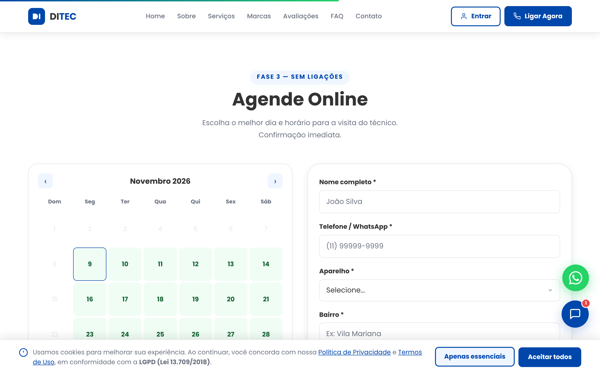{#fig-tela2 fonte="Captura de tela do front-end estático, versão e58a3d2, sem acesso à API (2026)."}

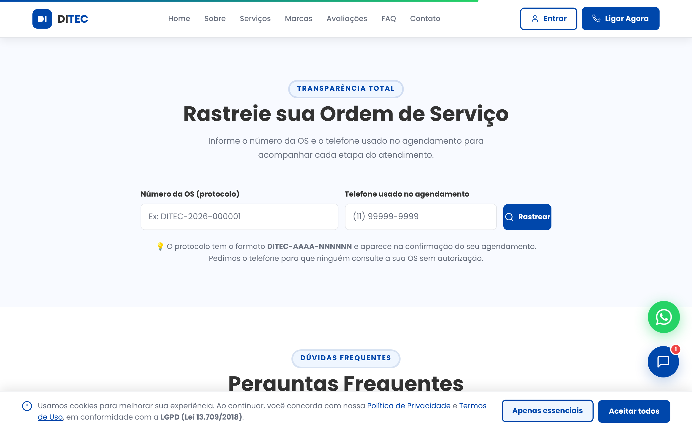{#fig-tela3 fonte="Captura de tela do front-end estático, versão e58a3d2, sem acesso à API (2026)."}

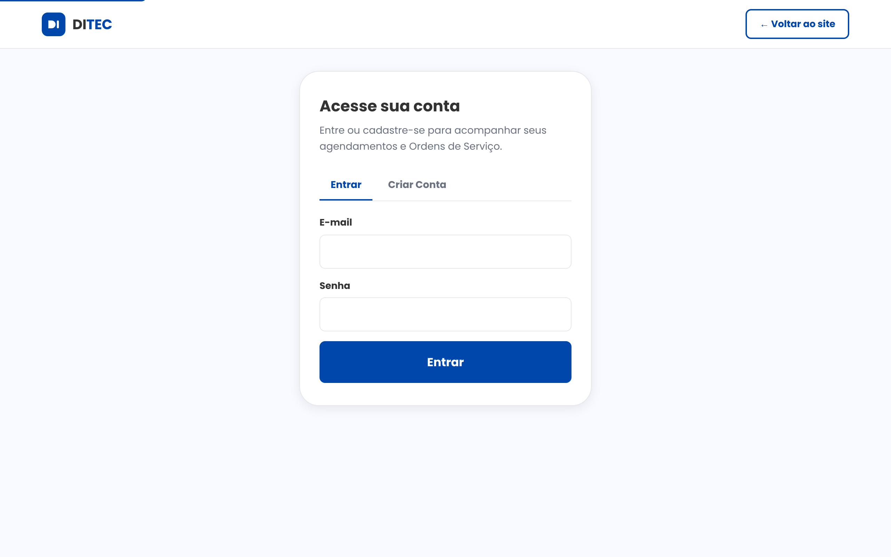{#fig-tela4 fonte="Captura de tela do front-end estático, versão e58a3d2, sem acesso à API (2026)."}

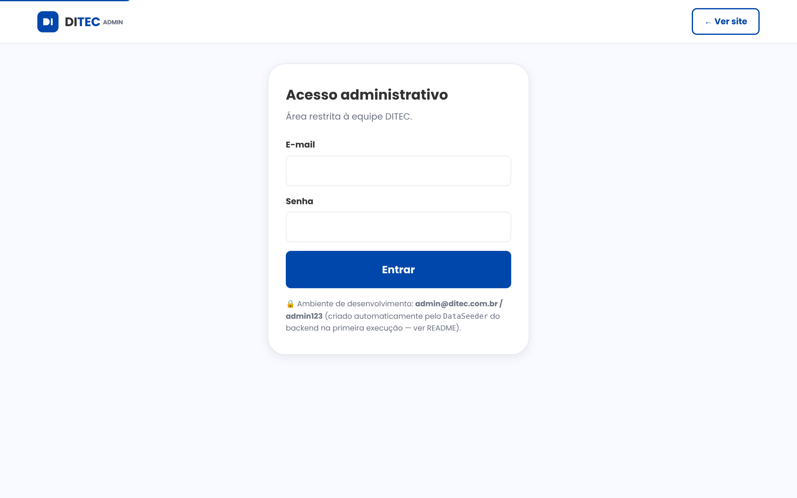{#fig-tela5 fonte="Captura de tela do front-end estático, versão e58a3d2, sem acesso à API (2026)."}

A interface é responsiva. A Figura 20 mostra a página inicial em tela de celular, o que evidencia o requisito de uso em dispositivos móveis (RNF15).

{#fig-tela6 fonte="Captura de tela do front-end estático, versão e58a3d2, em largura de 390 px, sem acesso à API (2026)."}

## Mapa de navegação

A navegação entre as páginas é simples e hierárquica. A página inicial (`index.html`) leva à área do cliente (`conta.html`) e ao acesso administrativo (`admin.html`) por links no rodapé; a entrada de técnicos e de clientes pelo formulário de login redireciona cada perfil à sua área (`tecnico.html` para o técnico), conforme o script da página inicial. Ao sair, o usuário permanece na mesma página, que volta a exibir a tela de entrada, pois o token é descartado no navegador. O perfil do usuário é sempre verificado pelo servidor, e não pela página acessada: o acesso de um perfil à área de outro resulta em 403.

# Coerência entre os modelos {#sec-coer}

A disciplina avalia a coerência dos modelos entre si e com o código. A Tabela 27 mostra como cada conceito central aparece nos diagramas, no código e no banco, e a Figura 21 resume a cadeia de rastreabilidade adotada: do requisito ao modelo, ao código e ao teste.

| Conceito | Casos de uso | Sequência e atividades | Classe | Tabela | Código |
|---------------|----------|------------------|---------------|----------------|--------------------------|
| Agendamento | CU02, CU08, CU17 | Figura 4, Figura 7 | `Agendamento` | `agendamento` | `AgendamentoService` |
| Ordem de serviço | CU03, CU09, CU12 a CU15, CU18 | Figura 5, Figura 6, Figura 8 | `OrdemServico`, `StatusOS` | `ordem_servico` | `OrdemServicoService`, `StatusOS` |
| Linha do tempo | CU03, CU09, CU14 | Figura 8, Figura 9 | `TimelineOS` | `timeline_os` | `OrdemServicoService`, `OrdemServicoMapper` |
| Orçamento | CU10, CU13 | Figura 5, Figura 9 | `OrdemServico` | `ordem_servico` | `OrdemServicoService.responderOrcamento` |
| Avaliação | CU11 | Figura 6 | `Avaliacao` | `avaliacao` | `OrdemServicoService.avaliar` |
| Assistente virtual | CU04 | Figura 10 | `ChatLog` | `chat_log` | `ChatService`, `GeminiClient` |
| Usuários e perfis | CU05 a CU07, CU19, CU21 | — | `Usuario`, `Cliente`, `Tecnico` | `usuario`, `cliente`, `tecnico` | `AuthService`, `SecurityConfig` |
| Serviços | CU01, CU20 | — | `Servico` | `servico` | `ServicoController` |

Table: Coerência dos conceitos entre os modelos, o código e o banco {#tbl-coerencia}

Fonte: Elaborado pelos autores (2026).

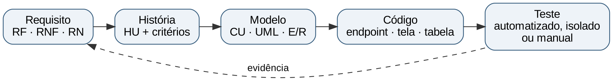{#fig-rastr}

Na verificação de coerência não foram encontradas divergências entre os diagramas e o código nos pontos modelados. As divergências localizadas pela revisão técnica estão em textos de documentação (por exemplo, o comentário do enum sobre o cancelamento, AM1 do Apêndice B) e não nos modelos, que foram gerados do próprio código.
