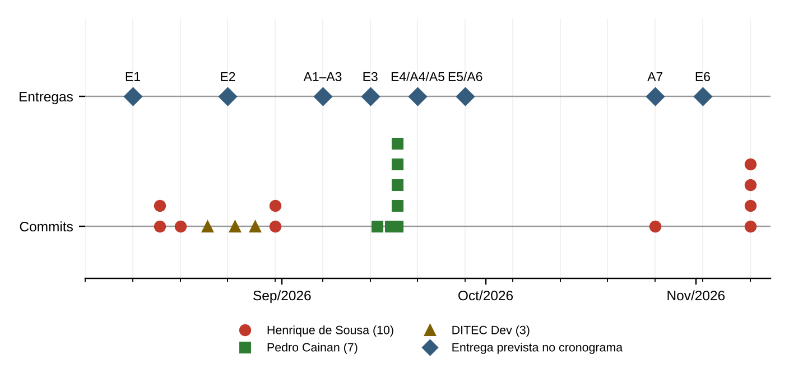

# Introdução

## Finalidade e honestidade das evidências

Este documento é o quarto entregável sugerido pela disciplina: backlog priorizado e evidências de gestão (PROJETO E DESENVOLVIMENTO DE SOFTWARE, [s. d.]). A disciplina pede que o grupo mostre como organizou o trabalho: quadro de tarefas, divisão de responsabilidades, controle de versão e acompanhamento do progresso.

As evidências de gestão que o projeto efetivamente deixou são o **histórico de versionamento** e o código. O repositório não contém registro de reuniões, de planejamento de ciclos (*sprints*), de quadro Kanban, de *issues*, de estimativas ou de retrospectivas, e não foi possível consultar, a partir do ambiente de elaboração, os recursos de gestão que a plataforma GitHub oferece (issues, projetos e pull requests), por restrição de acesso. Por isso, o **backlog e o quadro Kanban deste documento são uma reconstituição a posteriori**, feita a partir do sistema implementado e das pendências identificadas, e não o registro de um acompanhamento real. Cada item reconstituído é identificado como tal, e nenhum dado de esforço, de data de planejamento ou de reunião foi inventado.

## Organização do trabalho

A divisão de papéis entre os integrantes foi informada pelo grupo em 9 de novembro de 2026 e consta da Tabela 1: dois integrantes respondem pelo desenvolvimento e dois pelos testes. Essa divisão **não está registrada no repositório**, de modo que o histórico de versionamento não permite confirmá-la por inteiro (ver 3.2). As reuniões e os canais de comunicação também não deixaram registro no repositório.

| Integrante | RGM | Frente de trabalho | Atribuições |
|--------------------------|--------------|------------------|-------------------------------------------|
| Henrique de Sousa Cunha | 42873134 | Desenvolvimento | Back-end, front-end, banco de dados, integração com o assistente virtual, implantação e versionamento |
| Pedro Cainan Rodrigues de Paula | 41873891 | Desenvolvimento | Back-end, front-end, banco de dados, integração com o assistente virtual, implantação e versionamento |
| Cauã De Lucca Uema | 42057019 | Testes | Plano, execução e registro dos testes e verificação dos critérios de aceitação |
| Jesús Alejandro Romero Rivero | 42772915 | Testes | Plano, execução e registro dos testes e verificação dos critérios de aceitação |

Table: Divisão de papéis entre os integrantes, conforme informado pelo grupo {#tbl-papeis}

Fonte: Elaborado pelos autores (2026), a partir da informação do grupo em 9 de novembro de 2026.

O README do projeto cita apenas dois integrantes e o histórico registra três identidades de autoria, o que é tratado na 3.2.

# Cronograma e situação das entregas

A Tabela 2 relaciona as entregas do cronograma da disciplina, com a data de início da semana prevista, a evidência no conjunto de documentos e no repositório, e a situação. As avaliações entre integrantes (avaliações 360) do cronograma não fazem parte deste conjunto, por decisão do grupo.

| Entrega | Prevista | Evidência | Situação |
|-------------------|--------------|---------------------------------------------------|----------------|
| E1 Proposta | 10/08/2026 | Visão e escopo (Apêndice A); README do projeto. Problema, justificativa e nome oficial dependem da confirmação do grupo | PARCIAL |
| E2 Requisitos e casos de uso | 24/08/2026 | 29 requisitos funcionais, 18 não funcionais, 24 regras e 22 casos de uso (Apêndices B e C) | CONCLUÍDO |
| A1 a A3 Visão, requisitos e diagramas UML | 07/09/2026 | Apêndices A, B e C | CONCLUÍDO |
| E3 Modelagem | 14/09/2026 | Diagramas de casos de uso, atividades, sequência, estados e classes (Apêndice C) | CONCLUÍDO |
| E4, A4 e A5 Protótipo das telas e modelo do banco | 21/09/2026 | Quatro páginas do front-end; modelo E/R e dicionário de dados de 91 colunas (Apêndice C) | CONCLUÍDO |
| E5 e A6 MVP e documentação | 28/09/2026 | Front-end publicado por GitHub Pages e API configurada para o Render, com instruções de execução (Apêndice E); a disponibilidade da API em produção não foi verificada por restrição de acesso | PARCIAL |
| A7 Código funcionando | 26/10/2026 | Código versionado, com os fluxos exercitados nos testes do grupo. A configuração de produção não foi verificada (risco R01) | PARCIAL |
| E6 Testes | 02/11/2026 | 52 testes automatizados e verificações do grupo; 14 requisitos sem teste automatizado; `mvn test` não reproduzido pelos autores deste documento (Apêndice F) | PARCIAL |

Table: Entregas do cronograma, evidências e situação em 9 de novembro de 2026 {#tbl-cron}

Fonte: Elaborado pelos autores (2026), com base no cronograma da disciplina e no repositório (EQUIPE DITEC, 2026a).

A situação CONCLUÍDO nas entregas de documentação indica que o documento foi elaborado, não que tenha sido validado pelo grupo: a validação é uma das pendências da Tabela 11.

# Evidências do controle de versão {#sec-vc}

## Histórico do repositório

O repositório do projeto, na versão e58a3d2, contém **20 commits**, entre 14 de agosto e 9 de novembro de 2026, em dois ramos remotos (`main` e `atualizacao-gemini-auditoria`) e uma etiqueta (`backup-pre-troca-agente-ia`, criada antes da troca do agente de inteligência artificial do chatbot). Os commits se distribuem em 8 em agosto, 7 em setembro, 1 em outubro e 4 em novembro. Não há *merge commits* nem pull requests no histórico. A Figura 1 relaciona as entregas previstas aos commits, e a Tabela 3 lista todos eles.

{#fig-cron fonte="Elaborado pelos autores (2026), com base no cronograma da disciplina e no histórico do repositório (e58a3d2). A data de cada entrega é a segunda-feira da semana prevista."}

A leitura da Figura 1 mostra três fatos: (a) a maior parte do desenvolvimento do back-end, da autenticação e da publicação (15 dos 20 commits) ocorreu até 18 de setembro, no período das entregas de modelagem e de MVP do cronograma; (b) não há commits entre 19 de setembro e 25 de outubro; e (c) quatro commits de 9 de novembro concentram a troca do agente de inteligência artificial do chatbot, a ignorar arquivos do sistema operacional e a remoção do agente anterior.

| Data | Código | Autoria | Descrição do commit |
|---------------|------------|-----------------------|--------------------------------------------------|
| 14/08/2026 | 2f4ab3a | Henrique de Sousa | Initial commit |
| 14/08/2026 | d6e1ef0 | Henrique de Sousa | Arquivos do Semestre 2026.3 (sem mundanças) |
| 17/08/2026 | 9477be7 | Henrique de Sousa | Novas páginas de cliente e Administrador; adição de imagens das logos "Marcas que Atendemos" |
| 21/08/2026 | 8515d55 | DITEC Dev | Finalização do projeto: backend Spring Boot e MySQL, autenticação JWT, agendamento e OS reais, painel admin completo e relatórios CSV |
| 25/08/2026 | 45dab87 | DITEC Dev | Segunda rodada: corrige bug (listarMinhas usava o id de Usuario em vez de Tecnico) e implementa as três pendências |
| 28/08/2026 | 857ef3e | DITEC Dev | Auditoria e implementação de segurança completa (ver SECURITY.md) |
| 31/08/2026 | 183e64c | Henrique de Sousa | Organização do projeto `--v1` |
| 31/08/2026 | 3255531 | Henrique de Sousa | Create README.md |
| 15/09/2026 | c86a271 | Pedro Cainan | Corrige configuração de segurança e autenticação |
| 17/09/2026 | 684290c | Pedro Cainan | Prepara backend para hospedagem e login por perfil |
| 18/09/2026 | bc022ee | Pedro Cainan | Renomeia pasta do backend para compatibilidade com Render |
| 18/09/2026 | 66d3173 | Pedro Cainan | Conecta frontend ao backend público do Render |
| 18/09/2026 | 93f2d4e | Pedro Cainan | Configura publicação do frontend no GitHub Pages |
| 18/09/2026 | 60d5b66 | Pedro Cainan | Corrige habilitação do GitHub Pages no workflow |
| 18/09/2026 | f004857 | Pedro Cainan | Corrige sintaxe do workflow do GitHub Pages |
| 26/10/2026 | 15c2b99 | Henrique de Sousa | Fix brand image paths |
| 09/11/2026 | c60e962 | Henrique de Sousa | Atualiza projeto: adiciona .gitignore e remove .DS_Store do versionamento |
| 09/11/2026 | 9a7f8de | Henrique de Sousa | Backup antes da troca do agente de IA do chatbot |
| 09/11/2026 | b9e3961 | Henrique de Sousa | Integração do chatbot com Google Gemini API |
| 09/11/2026 | e58a3d2 | Henrique de Sousa | Remoção geral do antigo agente de IA (Hugging Face) |

Table: Commits do repositório, em ordem cronológica {#tbl-commits}

Fonte: Elaborado pelos autores (2026), a partir do histórico do repositório (EQUIPE DITEC, 2026a).

## Autoria dos commits e integrantes {#sec-autoria}

O grupo é formado por quatro integrantes, conforme informado por ele: Pedro Cainan Rodrigues de Paula, Henrique de Sousa Cunha, Cauã De Lucca Uema e Jesús Alejandro Romero Rivero. O histórico registra três identidades de autoria: Henrique de Sousa (10 commits), Pedro Cainan (7) e DITEC Dev (3). O README do projeto cita como equipe Henrique de Sousa Cunha e Caua Uema de Lucca. Portanto, (a) as identidades "Henrique de Sousa" e "Pedro Cainan" correspondem, presumivelmente, a dois integrantes do grupo, e Pedro Cainan Rodrigues de Paula não consta no README; (b) Cauã De Lucca Uema consta no README, com a grafia "Caua Uema de Lucca", mas não aparece com esse nome no histórico; (c) Jesús Alejandro Romero Rivero não aparece no README nem no histórico; e (d) "DITEC Dev" é uma identidade genérica, responsável por três commits de agosto, que o histórico não permite atribuir a um integrante, pois pode corresponder a mais de uma pessoa ou a uma configuração de Git comum à máquina. A ausência do nome de um integrante no histórico não indica ausência de contribuição, que pode ter ocorrido por outros meios ou com outra identidade de autoria. O grupo deve atualizar o README e conciliar as identidades (pendência P07), pois a disciplina avalia a colaboração, e a colaboração só é demonstrável quando o histórico identifica os autores.

## Práticas de versionamento observadas

A Tabela 4 compara as práticas de versionamento recomendadas pela disciplina (PROJETO E DESENVOLVIMENTO DE SOFTWARE, [s. d.]) com as observadas no repositório.

| Prática recomendada | Observação no repositório | Situação |
|----------------------------|----------------------------------------------------|-------------------|
| Repositório remoto compartilhado | Repositório no GitHub, com ramo `main` | CONCLUÍDO |
| Commits pequenos e com mensagens claras | Mensagens descritivas em português na maior parte; há mensagens em inglês e uma com redação genérica ("Create README.md") | PARCIAL |
| Ramos por funcionalidade | Há um ramo de atualização (`atualizacao-gemini-auditoria`); o desenvolvimento ocorreu, em geral, direto em `main` | PARCIAL |
| Pull requests e revisão por outro integrante | Nenhum pull request ou merge no histórico | NÃO IMPLEMENTADO |
| Etiquetas (*tags*) em marcos | Uma etiqueta de backup antes da troca do agente de IA | PARCIAL |
| Arquivos sensíveis fora do versionamento | `.gitignore` e `.env.example`; varredura do histórico sem credencial real | CONCLUÍDO |
| Integração contínua | Há fluxo de publicação do front-end (`deploy-pages.yml`); não há fluxo de compilação e testes | PARCIAL |

Table: Práticas de versionamento recomendadas e observadas {#tbl-git}

Fonte: Elaborado pelos autores (2026), a partir do repositório (EQUIPE DITEC, 2026a).

# Backlog do produto

## Critério de priorização

O backlog do produto é a lista ordenada do que o produto deve ter. A ordenação adotada considera, em primeiro lugar, a prioridade MoSCoW (*Must*, *Should*, *Could*), e, dentro de cada faixa, as dependências entre os itens: um item só pode ser entregue depois daquele de que depende. Os itens são as 20 histórias de usuário do Apêndice B, e a rastreabilidade de cada uma até os requisitos funcionais consta da coluna RF. Não há estimativas de esforço, e as técnicas de estimativa e de priorização numérica, como *planning poker* e matriz valor × esforço, citadas pela disciplina, não foram utilizadas pelo grupo, nem foram inventadas para este documento.

## Backlog reconstituído

Como o sistema já está implementado, todas as 20 histórias estão atendidas. A Tabela 5 apresenta o backlog na ordem de priorização. A coluna "Situação" reflete o estado do código e dos testes em 9 de novembro de 2026, e não o registro de um acompanhamento real.

| ID | Item | MoSCoW | RF | Depende de | Situação |
|--------|------------------------------------------|-----------|-----------|-------------|---------------|
| HU02 | Como visitante, quero escolher um horário livre e solicitar uma visita técnica sem criar conta | Must | RF05, RF06 | — | CONCLUÍDO |
| HU03 | Como visitante, quero consultar o andamento da minha ordem de serviço com o protocolo e o telefone | Must | RF09 | RF06 | CONCLUÍDO |
| HU05 | Como visitante, quero criar uma conta de cliente | Must | RF01 | — | CONCLUÍDO |
| HU08 | Como cliente, quero aprovar ou recusar o orçamento | Must | RF25 | RF24 | CONCLUÍDO |
| HU09 | Como cliente, quero consultar minhas ordens de serviço e o histórico de cada uma | Must | RF10 | RF06 | CONCLUÍDO |
| HU11 | Como técnico, quero ver as ordens de serviço atribuídas a mim | Must | RF10 | RF06 | CONCLUÍDO |
| HU12 | Como técnico, quero atualizar o status da OS seguindo o fluxo previsto | Must | RF11 | RF06 | CONCLUÍDO |
| HU13 | Como técnico, quero registrar o diagnóstico e o orçamento | Must | RF24 | RF11 | CONCLUÍDO |
| HU15 | Como técnico, quero finalizar a OS com valor, pagamento, peças e descrição | Must | RF12 | RF11 | CONCLUÍDO |
| HU16 | Como administrador, quero confirmar agendamentos e atribuir técnico | Must | RF18, RF28 | RF06, RF20 | CONCLUÍDO |
| HU19 | Como administrador, quero gerir técnicos e serviços | Must | RF20, RF21 | RF02 | CONCLUÍDO |
| HU06 | Como cliente, quero entrar na minha conta e manter o endereço atualizado | Should | RF02, RF03, RF04 | RF01 | CONCLUÍDO |
| HU07 | Como cliente, quero listar, alterar e cancelar meus agendamentos ainda não iniciados | Should | RF07, RF08 | RF06 | CONCLUÍDO |
| HU10 | Como cliente, quero avaliar o atendimento concluído | Should | RF13 | RF12 | CONCLUÍDO |
| HU14 | Como técnico, quero registrar observações e a previsão de conclusão | Should | RF26, RF27 | RF10 | CONCLUÍDO |
| HU17 | Como administrador, quero acompanhar o painel e filtrar todas as ordens de serviço | Should | RF16, RF19 | RF02, RF06 | CONCLUÍDO |
| HU18 | Como administrador, quero cancelar uma OS informando o motivo | Should | RF29 | RF11 | CONCLUÍDO |
| HU01 | Como visitante, quero verificar se o meu CEP ou bairro é atendido | Could | RF23 | — | CONCLUÍDO |
| HU04 | Como visitante, quero tirar dúvidas com um assistente virtual | Could | RF15 | — | CONCLUÍDO |
| HU20 | Como administrador, quero consultar clientes e exportar relatórios em CSV | Could | RF17, RF22 | RF02 | CONCLUÍDO |

Table: Product Backlog priorizado (reconstruído a posteriori) {#tbl-backlog}

Fonte: Elaborado pelos autores (2026).

A distribuição é de 11 histórias *Must*, 6 *Should* e 3 *Could*. Os itens de evolução futura e as pendências que ainda exigem trabalho estão nas seções de pendências e de evolução futura, abaixo.

## Quadro Kanban reconstituído

O Kanban organiza o trabalho em colunas que representam o fluxo, limitando o que está em andamento. A Tabela 6 reconstitui, para 9 de novembro de 2026, a posição de cada item nas colunas. Foi montada a partir do estado do sistema e das pendências, e não de um quadro real, razão pela qual as colunas "Em andamento" e "Em revisão" estão vazias: não há registro de trabalho em curso nem de revisões.

| Backlog (futuro) | A fazer (pendências) | Em andamento | Em revisão | Concluído |
|----------------------|-------------------------|--------------|-------------|--------------------------|
| F01 Recuperação de senha; F02 Notificações; F03 Pagamento online; F04 Nota fiscal; F05 Aplicativo móvel | P01 a P14 (ver Tabela 11) | Nenhum item registrado | Nenhum item registrado | HU01 a HU20 (20 histórias de usuário) |

Table: Quadro Kanban reconstituído em 9 de novembro de 2026 {#tbl-kanban}

Fonte: Elaborado pelos autores (2026), reconstituição a partir do sistema implementado e das pendências.

Para que o quadro deixe de ser reconstituição, o grupo pode adotar o recurso de projetos do GitHub, com as cinco colunas acima, um limite de itens simultâneos por integrante e a vinculação de cada cartão a uma *issue* e a um pull request. Essa adoção é uma recomendação e não está implementada.

## Elementos do Scrum e evidências

O Guia do Scrum define três artefatos (backlog do produto, backlog do ciclo e incremento), cada um com um compromisso (meta do produto, meta do ciclo e definição de pronto), e cinco eventos (o próprio ciclo, o planejamento, a reunião diária, a revisão e a retrospectiva) (SCHWABER; SUTHERLAND, 2020). A disciplina apresenta o Scrum e o Kanban como referências de organização do trabalho. A Tabela 7 indica o que o projeto evidencia de cada elemento.

| Elemento do Scrum | Evidência no projeto | Situação |
|----------------------------|----------------------------------------------------|-------------------|
| Backlog do produto | Reconstituído neste documento (20 histórias priorizadas) | PARCIAL |
| Backlog do ciclo | Sem registro | NÃO IMPLEMENTADO |
| Incremento | O sistema em hospedagem pública e o código versionado | CONCLUÍDO |
| Meta do produto | Proposta no Apêndice A, a confirmar pelo grupo | PARCIAL |
| Definição de pronto | Proposta na 5, ainda não adotada | PARCIAL |
| Ciclos, planejamento, reunião diária, revisão e retrospectiva | Sem registro; o ritmo de entregas foi o do cronograma semanal da disciplina | NÃO IMPLEMENTADO |

Table: Elementos do Scrum e evidências no projeto {#tbl-scrum}

Fonte: Elaborado pelos autores (2026), com base em Schwaber e Sutherland (2020) e no repositório (EQUIPE DITEC, 2026a).

# Definição de pronto {#sec-dod}

A definição de pronto é o critério comum que um item deve atender para ser considerado concluído. A lista abaixo é uma **proposta** deste documento para adoção pelo grupo, redigida a partir das práticas que o sistema já demonstra e das lacunas encontradas. A Tabela 8 confronta cada critério com a situação atual.

a) O código compila e a suíte automatizada executa sem falhas (`mvn test`).
b) Os critérios de aceitação da história de usuário foram verificados e registrados.
c) Mudanças de esquema entram por migração Flyway versionada, com roteiro de reversão testado.
d) Nenhuma credencial, chave ou dado pessoal real é versionado; a varredura de segredos não encontra ocorrências.
e) Entradas são validadas e a autorização é verificada no servidor.
f) A interface não apresenta violações automatizadas de acessibilidade (axe-core) nos fluxos alterados.
g) A documentação (requisitos, modelos, instruções de execução) reflete o comportamento implementado.
h) A mudança é revisada por outro integrante e integrada ao ramo principal por pull request.

| Critério | Situação atual | Evidência ou lacuna | Situação |
|----------------------|--------------------------------|---------------------------|-------------------|
| a) Compila e a suíte passa | 52 testes, aprovados segundo o relatório do grupo; execução não reproduzida pelos autores deste documento | Pendência P02 | PARCIAL |
| b) Critérios de aceitação verificados | 15 dos 29 requisitos funcionais têm teste automatizado | Pendência P08 | PARCIAL |
| c) Migração versionada e reversão testada | Migrações Flyway V1 e V2 em uso; o roteiro de reversão da V2 não cobre dois índices e não foi testado | Achado N-03 (pendência P04) | PARCIAL |
| d) Sem credenciais versionadas | Varredura sem ocorrência real; uma ocorrência é texto de exemplo | Pendência P03 (revogação de chaves antigas) | CONCLUÍDO |
| e) Validação e autorização no servidor | Bean Validation, tratamento padronizado de erros e autorização por perfil | RNF08 e RNF03 | CONCLUÍDO |
| f) Sem violações de acessibilidade automatizadas | Zero violações em 22 cenários, segundo o relatório do grupo | RNF16 (revisão manual pendente, P10) | CONCLUÍDO |
| g) Documentação reflete o comportamento | Há divergências textuais conhecidas (README, SECURITY, regra de cancelamento) | Achados N-02 e N-08 | PARCIAL |
| h) Revisão por outro integrante e pull request | Nenhum pull request no histórico | Seção 3 deste documento | NÃO IMPLEMENTADO |

Table: Definição de pronto proposta e situação atual de cada critério {#tbl-dod}

Fonte: Elaborado pelos autores (2026), a partir do repositório (EQUIPE DITEC, 2026a) e da revisão técnica (EQUIPE DITEC, 2026c).

# Riscos

A gestão de riscos identifica, para cada ameaça ao projeto, a probabilidade, o impacto e a resposta. A Tabela 9 registra os riscos identificados na revisão técnica do código (EQUIPE DITEC, 2026c). A escala de probabilidade e impacto (baixa, média, alta) é qualitativa e foi atribuída pelos autores deste documento, para validação do grupo.

| ID | Risco | Prob. | Impacto | Mitigação | Situação |
|------|-----------------------------|-------|---------|----------------------------------|---------------|
| R01 | A API pública inicia com perfil de desenvolvimento e contas de demonstração, por ausência de DITEC_PROFILE=prod no contêiner. | Média | Alta | Definir DITEC_PROFILE=prod e DITEC_SEED_ENABLED=false no serviço de hospedagem e verificar /actuator/health (achado N-01). | PENDENTE |
| R02 | Exposição de credenciais (chaves de IA, senha de banco, segredo JWT). | Média | Alta | .gitignore e .env.example; varredura do histórico sem ocorrência real; revogar chaves antigas ou compartilhadas. | PARCIAL |
| R03 | Indisponibilidade ou limite de uso do provedor de IA. | Alta | Baixa | Resposta automática de FAQ, pausa temporária das chamadas, modelo alternativo e novas tentativas limitadas. | CONCLUÍDO |
| R04 | Falha parcial da migração V2 em banco com dados (valor de OS negativo ou SGBD sem DROP CHECK). | Baixa | Média | Pré-checagem, backup e roteiro de reversão corrigido, propostos em patch ainda não aplicado. | PENDENTE |
| R05 | Acesso indevido a OS de visitante por vinculação por telefone no cadastro (janela de 24 h). | Baixa | Média | Decisão do grupo: exigir o protocolo ou confirmar a posse do telefone (achado N-06). | PENDENTE |
| R06 | Política de privacidade não menciona o envio do conteúdo do chat à Google nem o armazenamento em chat_log. | Média | Média | Revisar o texto da política (achado N-07). | PENDENTE |
| R07 | Descontinuação do modelo de IA configurado. | Média | Baixa | Modelo e modelo alternativo configuráveis por variável de ambiente. | CONCLUÍDO |
| R08 | Requisitos sem teste automatizado regridem sem serem percebidos. | Média | Média | Ampliar a suíte para os requisitos sem cobertura; executar regressão a cada mudança (Apêndice F). | PENDENTE |
| R09 | Documentação divergente do código (por exemplo, referências residuais ao provedor de IA anterior). | Alta | Baixa | Patch de documentação preparado e validado, aguardando autorização para aplicação. | PENDENTE |
| R10 | Limitação de requisições em memória, por janela fixa, não distribuída entre instâncias. | Baixa | Baixa | Decisão técnica registrada no código; revisar ao escalar para mais de uma instância. | CONCLUÍDO |

Table: Registro de riscos {#tbl-riscos}

Fonte: Elaborado pelos autores (2026).

# Decisões técnicas

As decisões abaixo são as que o código e os comentários evidenciam. A coluna de observação registra o motivo e a consequência de cada uma. Quando o motivo não consta no repositório, isso é dito, e não foi inventada justificativa.

| ID | Decisão | Justificativa | Evidência |
|------|-----------------------------|------------------------------------|----------------------------|
| D01 | Autenticação por JWT sem estado, com CSRF desabilitado. | Não há cookie de autenticação; a credencial trafega no cabeçalho Authorization. A decisão deve ser revista caso se adote cookies. | Comentário em SecurityConfig |
| D02 | Limitação de requisições por contador de janela fixa, em memória. | Simplicidade para instância única; registrada como decisão técnica. | Comentário em RateLimitFilter |
| D03 | Migrações incrementais (V2) em vez de recriar o esquema. | Preserva os dados existentes; converte EM_ATENDIMENTO em EM_MANUTENCAO. | V2__rastreamento_os.sql |
| D04 | Troca do provedor de IA do chatbot (Hugging Face para Google Gemini), mantendo o contrato com o front-end. | A conta do provedor anterior estava sem créditos (HTTP 402). | Relatório do grupo; commit b9e3961 |
| D05 | Resposta automática de FAQ quando a IA não está disponível. | Mantém o chat funcional a qualquer hora. | ChatFallbackService; relatório do grupo |
| D06 | Emissão de nota fiscal eletrônica fora do escopo. | Apenas o número do comprovante é registrado na OS. | Relatório do grupo (seção 4) |
| D07 | Páginas internas (conta, técnico, admin) com noindex. | Evita a indexação de painéis privados; reduz a nota de SEO no Lighthouse. | Relatório do grupo (seção 7) |
| D08 | Front-end estático no GitHub Pages e API em contêiner no Render. | Publicação simples e separação entre apresentação e regras de negócio. | deploy-pages.yml; Dockerfile; commits de 17 e 18/09/2026 |
| D09 | Rastreamento por protocolo e telefone, via POST; rota antiga apenas por protocolo removida. | Evita que terceiros consultem OS apenas pelo protocolo. | AgendamentoFlowIT.endpointAntigoDeRastreioSoComProtocoloFoiRemovido |
| D10 | CONCLUIDO apenas pela finalização, exigindo EM_TESTES. | Garante valor, pagamento e descrição do serviço na conclusão. | StatusOS; OrdemServicoService |

Table: Registro de decisões técnicas e de escopo {#tbl-decisoes}

Fonte: Elaborado pelos autores (2026).

# Pendências

A Tabela 11 reúne as pendências para as quais o trabalho ainda é necessário. Nenhuma delas foi executada de forma unilateral: as que alteram o repositório, o serviço de hospedagem ou as chaves de acesso dependem da autorização do grupo.

| ID | Item | Origem | Prior. | Situação |
|------|---------------------------------------------------|---------------|--------|-------------------|
| P01 | Conferir a configuração de produção no serviço de hospedagem (perfil, semeador, CORS, segredos). | N-01 | Alta | PENDENTE |
| P02 | Reproduzir `mvn test` (52 testes) em ambiente com acesso ao Maven Central e anexar a saída. | Limitação da revisão | Alta | PENDENTE |
| P03 | Revogar a chave antiga do provedor anterior e qualquer chave de IA compartilhada fora do arquivo .env. | Varredura de segredos | Alta | PENDENTE |
| P04 | Aplicar, após autorização do grupo, o patch de documentação (README, SECURITY e roteiro de reversão da V2). | N-02 a N-05 | Média | PENDENTE |
| P05 | Decidir a regra de vinculação de agendamentos de visitante por telefone. | N-06 | Média | PENDENTE |
| P06 | Atualizar a política de privacidade (envio do chat à Google; data de atualização). | N-07 | Média | PENDENTE |
| P07 | Conciliar a autoria dos commits com os quatro integrantes do grupo e atualizar o README, que cita dois. | A-10 | Média | PENDENTE |
| P08 | Ampliar os testes automatizados aos requisitos sem cobertura: RF03, RF04, RF05, RF07, RF08, RF13, RF14, RF16, RF17, RF18, RF20, RF21, RF22, RF23. | Cobertura de testes | Média | PENDENTE |
| P09 | Implantar pipeline de integração contínua (compilação e testes a cada push), conforme proposta do Apêndice E. | Disciplina (CI) | Média | NÃO IMPLEMENTADO |
| P10 | Realizar avaliação manual de acessibilidade com leitor de tela. | Relatório do grupo | Média | PENDENTE |
| P11 | Harmonizar textos divergentes (modelo de IA padrão; regra de cancelamento em EM_TESTES). | N-08 | Baixa | PENDENTE |
| P12 | Remover index.html.bak do versionamento, revisar a versão do pom.xml e localizar o DRS citado no código. | A-09, A-11 | Baixa | PENDENTE |
| P13 | Capturar telas autenticadas (cliente, técnico e administrador) com dados de teste, como evidência de demonstração. | Evidências | Baixa | PENDENTE |
| P14 | Documentar a implantação no Render e a criação do primeiro administrador em produção, procedimentos que o repositório não traz. | Instruções de execução | Média | PENDENTE |

Table: Pendências técnicas e documentais do backlog {#tbl-pend}

Fonte: Elaborado pelos autores (2026).

# Evolução futura

As funcionalidades abaixo não existem no código nem fazem parte do escopo declarado. São candidatas a versões futuras, sem prioridade nem estimativa definidas.

| ID | Funcionalidade | Constatação |
|------|--------------------------------------------|--------------------------------------------------|
| F01 | Recuperação de senha | Não há endpoint nem tela correspondentes. |
| F02 | Notificações ao cliente (e-mail ou mensagem) a cada mudança de status | Não há integração de envio no código. |
| F03 | Pagamento online | A forma de pagamento é apenas registrada na OS. |
| F04 | Emissão de nota fiscal eletrônica | Declarada fora do escopo pelo grupo. |
| F05 | Aplicativo móvel | Não há projeto móvel no repositório. |

Table: Funcionalidades não implementadas, candidatas a versões futuras {#tbl-futuro}

Fonte: Elaborado pelos autores (2026).

# Evolução a partir de revisões e *feedback*

A disciplina avalia a evolução do projeto a partir do *feedback*. O repositório e os documentos mostram os seguintes ciclos de revisão e de correção:

a) a **auditoria de segurança** interna de 28/08/2026 (commit 857ef3e, que resultou no arquivo SECURITY.md) e a correção da configuração de segurança e de autenticação de 15/09/2026 (commit c86a271);

b) a **segunda rodada** de 25/08/2026 (commit 45dab87), que corrigiu um defeito identificado (a listagem de OS do técnico usava o identificador do usuário em vez do do técnico);

c) o **ciclo de correções do grupo**, documentado no relatório de 9 de novembro de 2026 (EQUIPE DITEC, 2026b), com os resultados de testes, de acessibilidade, de desempenho e do chatbot;

d) a **troca do agente de inteligência artificial** em 9/11/2026 (commits 9a7f8de, b9e3961 e e58a3d2), com a etiqueta de backup que permite reverter a mudança;

e) a **revisão técnica** do código atualizado (EQUIPE DITEC, 2026c), que gerou os achados N-01 a N-08 e A-09 a A-11, em grande parte convertidos nas pendências da Tabela 11.

Não há registro de *feedback* de usuários finais nem de professores no repositório.
