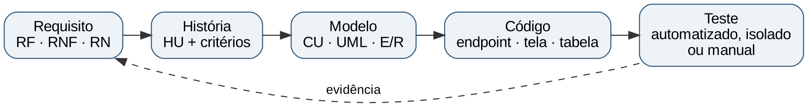

# Introdução

## Finalidade

Este documento é o sexto e último entregável sugerido pela disciplina: o plano e o relatório de testes e a demonstração funcional (PROJETO E DESENVOLVIMENTO DE SOFTWARE, [s. d.]). Ele responde a quatro perguntas: o que foi testado, como, com que resultado, e o que ainda não foi testado. A rastreabilidade entre requisito, modelo, código e teste, que a disciplina pede explicitamente, está na 6.

## Três classes de evidência

Para que nenhum resultado seja apresentado com mais certeza do que tem, cada resultado deste documento pertence a uma de três classes:

a) **relatado pelo grupo:** resultado registrado no relatório de correções do grupo (EQUIPE DITEC, 2026b) ou nos arquivos de `qa/relatorios` do repositório, que os autores deste documento não reexecutaram; quando o repositório tem o arquivo de evidência, a coerência interna dele foi conferida, mas isso não comprova a autenticidade da execução original;

b) **verificado de forma independente:** verificação executada pelos autores deste documento, com o escopo e o limite indicados em cada caso;

c) **não reproduzido ou pendente:** o que não pôde ser executado ou depende de ação do grupo.

Nenhum resultado de teste foi inventado, e os roteiros de teste manual propostos neste documento estão marcados como **não executados**.

# Estratégia e plano de testes

## Níveis de teste

A disciplina apresenta os níveis de teste de software: unidade, integração, sistema e aceitação, além dos testes não funcionais e de regressão (PROJETO E DESENVOLVIMENTO DE SOFTWARE, [s. d.]). A Tabela 1 mostra como cada nível é tratado no projeto.

| Nível | Objetivo | Como é tratado no projeto | Situação |
|----------------|---------------------------------|-------------------------------------|---------------|
| Unidade | Verificar regras isoladas, sem banco nem servidor | 23 testes JUnit: matriz de status da OS (4), regras auxiliares (2) e cliente da IA (17); execução não reproduzida pelos autores | CONCLUÍDO |
| Integração | Verificar a colaboração entre controllers, serviços, segurança e banco | 29 testes de integração com MockMvc e banco H2 em memória, sobre agendamento, autenticação, OS, chat e limite de requisições | CONCLUÍDO |
| Sistema | Verificar o sistema completo, de ponta a ponta | Script de fluxo da OS e testes de interface do grupo (relatados); roteiros manuais propostos para os requisitos sem teste | PARCIAL |
| Aceitação | Verificar se o sistema atende ao usuário | Roteiro de demonstração (seção 7); não há registro de validação por usuários reais | PARCIAL |
| Não funcionais | Segurança, acessibilidade, desempenho e usabilidade | Testes de segurança e de limite no JUnit; axe-core, teclado, Lighthouse e latência do chat nos scripts de `qa/`, relatados pelo grupo | PARCIAL |
| Regressão | Detectar quebras após mudanças | A suíte automatizada serve de regressão; falta o fluxo de integração contínua (Apêndice E) | PARCIAL |

Table: Níveis de teste e tratamento no projeto {#tbl-niveis}

Fonte: Elaborado pelos autores (2026), com base em Projeto e Desenvolvimento de Software ([s. d.]) e no repositório (EQUIPE DITEC, 2026a).

## Escopo, ambiente e critérios

O **escopo** do plano é o conjunto de 29 requisitos funcionais, 24 regras de negócio e 18 requisitos não funcionais do Apêndice B. Ficam **fora** do escopo as funcionalidades não implementadas (Apêndice D) e o desempenho sob carga, pois não há requisito de capacidade definido.

Os **ambientes** são três: (a) o perfil `test` do back-end, com banco H2 em memória e limite de requisições desligado, usado pela suíte JUnit; (b) o ambiente local completo (MySQL, back-end e front-end estático), com os dados de demonstração, usado nos roteiros manuais e na demonstração; e (c) os scripts de qualidade da pasta `qa/`, executados sobre o front-end servido localmente.

Segundo o grupo, os responsáveis pelos testes são Cauã De Lucca Uema e Jesús Alejandro Romero Rivero (Apêndice D). Os **papéis** internos (quem executa, quem registra e quem aprova os testes) e o **cronograma** de execução não deixaram registro. A entrega dos testes (E6) estava prevista para 02/11/2026.

Os **critérios de saída** propostos, ou seja, as condições para considerar a fase de testes encerrada, e a situação de cada um estão na Tabela 2.

| Critério de saída | Situação atual | Situação |
|-----------------------------------|-------------------------------------------------|---------------|
| Todos os testes automatizados passam | 52 aprovados segundo o grupo; execução não reproduzida | PARCIAL |
| Todos os requisitos *Must* têm teste automatizado | 10 de 13 (faltam RF05, RF18 e RF20) | PARCIAL |
| Nenhum defeito de severidade alta em aberto | O achado N-01 (alta, condicional) depende de verificação da configuração de produção | PENDENTE |
| Zero violações automatizadas de acessibilidade | Zero violações em 22 cenários, segundo o grupo | CONCLUÍDO |
| Resposta do chat em menos de 2 s (meta do grupo) | Média de 1,04 s e p95 de 1,43 s em 12 chamadas, segundo o grupo | CONCLUÍDO |
| Roteiros manuais dos requisitos sem teste executados | Propostos; nenhum executado | PENDENTE |

Table: Critérios de saída propostos e situação {#tbl-saida}

Fonte: Elaborado pelos autores (2026).

# Casos de teste automatizados

## Suíte por classe

A suíte automatizada contém 52 métodos de teste em 9 classes. A Tabela 3 os distribui por classe e nível. Os testes de unidade verificam regras sem o contexto do Spring, e os de integração sobem o contexto da aplicação com MockMvc e banco H2 em memória, exercitando filtros, segurança, controllers, serviços e persistência.

| Classe de teste | Nível | Métodos |
|--------------------------------------------------|---------------------------------|-----------------|
| AgendamentoFlowIT | Integração | 8 |
| AuthFlowIT | Integração | 3 |
| ChatGeminiIT | Integração | 5 |
| DitecApplicationTests | Integração | 1 |
| OrdemServicoFlowIT | Integração | 10 |
| RateLimitIT | Integração | 2 |
| StatusOSTest | Unitário | 4 |
| RegrasAuxiliaresTest | Unitário | 2 |
| GeminiClientTest | Unitário | 17 |
| **Total** |  | 52 |

Table: Suíte automatizada por classe {#tbl-classes-teste}

Fonte: Elaborado pelos autores (2026).

## Casos de teste

A Tabela 4 lista os 52 casos, com o requisito, a regra ou o requisito não funcional que cada um verifica. A coluna "Verifica" foi preenchida a partir do nome do método e do comportamento descrito no código, e não de documentação do grupo, que não existe para cada teste.

| ID | Classe | Método | Nível | Verifica |
|------|------------------------|--------------------------------------|------------|-------------------|
| T01 | AgendamentoFlowIT | criarAgendamentoGeraProtocoloERastreiaPorProtocolo | Integração | RF06, RF09, RN08 |
| T02 | AgendamentoFlowIT | criarDoisAgendamentosNoMesmoHorarioRetorna409 | Integração | RF06, RN05 |
| T03 | AgendamentoFlowIT | criarAgendamentoEmBairroNaoAtendidoRetorna422 | Integração | RF06, RN01 |
| T04 | AgendamentoFlowIT | protocoloInexistenteRetorna404 | Integração | RF09, RN13 |
| T05 | AgendamentoFlowIT | telefoneInvalidoNoAgendamentoRetorna422 | Integração | RF06 |
| T06 | AgendamentoFlowIT | rastreioComProtocoloMalformadoRetorna422 | Integração | RF09 |
| T07 | AgendamentoFlowIT | endpointAntigoDeRastreioSoComProtocoloFoiRemovido | Integração | RF09, RN13 |
| T08 | AgendamentoFlowIT | rastreamentoPublicoNuncaExpoeDadosSensiveis | Integração | RF09, RN13 |
| T09 | AuthFlowIT | registrarNovoClienteRetornaToken | Integração | RF01 |
| T10 | AuthFlowIT | registrarComEmailJaExistenteRetorna409 | Integração | RF01, RN16 |
| T11 | AuthFlowIT | loginComSenhaErradaRetorna401 | Integração | RF02 |
| T12 | ChatGeminiIT | respondeComIaNoMesmoContratoDoFrontEMantemContexto | Integração | RF15 |
| T13 | ChatGeminiIT | chaveInvalidaRespondeAutomaticamenteEPausaAsChamadas | Integração | RF15, RNF10 |
| T14 | ChatGeminiIT | limiteDoPlanoGratuitoResultaEmRespostaAmigavel | Integração | RF15, RNF10 |
| T15 | ChatGeminiIT | conteudoBloqueadoRecebeMensagemEducada | Integração | RF15 |
| T16 | ChatGeminiIT | validacoesDoEndpointContinuamAtivas | Integração | RF15, RNF08 |
| T17 | DitecApplicationTests | contextLoads | Integração | RNF13 |
| T18 | OrdemServicoFlowIT | naoIniciaAtendimentoComAgendamentoPendente | Integração | RF11, RN21 |
| T19 | OrdemServicoFlowIT | cicloCompletoAteEntregaComHistoricoEDesconto | Integração | RF11, RF12, RF24, RF25, RN09, RN10, RN11, RN12 |
| T20 | OrdemServicoFlowIT | naoPermitePularEtapa | Integração | RF11, RN09 |
| T21 | OrdemServicoFlowIT | somenteAdminCancelaEExigeMotivo | Integração | RF29, RN20 |
| T22 | OrdemServicoFlowIT | clienteRecusaOrcamentoECancelaSemCusto | Integração | RF24, RF25, RN19 |
| T23 | OrdemServicoFlowIT | aguardandoAprovacaoExigeOrcamento | Integração | RF24, RN19 |
| T24 | OrdemServicoFlowIT | observacaoInternaNaoApareceNoRastreioMasApareceParaEquipe | Integração | RF09, RF26, RN13 |
| T25 | OrdemServicoFlowIT | permissoesDeAcessoAOS | Integração | RF10, RNF03 |
| T26 | OrdemServicoFlowIT | adminFiltraEAtribuiTecnicoAtivo | Integração | RF19, RF28, RN23 |
| T27 | OrdemServicoFlowIT | previsaoNoPassadoERecusada | Integração | RF27, RN22 |
| T28 | RateLimitIT | bloqueiaAposMuitasTentativasDeLoginEmSequencia | Integração | RF02, RN17, RNF04 |
| T29 | RateLimitIT | naoAceitaXForwardedForForjadoParaBurlarOLimite | Integração | RNF04 |
| T30 | StatusOSTest | fluxoPrincipalPermitido | Unitário | RF11, RN09 |
| T31 | StatusOSTest | transicoesInvalidas | Unitário | RF11, RN09 |
| T32 | StatusOSTest | estadosTerminaisNaoMudam | Unitário | RN09 |
| T33 | StatusOSTest | sincronizaComStatusDoAgendamento | Unitário | RF11 |
| T34 | RegrasAuxiliaresTest | telefoneConfereIgnorandoMascaraEDdi | Unitário | RF09, RN13 |
| T35 | RegrasAuxiliaresTest | chatbotAutomaticoRespondeRegrasDeNegocio | Unitário | RF15, RNF10 |
| T36 | GeminiClientTest | enviaFormatoCorretoComChaveNoHeaderENaoNaUrl | Unitário | RF15, RNF07 |
| T37 | GeminiClientTest | mantemOContextoDaConversaComPapeisDoGemini | Unitário | RF15 |
| T38 | GeminiClientTest | modelosGemini3UsamThinkingLevelESemTemperature | Unitário | RF15, RNF10 |
| T39 | GeminiClientTest | repeteApos429ETemSucesso | Unitário | RF15, RNF10 |
| T40 | GeminiClientTest | tentativasSaoLimitadasNo429 | Unitário | RF15, RNF10 |
| T41 | GeminiClientTest | limiteComEsperaLongaNaoERepetido | Unitário | RF15, RNF10 |
| T42 | GeminiClientTest | converteDuracaoDoGoogle | Unitário | RF15, RNF10 |
| T43 | GeminiClientTest | repeteApos503ETemSucesso | Unitário | RF15, RNF10 |
| T44 | GeminiClientTest | chaveInvalidaNaoERepetidaENaoVazaNaMensagem | Unitário | RF15, RNF07, RNF10 |
| T45 | GeminiClientTest | erros401E403E402SaoClassificados | Unitário | RF15, RNF10 |
| T46 | GeminiClientTest | modeloIndisponivelUsaOAlternativoUmaVez | Unitário | RF15, RNF10 |
| T47 | GeminiClientTest | depoisDeTrocarVaiDiretoAoAlternativo | Unitário | RF15, RNF10 |
| T48 | GeminiClientTest | modeloIndisponivelSemAlternativoFalha | Unitário | RF15, RNF10 |
| T49 | GeminiClientTest | timeoutNaoTravaENaoERepetido | Unitário | RF15, RNF10 |
| T50 | GeminiClientTest | respostasInvalidasOuBloqueadas | Unitário | RF15, RNF10 |
| T51 | GeminiClientTest | ignoraPartesDeRaciocinioInterno | Unitário | RF15, RNF10 |
| T52 | GeminiClientTest | semChaveNaoChamaAApi | Unitário | RF15, RNF07, RNF10 |

Table: Casos de teste automatizados existentes (52) {#tbl-testes}

Fonte: Elaborado pelos autores (2026).

## Modelo de caso de teste

Para os testes manuais e para a documentação dos automatizados, adota-se o modelo da Tabela 5, que contém os campos que a disciplina recomenda: identificação, requisito, pré-condição, passos, resultado esperado e resultado obtido. O exemplo preenche o caso T02, automatizado.

| Campo | Conteúdo |
|-----------------------------|-----------------------------------------------------------------------|
| Identificação | T02 — `AgendamentoFlowIT.criarDoisAgendamentosNoMesmoHorarioRetorna409` |
| Requisito e regra | RF06; RN05 |
| Pré-condição | Banco de teste vazio; horário da grade livre em dia útil; bairro atendido |
| Passos | 1. Criar um agendamento no horário. 2. Criar outro agendamento no mesmo horário |
| Resultado esperado | O primeiro cria o agendamento; o segundo é recusado com 409 |
| Resultado obtido | Aprovado, segundo o relatório do grupo (execução não reproduzida) |
| Nível | Integração |

Table: Modelo de caso de teste, preenchido com o caso T02 {#tbl-modelo-ct}

Fonte: Elaborado pelos autores (2026), a partir do código-fonte dos testes (EQUIPE DITEC, 2026a).

# Roteiros de teste manual propostos

Quatorze requisitos funcionais não têm teste automatizado (**RF03, RF04, RF05, RF07, RF08, RF13, RF14, RF16, RF17, RF18, RF20, RF21, RF22, RF23**). A Tabela 6 propõe, para cada um, um roteiro de teste manual, derivado dos critérios de aceitação do Apêndice B. **Nenhum deles foi executado**: a coluna de situação indica NÃO EXECUTADO, e os roteiros devem ser percorridos no ambiente local, registrando o resultado obtido. Segundo o grupo, a frente de testes cabe a Cauã De Lucca Uema e Jesús Alejandro Romero Rivero, a quem se propõe a execução e o registro; o desenvolvimento (Henrique de Sousa Cunha e Pedro Cainan Rodrigues de Paula) corrige os defeitos encontrados. A 7 mostra um percurso que exercita vários deles em sequência.

| ID | RF | Procedimento | Resultado esperado | Situação |
|-----------|--------|------------------------------------|-------------------------------|---------------|
| CT-M01 | RF03 | Entrar com uma conta e consultar `GET /api/auth/me` com o token; repetir sem token | Devolve os dados do usuário do token; sem token válido, 401 | NÃO EXECUTADO |
| CT-M02 | RF04 | Entrar como cliente, alterar o endereço na área da conta, salvar e recarregar a página; tentar o mesmo endpoint com perfil de técnico | O endereço alterado permanece; o técnico recebe 403 | NÃO EXECUTADO |
| CT-M03 | RF05 | Na seção de agendamento, escolher uma segunda-feira futura; depois um domingo; depois a data de hoje, em um horário já passado | Segunda: horários livres da grade de 9 horários; domingo e datas passadas: nenhum horário; hoje: sem horários já decorridos | NÃO EXECUTADO |
| CT-M04 | RF07 | Como cliente, alterar a data de um agendamento PENDENTE e depois cancelá-lo; tentar alterar um agendamento em atendimento; tentar acessar o agendamento de outro cliente | A alteração e o cancelamento são aceitos e a OS vinculada é cancelada; os demais casos são recusados | NÃO EXECUTADO |
| CT-M05 | RF08 | Com dois clientes que têm agendamentos, listar os agendamentos de cada um | Cada cliente vê apenas os seus | NÃO EXECUTADO |
| CT-M06 | RF13 | Como cliente, avaliar uma OS concluída com nota 5 e comentário; repetir; tentar avaliar uma OS não concluída e informar nota fora de 1 a 5 | A primeira avaliação é aceita; a repetição é recusada com 409; os demais casos são recusados | NÃO EXECUTADO |
| CT-M07 | RF14 | Consultar a seção de serviços do site; inativar um serviço no painel administrativo e consultar de novo | Só os serviços ativos aparecem; o serviço inativado deixa de aparecer | NÃO EXECUTADO |
| CT-M08 | RF16 | Entrar como administrador e abrir o painel; tentar o mesmo endpoint como cliente | O administrador vê os indicadores; o cliente recebe 403 | NÃO EXECUTADO |
| CT-M09 | RF17 | Como administrador, abrir o painel de clientes; tentar como técnico | O administrador vê a lista de clientes; o técnico recebe 403 | NÃO EXECUTADO |
| CT-M10 | RF18 | Como administrador, abrir os agendamentos, confirmar um PENDENTE, tentar confirmá-lo de novo e atribuir um técnico ativo | Aparelhos a gás vêm primeiro; a confirmação leva a AGENDADO; a segunda confirmação é recusada (422); o técnico é atribuído | NÃO EXECUTADO |
| CT-M11 | RF20 | Como administrador, criar um técnico com senha de 8 caracteres ou mais, editá-lo, inativá-lo e entrar com a conta criada | O técnico é criado e consegue entrar; após a inativação não recebe novas OS | NÃO EXECUTADO |
| CT-M12 | RF21 | Como administrador, criar um serviço, editá-lo e inativá-lo | As alterações são persistidas e refletidas no catálogo público | NÃO EXECUTADO |
| CT-M13 | RF22 | Como administrador, baixar os relatórios de agendamentos, OS, avaliações e chatbot | Quatro arquivos CSV, com as colunas e os registros esperados | NÃO EXECUTADO |
| CT-M14 | RF23 | Na página inicial, informar o CEP 01310-100, o CEP 30140-071, o bairro Moema e o bairro Campinas | CEP 01310-100 e bairro Moema: atendidos; CEP 30140-071 e bairro Campinas: fora da área | NÃO EXECUTADO |

Table: Roteiros de teste manual propostos para os requisitos sem teste automatizado {#tbl-manuais}

Fonte: Elaborado pelos autores (2026), a partir dos critérios de aceitação do Apêndice B.

As regras de negócio de CEP e de bairro (RN01 e RN02) foram verificadas de forma independente em isolamento (seção 5.2), mas a regra espelhada no navegador (`script.js`, RF23) não foi exercitada.

# Relatório de testes

## Resultados relatados pelo grupo (classe a)

A Tabela 7 reúne os resultados que o grupo relata e o arquivo de evidência existente no repositório.

| Verificação | Resultado relatado | Evidência no repositório | Situação |
|------------------------|----------------------------|---------------------------------|---------------|
| Testes automatizados (`mvn test`) | 52 de 52 aprovados | Nenhum arquivo de saída versionado | PARCIAL |
| Fluxo ponta a ponta da OS (`teste-fluxo-os.sh`) | 17 de 17 verificações | O script existe; sem arquivo de resultado | PARCIAL |
| Testes de interface (`teste-interface.mjs`) | 22 de 22 verificações | O script existe; sem arquivo de resultado | PARCIAL |
| Navegação por teclado (`teclado.mjs`) | 10 de 10 verificações | O script existe; sem arquivo de resultado | PARCIAL |
| Acessibilidade automatizada (axe-core) | 0 violações em 22 cenários | `axe-resultado.json`: 22 cenários, 0 violações (conferido) | CONCLUÍDO |
| Lighthouse | Desempenho em celular de 98 a 100 e em computador de 82 a 89; acessibilidade 100 e boas práticas 100 em todas as páginas; SEO 100 na página inicial e 60 nas demais | `lighthouse-resumo.json` (conferido) | CONCLUÍDO |
| Latência do chat com IA (meta de menos de 2 s) | Média de 1.038 ms e p95 de 1.428 ms em 12 chamadas | `benchmark-chat-*.json` (conferido) | CONCLUÍDO |

Table: Resultados relatados pelo grupo e evidências {#tbl-rel-grupo}

Fonte: Elaborado pelos autores (2026), a partir do relatório do grupo (EQUIPE DITEC, 2026b) e da pasta `qa/relatorios` (EQUIPE DITEC, 2026a).

Duas observações sobre essas evidências: (a) "conferido" significa que os números do relatório coincidem com os do arquivo de evidência, o que verifica a coerência dos dados, mas não prova a autenticidade da execução original; e (b) na execução anterior do teste de latência, a primeira resposta levou 1.969 ms, próxima do limite de 2.000 ms, e o relatório do grupo cita a execução mais recente, na qual a primeira resposta levou 1.428 ms. A meta de 2 s é, portanto, atendida na média, mas a primeira chamada, que inclui a abertura da conexão, tem pouca folga.

## Verificações independentes (classe b) {#sec-indep}

Os autores deste documento executaram as verificações da Tabela 8, com os limites indicados. Os arquivos de resultado acompanham esta entrega, na pasta `evidencias`, junto com os scripts de apoio que foram mantidos (matriz de transições, integridade do banco, migrações e comparação de entidades), que dependem de um servidor MariaDB local e de uma cópia do repositório; a verificação das regras auxiliares e a varredura de segredos constam apenas como arquivos de resultado.

| Verificação | Escopo | Resultado | Limite |
|-----------------------|--------------------------|------------------------|---------------------------|
| Matriz de transições da OS | `StatusOS` e `StatusAgendamento`, compilados isoladamente, com réplica dos 4 testes do grupo e análise do grafo | 42 verificações aprovadas; 19 transições; os 10 estados são alcançáveis a partir de AGENDADO; nenhum estado sem saída; só EM_TESTES leva a CONCLUIDO | Sem o contexto do Spring |
| Regras de negócio auxiliares | Bairro, CEP, dia, horário e aparelho a gás, em isolamento | 15 de 15 aprovadas | Não exercita os serviços nem o banco |
| Migrações V1 e V2 | Aplicação em sequência, reversão do README, reversão corrigida e nova aplicação | 42 de 42 verificações aprovadas, inclusive a reprodução do defeito N-03 e a validação da correção | Instância MariaDB, com adaptação do comando `DROP CHECK` (exclusivo do MySQL) |
| Integridade do banco | Chaves, unicidade, CHECK e regras de exclusão (CASCADE e SET NULL) nas 9 tabelas | 35 de 35 aprovadas | Instância MariaDB |
| Entidades e banco | Comparação entre os campos das 9 entidades JPA e as colunas do banco após a V1 e a V2 | 9 de 9 entidades coincidem com as tabelas; 91 campos conferidos | Comparação textual; não substitui a validação do Hibernate na inicialização |
| Varredura de segredos | Histórico completo (20 commits) e árvore atual | Nenhuma credencial real; uma ocorrência é texto de exemplo (prefixo com `x` repetido); nenhum arquivo sensível versionado; `.env` ignorado | Padrões conhecidos de chaves |
| Coerência dos relatórios de QA | Números do relatório do grupo contra os arquivos JSON | Coincidem | Não prova a autenticidade da execução |

Table: Verificações independentes realizadas na elaboração deste documento {#tbl-indep}

Fonte: Elaborado pelos autores (2026).

## Não reproduzido ou pendente (classe c)

A Tabela 9 lista o que não foi reproduzido, com o motivo e o encaminhamento.

| Item | Motivo | Encaminhamento |
|---------------------------------|------------------------------------|-------------------------------|
| Execução de `mvn test` (52 testes) | O ambiente de elaboração não alcança o repositório central de dependências do Maven | Pendência P02: executar em máquina com acesso e anexar a saída |
| Configuração de produção no Render | O serviço não pôde ser consultado | Pendência P01: percorrer a lista de verificação do Apêndice E |
| Telas autenticadas (cliente, técnico e administrador) | Dependem da API e de dados de teste | Pendência P13: capturar com dados de teste |
| Avaliação de acessibilidade com leitor de tela | Exige revisão humana | Pendência P10 |
| Reexecução dos scripts de `qa/` (axe, teclado, interface, Lighthouse, latência) | Exigem o sistema completo no ar e o navegador | Executar no ambiente local do grupo e anexar os resultados |
| Roteiros de teste manual propostos | Não executados | Pendência P08 (testes automatizados) e execução dos roteiros da Tabela 6 |

Table: Itens não reproduzidos ou pendentes {#tbl-nao-repro}

Fonte: Elaborado pelos autores (2026).

## Defeitos e achados

Os defeitos e riscos encontrados na revisão técnica do código (EQUIPE DITEC, 2026c) estão na Tabela 10, com a severidade atribuída na revisão e a situação em 9 de novembro de 2026.

| Código | Severidade | Achado | Situação |
|---------|-------------------|-------------------------------------------------|-----------------------|
| N-01 | Alta (condicional) | O `Dockerfile` não define `DITEC_PROFILE`; sem a variável, o serviço inicia no perfil `dev`, com o semeador de contas de demonstração | PENDENTE |
| N-02 | Média | README e SECURITY do front-end ainda citam o provedor de IA anterior | CORRIGIDO no patch (não aplicado) |
| N-03 | Baixa | O roteiro de reversão da V2 não remove dois índices | CORRIGIDO no patch (validado) |
| N-04 | Baixa (probabilidade) e média (impacto) | A V2 falha se houver OS com valor negativo, deixando o banco parcialmente migrado | CORRIGIDO no patch (pré-checagem documentada) |
| N-05 | Informativa | A V2 usa `DROP CHECK`, exclusivo do MySQL | CORRIGIDO no patch (documentado) |
| N-06 | Baixa a média | Vínculo de agendamento de visitante à conta por telefone, sem verificar a posse do número | PENDENTE |
| N-07 | Média | A política de privacidade não menciona o envio do chat à Google | PENDENTE |
| N-08 | Informativa | Divergências textuais (modelo de IA padrão; cancelamento em EM_TESTES) | PENDENTE |

Table: Achados da revisão técnica e situação {#tbl-achados}

Fonte: Elaborado pelos autores (2026), a partir da revisão técnica (EQUIPE DITEC, 2026c).

# Cobertura e rastreabilidade {#sec-rastr}

## Cobertura dos requisitos pelos testes automatizados

A Tabela 11 mostra quantos requisitos têm pelo menos um teste automatizado que os verifica, por associação explícita. Essa medida é de **cobertura de requisitos**, e não de cobertura de código (linhas ou ramos), que não foi medida porque a ferramenta de cobertura não faz parte do projeto.

| Conjunto | Total | Com teste automatizado | Sem teste automatizado | Cobertura |
|----------------------------------|------------|--------------------|--------------------|--------------|
| RF *Must* | 13 | 10 | 3 | 77% |
| RF *Should* | 12 | 4 | 8 | 33% |
| RF *Could* | 4 | 1 | 3 | 25% |
| **RF, total** | 29 | 15 | 14 | 52% |
| Regras de negócio | 24 | 15 | 9 | 63% |
| Requisitos não funcionais | 18 | 6 | 12 | 33% |

Table: Cobertura dos requisitos por testes automatizados (associação explícita do teste ao requisito) {#tbl-cobertura}

Fonte: Elaborado pelos autores (2026).

Os requisitos funcionais sem teste automatizado são RF03, RF04, RF05, RF07, RF08, RF13, RF14, RF16, RF17, RF18, RF20, RF21, RF22, RF23, e as regras de negócio sem associação explícita são RN02, RN03, RN04, RN06, RN07, RN14, RN15, RN18, RN24; algumas dessas regras são exercitadas indiretamente por outros testes, como o ciclo completo da OS (T19), que passa pelo diagnóstico (RN18). Dos 12 requisitos não funcionais sem teste JUnit, parte é verificada por outros meios: acessibilidade (axe-core), usabilidade (testes de interface e de teclado) e desempenho (latência do chat), relatados pelo grupo. Os demais são verificados por revisão de código, na coluna de evidências do Apêndice B.

## Cadeia de rastreabilidade

A Figura 1 mostra a cadeia adotada neste conjunto de documentos: cada requisito é ligado ao caso de uso que o realiza, ao modelo (diagramas e tabelas), ao código (endpoint, serviço e tela) e ao teste que o verifica. A matriz completa está na Tabela 12.

{#fig-cadeia}

## Matriz de rastreabilidade

A matriz liga os 29 requisitos funcionais ao caso de uso (Apêndice C), ao endpoint e à tela (código), às tabelas (modelo de dados) e aos testes (esta seção). Quando não há teste automatizado, a coluna "Teste" indica "Revisão de código", e o requisito consta da lista de pendências do Apêndice D.

| RF | CU | Endpoint | Tela | Tabelas | Teste |
|--------|--------|----------------------------|------------------|------------------------|--------------|
| RF01 | CU05 | POST /api/auth/register | conta.html (Criar Conta) | usuario, cliente, agendamento, ordem_servico | T09, T10 |
| RF02 | CU06 | POST /api/auth/login | conta, tecnico, admin | usuario | T11, T28 |
| RF03 | CU06 | GET /api/auth/me | áreas logadas | usuario | Revisão de código |
| RF04 | CU07 | GET/PUT /api/clientes/me | conta.html | cliente, usuario | Revisão de código |
| RF05 | CU02 | GET /api/agendamentos/disponibilidade | index.html (#agendamento) | agendamento | Revisão de código |
| RF06 | CU02 | POST /api/agendamentos | index.html (#agendamento) | agendamento, ordem_servico, timeline_os | T01, T02, T03, T05 |
| RF07 | CU08 | GET/PUT/DELETE /api/agendamentos/{id} | conta.html | agendamento, ordem_servico | Revisão de código |
| RF08 | CU08 | GET /api/clientes/me/agendamentos | conta.html | agendamento | Revisão de código |
| RF09 | CU03 | POST /api/ordens-servico/rastreio | index.html (#rastreamento) | ordem_servico, timeline_os | T01, T04, T06, T07 e mais 3 |
| RF10 | CU09 | GET /api/ordens-servico; GET /api/ordens-servico/{id} | conta, tecnico | ordem_servico, timeline_os | T25 |
| RF11 | CU12 | PUT /api/ordens-servico/{id}/status | tecnico.html, admin.html | ordem_servico, timeline_os, agendamento | T18, T19, T20, T30 e mais 2 |
| RF12 | CU15 | POST /api/ordens-servico/{id}/finalizar | tecnico.html, admin.html | ordem_servico, timeline_os | T19 |
| RF13 | CU11 | POST /api/ordens-servico/{id}/avaliacao | conta.html | avaliacao | Revisão de código |
| RF14 | CU01 | GET /api/servicos | index.html (#servicos) | servico | Revisão de código |
| RF15 | CU04 | POST /api/chat | index.html (chatbot) | chat_log | T12, T13, T14, T15 e mais 19 |
| RF16 | CU16 | GET /api/admin/dashboard | admin.html | consultas agregadas | Revisão de código |
| RF17 | CU21 | GET /api/admin/clientes | admin.html | cliente, usuario | Revisão de código |
| RF18 | CU17 | GET /api/admin/agendamentos; PUT .../{id}/confirmar; PUT .../{id}/tecnico | admin.html | agendamento, ordem_servico | Revisão de código |
| RF19 | CU18 | GET /api/admin/ordens-servico | admin.html | ordem_servico | T26 |
| RF20 | CU19 | GET/POST/PUT /api/admin/tecnicos; PUT .../{id}/status | admin.html | tecnico, usuario | Revisão de código |
| RF21 | CU20 | GET/POST/PUT /api/admin/servicos; PUT .../{id}/status | admin.html | servico | Revisão de código |
| RF22 | CU22 | GET /api/admin/relatorios/{agendamentos\|os\|avaliacoes\|chatbot} | admin.html | agendamento, ordem_servico, avaliacao, chat_log | Revisão de código |
| RF23 | CU01 | (navegador) | index.html | — | Revisão de código |
| RF24 | CU13 | PUT /api/ordens-servico/{id}/diagnostico | tecnico.html, admin.html | ordem_servico, timeline_os | T19, T22, T23 |
| RF25 | CU10 | POST /api/ordens-servico/{id}/orcamento/resposta | conta.html | ordem_servico, timeline_os | T19, T22 |
| RF26 | CU14 | POST /api/ordens-servico/{id}/observacoes | tecnico.html, admin.html | timeline_os | T24 |
| RF27 | CU14 | PUT /api/ordens-servico/{id}/previsao | tecnico.html, admin.html | ordem_servico, timeline_os | T27 |
| RF28 | CU18 | PUT /api/admin/ordens-servico/{id}/tecnico | admin.html | ordem_servico, agendamento | T26 |
| RF29 | CU18 | PUT /api/ordens-servico/{id}/status = CANCELADO | admin.html | ordem_servico, timeline_os | T21 |

Table: Matriz de rastreabilidade requisito → caso de uso → código → teste {#tbl-rastr}

Fonte: Elaborado pelos autores (2026).

# Demonstração funcional {#sec-demo}

A disciplina prevê a demonstração funcional do sistema como parte da entrega. O roteiro da Tabela 13 percorre, em ordem, o ciclo completo de um atendimento, passando pelos quatro perfis de usuário e por 19 dos 29 requisitos funcionais, e termina com a consulta pública do andamento. Ele foi elaborado para o ambiente local com os dados de demonstração e **não foi executado pelos autores deste documento**; o grupo deve ensaiá-lo antes da apresentação e registrar o tempo total.

**Preparação.** Iniciar o banco, o back-end (`./run-local.sh`) e o front-end (servidor estático nas portas 5500 ou 5501), conforme o Apêndice E; ter à mão as contas de demonstração do README e uma data útil futura; abrir quatro abas do navegador, uma para cada perfil (visitante, administrador, técnico e cliente).

| Etapa | Perfil e tela | Ação | Resultado esperado | Requisitos |
|-------|------------------|-----------------------------|---------------------------------|------------|
| 1 | Visitante, página inicial | Verificar um CEP atendido e consultar o catálogo de serviços | Mensagem de área atendida; serviços ativos listados | RF14, RF23 |
| 2 | Visitante, seção de agendamento | Escolher uma data útil e um horário livre, preencher os dados e confirmar | Agendamento criado; protocolo `DITEC-AAAA-NNNNNN` exibido | RF05, RF06 |
| 3 | Visitante, seção de rastreamento | Informar o protocolo e o telefone | Status AGENDADO, sem dados sensíveis | RF09 |
| 4 | Administrador, painel | Abrir agendamentos, confirmar o novo (PENDENTE para AGENDADO) e atribuir um técnico | Agendamento AGENDADO, com técnico | RF18, RF28 |
| 5 | Técnico, painel | Abrir a OS atribuída, iniciar o diagnóstico, registrar o diagnóstico e o orçamento e enviar ao cliente | OS em AGUARDANDO_APROVACAO | RF11, RF24 |
| 6 | Cliente, área da conta | Entrar, abrir a OS e aprovar o orçamento | OS em EM_MANUTENCAO | RF10, RF25 |
| 7 | Técnico, painel | Registrar uma observação visível e a previsão; avançar a OS para EM_TESTES | Eventos na linha do tempo | RF26, RF27, RF11 |
| 8 | Técnico, painel | Finalizar a OS com valor, forma de pagamento Pix e descrição | OS CONCLUIDO, com 5% de desconto e garantia de 90 dias | RF12 |
| 9 | Cliente, área da conta | Avaliar o atendimento com nota e comentário | Avaliação registrada | RF13 |
| 10 | Visitante, seção de rastreamento | Consultar novamente o protocolo | Status final e linha do tempo com os eventos visíveis ao cliente | RF09 |
| 11 | Administrador, painel | Mostrar o painel, os filtros de OS e o download de um relatório CSV | Indicadores atualizados e arquivo CSV | RF16, RF19, RF22 |
| 12 | Visitante, assistente virtual | Fazer uma pergunta sobre garantia | Resposta da IA ou, sem chave, resposta automática | RF15 |

Table: Roteiro da demonstração funcional {#tbl-demo}

Fonte: Elaborado pelos autores (2026), a partir dos requisitos e do comportamento do código (EQUIPE DITEC, 2026a).

Em caso de falha durante a demonstração, as alternativas são: usar as capturas de tela do Apêndice C; mostrar a execução dos testes automatizados; e, para o chatbot, usar a resposta automática, que é o comportamento previsto quando a IA está indisponível. As telas autenticadas ainda precisam ser capturadas (pendência P13) para servir de reserva.

# Conclusão sobre o estado dos testes

Em 9 de novembro de 2026, o projeto tem uma suíte automatizada de 52 testes, em dois níveis, com cobertura de requisitos de 77% nos requisitos funcionais *Must*, de 52% nos requisitos funcionais em geral e de 63% nas regras de negócio, e evidências de acessibilidade, desempenho e latência do chat relatadas pelo grupo e coerentes com os arquivos do repositório. As verificações independentes dos autores deste documento confirmaram a matriz de transições da OS, as regras auxiliares, as migrações e a integridade do banco, em isolamento. Faltam: reproduzir a execução de `mvn test`; testar os 14 requisitos funcionais sem teste, a começar por RF05, RF18 e RF20, que são *Must*; verificar a configuração de produção; e registrar as evidências das telas autenticadas. Esses pontos estão na lista de pendências do Apêndice D.
