# Introdução

## Contexto e problema

O DITEC Assistência Técnica é um sistema web para uma empresa de assistência técnica de eletrodomésticos (geladeira, máquina de lavar, fogão, micro-ondas e condicionador de ar) que atende a cidade de São Paulo e municípios da Grande São Paulo. O problema que o sistema aborda tem duas pontas: o cliente não sabe quando o técnico virá nem em que etapa está o reparo, e a empresa precisa organizar pedidos de visita, agenda e equipe, e manter o histórico de cada atendimento. A disciplina Análise e Projeto de Sistemas II propõe percorrer o ciclo completo de um produto, da identificação do problema à entrega de uma solução funcional (PROJETO E DESENVOLVIMENTO DE SOFTWARE, [s. d.]), e o DITEC é o projeto desenvolvido pelo grupo para esse fim.

## Objetivos

O **objetivo geral** deste relatório é consolidar, em um único documento, a documentação do projeto DITEC segundo os seis entregáveis sugeridos pela disciplina e verificá-la contra o sistema implementado, apontando o que está concluído, o que está parcial e o que depende de decisão do grupo.

Os **objetivos específicos** são: (a) delimitar o problema, a visão e o escopo; (b) especificar os requisitos funcionais e não funcionais, as regras de negócio e as histórias de usuário; (c) modelar o sistema em UML e o banco de dados no modelo entidade-relacionamento; (d) apresentar o backlog priorizado e as evidências de gestão; (e) documentar o código, o banco e a forma de executar o sistema; (f) apresentar o plano e o relatório de testes e o roteiro de demonstração; e (g) demonstrar a rastreabilidade entre requisito, modelo, código e teste.

## Justificativa

A disciplina avalia clareza, rastreabilidade, coerência dos modelos, qualidade técnica, colaboração e evolução a partir do *feedback*. O projeto chegou à versão de 9 de novembro de 2026 com um sistema funcional e um conjunto de testes automatizados, mas sem documentação de visão, de requisitos, de modelagem e de gestão que o acompanhasse. A consolidação aqui apresentada preenche essa lacuna e, ao fazê-lo, torna visíveis as divergências e as pendências que o código sozinho não revela.

## Organização do documento

O texto principal (seções 1 a 11) apresenta a síntese de cada etapa, e seis apêndices trazem o detalhe de cada entregável, conforme a Tabela 1. Cada apêndice pode ser lido separadamente e também acompanha esta entrega como documento independente.

| Entregável da disciplina | Seções deste texto | Apêndice |
|--------------------------------------|---------------------|----------------------------------------|
| 1. Documento de visão e escopo | 1, 3 e 4 | A: Documento de visão e escopo do sistema |
| 2. Requisitos e histórias de usuário | 4 | B: Requisitos, regras de negócio e histórias de usuário |
| 3. UML e modelo entidade-relacionamento | 5 e 6 | C: Modelagem UML e modelo entidade-relacionamento |
| 4. Backlog e evidências de gestão | 7 e 10 | D: Backlog priorizado e evidências de gestão |
| 5. Código, banco e instruções de execução | 6, 7 e 8 | E: Código, banco de dados e instruções de execução |
| 6. Plano e relatório de testes e demonstração | 9 | F: Plano e relatório de testes e demonstração funcional |

Table: Entregáveis da disciplina, seções deste texto e apêndices {#tbl-m-entreg}

Fonte: Elaborado pelos autores (2026), com base em Projeto e Desenvolvimento de Software ([s. d.]).

# Fundamentação teórica

## Requisitos e rastreabilidade

Um requisito descreve uma capacidade ou uma restrição que o sistema deve atender. A norma ISO/IEC/IEEE 29148 trata dos processos e dos produtos da engenharia de requisitos e recomenda que cada requisito seja, entre outras características, necessário, não ambíguo, verificável e rastreável (ISO/IEC/IEEE, 2018). A disciplina distingue requisitos funcionais (o que o sistema faz), não funcionais (qualidades como segurança, desempenho e acessibilidade), regras de negócio (condições do domínio) e restrições, e recomenda registrar, para cada um, a origem, a prioridade, o responsável e o critério de aceitação (PROJETO E DESENVOLVIMENTO DE SOFTWARE, [s. d.]). A prioridade é tratada com a técnica MoSCoW (*Must*, *Should*, *Could* e *Won't*), e as necessidades dos usuários são expressas como histórias de usuário, no formato "Como, quero, para", com critérios de aceitação. A **rastreabilidade** é a capacidade de seguir um requisito até os elementos que o realizam e o verificam: o modelo, o código e o teste. É o fio condutor deste relatório.

## Modelagem

A *Unified Modeling Language* (UML) é a linguagem gráfica padronizada para especificar, visualizar e documentar sistemas de software, e sua versão 2.5.1 define os diagramas estruturais (por exemplo, o de classes) e comportamentais (como os de casos de uso, atividades, sequência e estados) (OBJECT MANAGEMENT GROUP, 2017). A disciplina orienta escolher os diagramas pertinentes, isto é, os que respondem a uma pergunta do projeto, para que a modelagem não se torne burocracia. Para os dados, o modelo entidade-relacionamento é elaborado em três níveis: conceitual (entidades e relacionamentos), lógico (tabelas e chaves) e físico (tipos, restrições e índices em um sistema de gerenciamento de banco de dados).

## Arquitetura e tecnologias

O sistema adota o estilo arquitetural REST, em que o cliente é separado do servidor, a comunicação não mantém estado entre requisições e as camadas se comunicam em um só sentido (FIELDING, 2000). A autenticação usa *JSON Web Token* (JWT), um formato compacto para representar declarações entre as partes (JONES; BRADLEY; SAKIMURA, 2015). O back-end é construído com o Spring Boot (SPRING, [s. d.]); o banco é o MySQL, que aplica restrições CHECK a partir da versão 8.0.16 (ORACLE CORPORATION, [s. d.]); e o esquema é versionado pelo Flyway, que executa em ordem as migrações ainda não aplicadas (REDGATE SOFTWARE, [s. d.]).

## Gestão ágil

O Guia do Scrum descreve o *framework* em torno de três artefatos (backlog do produto, backlog do ciclo e incremento), compromissos (meta do produto, meta do ciclo e definição de pronto) e eventos (o ciclo, o planejamento, a reunião diária, a revisão e a retrospectiva) (SCHWABER; SUTHERLAND, 2020). O Kanban organiza o trabalho em colunas que representam o fluxo e limita o trabalho em andamento. A disciplina apresenta ambos como formas de obter *feedback* frequente.

# Metodologia

## Natureza do trabalho

Este é um trabalho de **documentação e verificação de um sistema existente**. O código-fonte, o banco de dados e os testes já existiam na versão e58a3d2 do repositório (EQUIPE DITEC, 2026a); a documentação que os acompanha foi **reconstruída a posteriori**. Em consequência, a origem dos requisitos é o próprio sistema, e não entrevistas ou observação do processo real, que não deixaram registro. Essa limitação é declarada nos apêndices e nas conclusões.

## Fontes e procedimentos

Foram usadas quatro fontes: o código-fonte e o banco de dados do repositório; os documentos do grupo, em especial o relatório de correções de 9 de novembro de 2026 (EQUIPE DITEC, 2026b); a revisão técnica do código atualizado (EQUIPE DITEC, 2026c); e os arquivos de qualidade da pasta `qa` do repositório. Os procedimentos foram:

a) **leitura do código** para extrair requisitos, regras, endpoints, transições de estado e a estrutura das camadas;

b) **extração do modelo de dados** de uma instância MySQL/MariaDB em que as migrações V1 e V2 foram aplicadas em sequência, o que gerou o dicionário de dados de 91 colunas;

c) **geração dos diagramas** a partir do código e do banco (por exemplo, o diagrama de estados foi gerado da enumeração `StatusOS`), com Graphviz e Mermaid;

d) **verificações independentes** em isolamento: matriz de transições da OS, regras de negócio auxiliares, migrações, integridade do banco, comparação das entidades com as tabelas e varredura de segredos;

e) **conferência** dos relatórios de qualidade do grupo contra os arquivos de evidência; e

f) **classificação de cada resultado** em três classes: relatado pelo grupo, verificado de forma independente e não reproduzido ou pendente.

## Limites do ambiente

O ambiente em que a documentação foi elaborada não alcançava o repositório central de dependências do Maven, a interface de programação do GitHub nem o serviço publicado no Render. Em consequência, **a execução de `mvn test` não foi reproduzida**, a configuração de produção não foi verificada e não foi possível consultar *issues*, projetos e pull requests. Esses pontos estão registrados como pendências no Apêndice D.

## Padrão de apresentação

A apresentação segue as normas da Associação Brasileira de Normas Técnicas: estrutura do trabalho (NBR 14724), referências (NBR 6023), citações (NBR 10520), numeração progressiva (NBR 6024), sumário (NBR 6027) e resumo (NBR 6028) (ASSOCIAÇÃO BRASILEIRA DE NORMAS TÉCNICAS, 2012, 2018, 2021, 2023, 2024). O arquivo PDF foi gerado em papel A4, com margens de 3 cm (esquerda e superior) e 2 cm (direita e inferior), fonte de 12 pontos e espaçamento de 1,5 entre linhas. Como a fonte Times New Roman não estava disponível no ambiente de geração, usou-se a Liberation Serif, de métricas equivalentes.

# Levantamento e análise de requisitos

## Visão, escopo e partes interessadas

O produto é uma plataforma web que concentra agendamento, ordem de serviço e relacionamento com o cliente. Usam o sistema quatro perfis: o visitante (sem conta), o cliente, o técnico e o administrador. Estão no escopo os 29 requisitos funcionais do Apêndice B. Estão fora desta versão a recuperação de senha, as notificações automáticas ao cliente, o pagamento online (a forma de pagamento é apenas registrada), a emissão de nota fiscal eletrônica, o aplicativo móvel nativo e a limitação de requisições distribuída entre instâncias. A visão, as partes interessadas, as premissas, as restrições e os critérios de sucesso estão no Apêndice A.

## Requisitos especificados

O Apêndice B especifica o conjunto resumido na Tabela 2. Os requisitos funcionais são 13 Must, 12 Should e 4 Could e cada um traz critério de aceitação verificável, dependências e prioridade pelo método MoSCoW.

| Elemento | Quantidade | Onde está |
|----------------------------------|---------------|---------------------------------------------------|
| Requisitos funcionais (RF) | 29 | Apêndice B, Tabela 10 |
| Requisitos não funcionais (RNF) | 18 | Apêndice B, Tabela 12 |
| Regras de negócio (RN) | 24 | Apêndice B, Tabela 13 |
| Histórias de usuário (HU) | 20 | Apêndice B, Tabela 14 |
| Casos de uso (CU) | 22 | Apêndice C, Tabela 18 |

Table: Elementos de requisitos especificados {#tbl-m-req}

Fonte: Elaborado pelos autores (2026), a partir dos Apêndices B e C.

## Qualidade dos requisitos

A verificação dos requisitos contra o código e a documentação encontrou cinco ambiguidades e divergências (Apêndice B, Tabela 15), entre elas: a documentação do enum `StatusOS` afirma que o cancelamento é possível em qualquer etapa anterior à conclusão, mas o código não o admite em EM_TESTES; a política de privacidade afirma que os dados não são compartilhados com terceiros, mas o conteúdo do chat é enviado à Google; e o vínculo de agendamentos de visitante à conta por telefone não verifica a posse do número. Esses pontos dependem de decisão do grupo.

# Modelagem e arquitetura

## Arquitetura

O sistema é composto por um front-end estático (HTML, CSS e JavaScript) publicado no GitHub Pages e por uma API REST em Java 21 e Spring Boot 3.5, executada em contêiner Docker no Render e conectada a um banco MySQL (ver Figura 1). O procedimento de implantação em produção não está documentado no repositório (pendência P14). A API passa, em ordem, por filtros de limite de requisições e de autenticação por JWT, controllers, serviços (que concentram as regras de negócio) e repositórios. O assistente virtual consulta a Google Gemini API a partir do servidor, sem expor a chave ao navegador, e recorre a respostas de perguntas frequentes quando a IA está indisponível.

## Modelos UML

Os modelos, no Apêndice C, respondem a perguntas específicas do projeto. Os casos de uso (Figura 2 e Figura 3) mostram o que cada perfil faz, com sete deles especificados em detalhe. Os três diagramas de atividades (Figura 4, Figura 5 e Figura 6) descrevem o agendamento, o diagnóstico com orçamento e a execução até a entrega. Os quatro diagramas de sequência (Figura 7 a Figura 10) mostram a colaboração entre front-end, API e banco no agendamento, no rastreamento, no orçamento e no assistente virtual. O diagrama de classes (Figura 12) representa o domínio.

O diagrama de estados da ordem de serviço (Figura 11) é o modelo mais rico do sistema: 10 estados e 19 transições, com a regra de que o estado CONCLUIDO só é alcançado pela finalização, a partir de EM_TESTES, e de que ENTREGUE e CANCELADO são estados finais. A análise independente confirmou que os 10 estados são alcançáveis a partir de AGENDADO e que não há estado intermediário sem saída.

## Decisões de arquitetura

As decisões que moldam o sistema são: autenticação sem estado por JWT; regras de negócio aplicadas no servidor, e não no navegador; migrações versionadas pelo Flyway; limite de requisições por origem e rota; chamada da IA apenas pelo servidor, com contingência; e separação entre front-end estático e API. O Apêndice D registra cada decisão com o motivo e a consequência.

# Modelagem e implementação do banco de dados

## Modelo de dados

O modelo é apresentado nos três níveis no Apêndice C: conceitual (Figura 13), lógico (Figura 14) e físico (dicionário de dados). O banco tem 9 tabelas, 91 colunas (83 da migração V1 e 8 da V2), 13 chaves estrangeiras, 8 chaves únicas e 11 restrições CHECK. A Tabela 3 resume a finalidade de cada tabela.

| Tabela | Finalidade |
|--------------------------|--------------------------------------------------------------------------|
| `usuario` | Identidade e perfil de acesso (cliente, técnico ou administrador) |
| `cliente` | Dados de endereço do cliente, em relação 1:1 com o usuário |
| `tecnico` | Dados do técnico (especialidade, certificação, situação), em relação 1:1 com o usuário |
| `servico` | Catálogo de serviços |
| `agendamento` | Pedido de visita, com protocolo, horário, aparelho e prioridade |
| `ordem_servico` | Ciclo de vida do atendimento: status, diagnóstico, orçamento, pagamento e garantia |
| `timeline_os` | Histórico de eventos da OS, com visibilidade ao cliente |
| `avaliacao` | Nota e comentário do cliente sobre o atendimento concluído |
| `chat_log` | Registro das interações do assistente virtual |

Table: Tabelas do banco de dados e finalidade {#tbl-m-tabelas}

Fonte: Elaborado pelos autores (2026), a partir das migrações do repositório (EQUIPE DITEC, 2026a).

## Integridade e evolução do esquema

A integridade é garantida por chaves primárias e estrangeiras, chaves únicas (por exemplo, o protocolo e a avaliação por OS) e restrições CHECK sobre status, tipos, notas e valores não negativos. A exclusão em cascata é usada onde o registro filho não tem sentido sem o pai, e a anulação (`SET NULL`), onde o histórico deve ser preservado. As migrações V1 e V2 foram aplicadas em sequência em uma instância de teste, e a comparação entre os campos das 9 entidades e as colunas do banco confirmou 91 campos coincidentes. Foram identificadas três limitações da V2, que têm orientação no Apêndice E: o roteiro de reversão deixava dois índices, a V2 falha se houver OS com valor negativo, e o comando `DROP CHECK` é exclusivo do MySQL.

# Desenvolvimento e implementação

## Estrutura do código

O repositório reúne o front-end (`Código-fonte`), o back-end (`Prototipos/backend`), os arquivos do banco (`Banco de Dados`), a automação de publicação (`.github/workflows`) e os scripts de qualidade (`qa`). O back-end tem 100 arquivos Java de produção, organizados em camadas (controllers, serviços, repositórios, entidades, segurança, configuração e tratamento de exceções), e expõe 42 rotas sob o prefixo `/api` (Apêndice E).

## Segurança e qualidade de implementação

A implementação inclui: autenticação por JWT sem estado, com expiração configurável; senhas com *hash* BCrypt; autorização por perfil verificada no servidor; validação de entrada por Bean Validation e respostas de erro padronizadas; limite de requisições por origem e rota; cabeçalhos de segurança; CORS restrito às origens configuradas; e chave de IA mantida apenas no servidor. A varredura do histórico completo de 20 commits não encontrou credencial real. Dependem do grupo a configuração do perfil de produção (achado N-01) e a vinculação de agendamentos de visitante por telefone (N-06).

## Versionamento e gestão do trabalho

O histórico do repositório tem 20 commits, entre 14 de agosto e 9 de novembro de 2026, de três identidades de autoria e sem commits de *merge* (Figura 22). O repositório não registra reuniões, quadro de tarefas nem estimativas, e as *issues* e os projetos do GitHub não puderam ser consultados; por isso, o backlog e o quadro Kanban do Apêndice D são **reconstituições a posteriori**. Segundo o grupo, Henrique de Sousa Cunha e Pedro Cainan Rodrigues de Paula respondem pelo desenvolvimento, e Cauã De Lucca Uema e Jesús Alejandro Romero Rivero, pelos testes (Tabela 43), divisão que o repositório não registra. A autoria dos commits deve ser conciliada com os quatro integrantes (pendência P07).

## Execução e implantação

A execução local exige Java 21, Maven, MySQL e um servidor estático, e segue as seis etapas do Apêndice E. A implantação usa o GitHub Pages (front-end) e o Render, com contêiner Docker (API). O repositório não documenta a configuração do Render nem a criação do primeiro administrador em produção (pendência P14); o Apêndice E traz a lista de verificação.

# Funcionalidades

As funcionalidades estão organizadas por perfil e correspondem aos casos de uso do Apêndice C e às telas do catálogo de telas daquele apêndice, que traz capturas reais do front-end estático. A Tabela 4 as resume.

| Perfil | Funcionalidades principais | Casos de uso |
|----------------|--------------------------------------------------------------------|---------------|
| Visitante | Consultar serviços e área de atendimento; agendar visita sem conta, com protocolo; rastrear a OS por protocolo e telefone; conversar com o assistente virtual; criar conta | CU01 a CU05 |
| Cliente | Entrar; gerir perfil e endereço; listar, alterar e cancelar agendamentos; consultar OS e histórico; aprovar ou recusar o orçamento; avaliar o atendimento | CU06 a CU11 |
| Técnico | Consultar as OS atribuídas; atualizar o status pelo fluxo permitido; registrar diagnóstico, orçamento, observações e previsão; finalizar a OS com valor, pagamento e descrição | CU06, CU09, CU12 a CU15 |
| Administrador | Acompanhar o painel; confirmar agendamentos e atribuir técnico; supervisionar, atualizar e cancelar OS; gerir técnicos, serviços e clientes; exportar relatórios CSV | CU06, CU09, CU12 a CU22 |

Table: Funcionalidades por perfil de usuário {#tbl-m-func}

Fonte: Elaborado pelos autores (2026), a partir dos Apêndices B e C.

O fluxo central do sistema é o ciclo de um atendimento: o visitante agenda a visita e recebe um protocolo; o administrador confirma o agendamento e atribui um técnico; o técnico faz o diagnóstico e envia o orçamento; o cliente o aprova; o técnico executa, testa e finaliza a OS, com garantia de 90 dias e desconto de 5% para pagamento em Pix ou dinheiro; e o cliente avalia o atendimento. O rastreamento público mostra a etapa atual, sem expor dados sensíveis. O roteiro de demonstração do Apêndice F percorre esse ciclo em 12 etapas.

# Testes e validação

## Estratégia

A estratégia cobre os níveis de unidade, integração, sistema e aceitação, além de testes não funcionais e de regressão (Apêndice F). Segundo o grupo, Cauã De Lucca Uema e Jesús Alejandro Romero Rivero são os responsáveis pelos testes. A suíte automatizada tem **52 testes**: 23 de unidade (matriz de status da OS, regras auxiliares e cliente da IA) e 29 de integração, com MockMvc e banco H2 em memória, sobre agendamento, autenticação, OS, chat e limite de requisições.

## Resultados por classe de evidência

Os resultados são apresentados em três classes, sem misturá-las:

a) **relatados pelo grupo:** 52 de 52 testes aprovados; fluxo da OS, 17 de 17; testes de interface, 22 de 22; navegação por teclado, 10 de 10; zero violações de acessibilidade (axe-core) em 22 cenários; desempenho em celular de 98 a 100 no Lighthouse; e latência do chat com média de 1,04 s e p95 de 1,43 s (meta: menos de 2 s). Os três últimos têm arquivo de evidência no repositório, conferido pelos autores; os demais não têm arquivo de resultado;

b) **verificados de forma independente:** a matriz de transições da OS (42 verificações, 19 transições, 10 estados alcançáveis), as regras auxiliares (15 de 15), as migrações V1 e V2 (42 de 42), a integridade do banco (35 de 35), a coincidência entre as 9 entidades e as 91 colunas, e a varredura de segredos (nenhuma credencial real);

c) **não reproduzidos ou pendentes:** a execução de `mvn test`, a configuração de produção, as telas autenticadas e a avaliação com leitor de tela.

## Cobertura e lacunas

Por associação explícita entre teste e requisito, os testes automatizados cobrem 15 dos 29 requisitos funcionais (10 dos 13 *Must*), 15 das 24 regras de negócio e 6 dos 18 requisitos não funcionais (Apêndice F, Tabela 72). Os 14 requisitos funcionais sem teste, entre eles os *Must* RF05, RF18 e RF20, ganharam roteiros de teste manual no Apêndice F, **ainda não executados**. A cobertura de código (linhas e ramos) não foi medida.

# Resultados e discussão

## Situação dos entregáveis

A Tabela 5 apresenta a situação de cada entregável em 9 de novembro de 2026, com o vocabulário CONCLUÍDO, PARCIAL, NÃO IMPLEMENTADO e PENDENTE.

| Entregável | Apêndice | Situação | Observação |
|------------------------------|------------|---------------|--------------------------------------------|
| 1. Visão e escopo | A | CONCLUÍDO | Elaborado; instituição, curso, cidade e confirmação das partes interessadas dependem do grupo; não há pesquisa com usuários |
| 2. Requisitos e histórias | B | CONCLUÍDO | 29 RF, 18 RNF, 24 RN e 20 HU, com critérios de aceitação |
| 3. UML e modelo E/R | C | CONCLUÍDO | Diagramas gerados do código e do banco |
| 4. Backlog e gestão | D | PARCIAL | Backlog e quadro reconstituídos; não há registro real de gestão |
| 5. Código, banco e execução | E | PARCIAL | Instruções completas; execução de `mvn test` e configuração de produção não reproduzidas |
| 6. Testes e demonstração | F | PARCIAL | 52 testes; 14 RF sem teste; roteiros manuais não executados |

Table: Situação dos entregáveis em 9 de novembro de 2026 {#tbl-m-sit}

Fonte: Elaborado pelos autores (2026).

## Critérios de avaliação da disciplina

A Tabela 6 confronta cada critério de avaliação sugerido pela disciplina com as evidências e as lacunas do projeto.

| Critério | Evidências | Lacunas |
|------------------|-----------------------------------------|-----------------------------------------|
| Clareza | Documentos no padrão ABNT, com identificadores únicos, siglas e legendas; seis apêndices independentes | Informações de gestão ausentes do repositório (reuniões, canais de comunicação e *feedback*) |
| Rastreabilidade | Matriz que liga os 29 RF a caso de uso, endpoint, tela, tabela e teste | 14 RF sem teste automatizado |
| Coerência dos modelos | Diagramas gerados do código e do banco; 9 de 9 entidades coincidem com as tabelas; diagramas gerados do código e do banco, com a mesma terminologia (Tabela 42) | Cinco divergências textuais entre documentação e código |
| Qualidade técnica | Segurança em camadas; migrações versionadas; 52 testes; acessibilidade e desempenho medidos | Achado N-01, regra do vínculo por telefone, ausência de integração contínua |
| Colaboração | Divisão de papéis informada pelo grupo (dois integrantes no desenvolvimento e dois nos testes); 20 commits de três identidades de autoria | Nenhum pull request no histórico e nenhum registro de revisão por outro integrante; autoria a conciliar |
| Evolução a partir do *feedback* | Ciclos de auditoria, correção e revisão registrados no histórico e nos relatórios | Nenhum registro de *feedback* do professor ou de usuários |

Table: Critérios de avaliação, evidências e lacunas {#tbl-m-crit}

Fonte: Elaborado pelos autores (2026), com base em Projeto e Desenvolvimento de Software ([s. d.]).

## Discussão: as perguntas da disciplina aplicadas ao projeto

A disciplina propõe cinco perguntas para discussão. As respostas a seguir se apoiam apenas em fatos observados neste projeto.

**Qual é o risco de começar a programar sem entender o problema?** O projeto mostra o custo de inverter a ordem: como o código precedeu a visão e os requisitos, foi preciso reconstruí-los depois, e a origem dos requisitos (entrevistas, observação) não pôde ser registrada. As ambiguidades e divergências encontradas (Apêndice B) são a consequência prática, pois decisões de domínio, como o cancelamento em EM_TESTES, ficaram implícitas no código e contradizem o texto que as descreve.

**Quando um diagrama realmente ajuda e quando vira burocracia?** Ajudou o diagrama de estados da OS, gerado da própria enumeração, porque expõe regras (como o estado CONCLUIDO só ser alcançável a partir de EM_TESTES) que no código estão espalhadas, e porque permitiu a análise de alcançabilidade. Os diagramas de sequência ajudaram a mostrar decisões de segurança, como a resposta idêntica para protocolo inexistente e telefone divergente. Foram dispensados os diagramas de componentes e de implantação, substituídos pela figura de arquitetura, por não acrescentarem informação a um sistema com poucos blocos.

**Como validar um requisito que é ambíguo?** Reescrevendo-o com critério de aceitação verificável e confrontando-o com o código e com o teste. Foi o que se fez com o requisito de resposta ao orçamento (RF25): o critério define quem pode responder (apenas o dono da OS), o estado de origem (AGUARDANDO_APROVACAO) e o destino de cada resposta (EM_MANUTENCAO, se aprovado; cancelamento sem custo, se recusado), e dois testes o verificam (T19 e T22). Para as ambiguidades restantes, o Apêndice B propõe tratamento, mas a decisão é do grupo, e a validação final cabe aos usuários.

**Como demonstrar que uma funcionalidade está concluída?** Por uma definição de pronto explícita e por evidências. O Apêndice D propõe uma definição de pronto e mostra que o projeto a atende em parte: compila e passa nos testes (segundo o grupo), mas só 15 dos 29 requisitos funcionais têm teste, e não há registro de revisão por outro integrante. O roteiro de demonstração do Apêndice F é o complemento, pois mostra a funcionalidade em uso.

**Que evidências permitem rastrear requisito, modelo, código e teste?** A matriz do Apêndice F, que liga cada requisito funcional a caso de uso, endpoint, tela, tabelas e testes. A Tabela 7 exemplifica a cadeia completa para um requisito.

| Elo | Elemento |
|-------------------------|---------------------------------------------------------------------------|
| Requisito | RF25: o cliente aprova ou recusa o orçamento enviado pelo técnico |
| Regras de negócio | RN19 (o envio do orçamento exige valor registrado; a resposta é gravada em `orcamento_aprovado`) e RN20 (a recusa pelo cliente cancela a OS) |
| Caso de uso e história | CU10 (Responder ao orçamento) e HU08 |
| Modelo | Sequência do orçamento (Figura 9) e estados da OS (Figura 11) |
| Código | `POST /api/ordens-servico/{id}/orcamento/resposta`; `OrdemServicoService.responderOrcamento` |
| Dados | Tabelas `ordem_servico` (campo `orcamento_aprovado`) e `timeline_os` |
| Teste | T19 (ciclo completo até a entrega) e T22 (cliente recusa o orçamento e a OS é cancelada sem custo) |

Table: Cadeia de rastreabilidade do requisito RF25 {#tbl-m-cadeia}

Fonte: Elaborado pelos autores (2026), a partir dos Apêndices B, C e F.

## Limitações

As principais limitações deste trabalho são: (a) a documentação foi reconstruída a posteriori e não reflete um processo de descoberta com usuários; (b) o ambiente de elaboração não permitiu reproduzir `mvn test`, consultar o Render nem o GitHub; (c) parte dos resultados de teste é relatada pelo grupo, sem arquivo de resultado; (d) os roteiros de teste manual e a demonstração não foram executados; e (e) o backlog e o quadro Kanban são reconstituições. Cada uma está indicada no ponto do texto a que se refere.

# Considerações finais

O projeto DITEC é um sistema funcional e razoavelmente bem estruturado: tem arquitetura em camadas, regras de negócio centralizadas no servidor, segurança em vários níveis, banco versionado e uma suíte de 52 testes. A documentação consolidada neste relatório torna o sistema compreensível e rastreável: 29 requisitos funcionais, 22 casos de uso, diagramas de casos de uso, atividades, sequência, estados e classes, um modelo de dados de 91 colunas, instruções de execução e um plano de testes, tudo gerado ou conferido contra o código.

Ao mesmo tempo, a verificação revelou o que ainda falta. As pendências de maior prioridade são: (a) reproduzir a execução dos 52 testes em um ambiente com acesso ao Maven (P02); (b) conferir a configuração de produção no Render, em especial o perfil `prod` e a desativação do semeador (P01); (c) revogar chaves antigas e compartilhadas (P03); (d) documentar a implantação e a criação do administrador (P14); e (e) estender os testes aos requisitos sem cobertura, a começar por RF05, RF18 e RF20 (P08). Dependem de decisão do grupo a regra de vinculação de agendamentos por telefone, o texto da política de privacidade, a conciliação da autoria dos commits e a aplicação do patch de documentação. Nada foi alterado no repositório, no histórico do Git ou no serviço de hospedagem.

Como evolução, recomenda-se que o grupo passe a registrar a sua gestão: quadro de tarefas com *issues*, pull requests com revisão por outro integrante, integração contínua com o fluxo proposto no Apêndice E e retrospectivas curtas. Esses registros transformariam o backlog reconstituído em evidência real de gestão e fechariam a lacuna que hoje separa o sistema, que é sólido, da demonstração de como ele foi construído em equipe.


# APÊNDICE A – Documento de visão e escopo do sistema


## Introdução

### Finalidade do documento

Este documento reúne a visão e o escopo do sistema DITEC Assistência Técnica, primeiro dos seis entregáveis sugeridos pela disciplina (PROJETO E DESENVOLVIMENTO DE SOFTWARE, [s. d.]). Ele responde às perguntas que a disciplina associa ao entendimento do problema: quem tem o problema, quem usará o sistema, qual processo precisa melhorar, quais são as dores, os riscos e as oportunidades, e quais são os objetivos e os critérios de sucesso.

### Fontes e limites da reconstrução

O repositório do projeto não contém documento de visão anterior a este. O documento segue a organização em elementos pré-textuais, textuais e pós-textuais da NBR 14724 (ASSOCIAÇÃO BRASILEIRA DE NORMAS TÉCNICAS, 2024). O conteúdo foi reconstruído a posteriori a partir de quatro fontes: o código-fonte na versão e58a3d2, de 9 de novembro de 2026 (EQUIPE DITEC, 2026a); os arquivos de apresentação do projeto (README), no mesmo repositório, e o relatório de correções do grupo (EQUIPE DITEC, 2026b); a revisão técnica do código atualizado (EQUIPE DITEC, 2026c); e os resultados dos testes e das medições de qualidade executados pelo grupo.

Como técnica de levantamento, empregou-se a análise documental e a leitura do código. Entrevistas, observação do processo real e questionários, citados pela disciplina como técnicas possíveis, não deixaram registro no repositório. Os trechos que dependem de confirmação do grupo trazem a indicação "proposto".

## Entendimento do problema

### Quem tem o problema e quem usa o sistema

O problema afeta duas pontas do atendimento. De um lado, o cliente que precisa consertar um eletrodoméstico (geladeira, máquina de lavar, fogão, micro-ondas ou condicionador de ar) e não sabe quando o técnico virá nem em que etapa está o reparo. De outro, a empresa, que precisa organizar pedidos de visita, agenda e equipe técnica, e manter o histórico de cada atendimento. O repositório apresenta a DITEC como empresa que atende a cidade de São Paulo e municípios da Grande São Paulo, com técnicos certificados e garantia de 90 dias.

Usam o sistema quatro perfis: o visitante (sem conta), o cliente, o técnico e o administrador. A Tabela 8 resume as partes interessadas.

| Parte interessada | Papel | Interesse no sistema |
|------------------|---------------------|-------------------------------------------------------------|
| Visitante | Pessoa sem conta | Conhecer os serviços, verificar se a região é atendida, agendar visita, rastrear a OS e conversar com o assistente |
| Cliente | Usuário com perfil CLIENTE | Acompanhar agendamentos e OS, aprovar ou recusar orçamentos e avaliar o atendimento |
| Técnico | Usuário com perfil TECNICO | Consultar OS atribuídas, registrar diagnóstico e orçamento, atualizar o status e finalizar o atendimento |
| Administrador | Usuário com perfil ADMINISTRADOR | Confirmar agendamentos, atribuir técnicos, gerir serviços e equipe, acompanhar indicadores e exportar relatórios |
| Equipe de desenvolvimento | Grupo da disciplina | Entregar o sistema e a documentação nos prazos do cronograma |
| Docente e avaliação | Avaliador | Verificar clareza, rastreabilidade, coerência dos modelos, qualidade técnica, colaboração e evolução a partir do feedback |
| Google (Gemini API) | Serviço externo | Fornecer a inferência do assistente virtual |

Table: Partes interessadas do projeto {#tbl-partes}

Fonte: Elaborado pelos autores (2026), a partir dos perfis do sistema (TipoUsuario) e do material da disciplina.

### Processo atual e dores

Proposto — confirmar com o grupo. Em uma assistência técnica que opera por telefone e mensagens, as informações do atendimento ficam dispersas. Dessa dispersão decorrem quatro dores: conflitos de horário na agenda; falta de rastreabilidade do serviço; dificuldade do cliente em saber a etapa do conserto e o valor a aprovar; e ausência de um registro padronizado do diagnóstico, do orçamento, das peças e da garantia. O repositório declara como objetivo centralizar as informações de clientes, serviços, técnicos e ordens de serviço.

### Riscos e oportunidades

Entre os riscos do negócio estão o atendimento fora da área coberta, a sobreposição de horários, a cobrança sem aprovação prévia e a exposição de dados do cliente no acompanhamento público. As oportunidades identificadas são o agendamento online com protocolo, o rastreamento sem necessidade de contato manual, a aprovação de orçamento pelo próprio cliente e o assistente virtual disponível a qualquer hora. Os riscos técnicos do projeto são tratados no registro de riscos (Apêndice D).

### Objetivos e critérios de sucesso

O **objetivo geral** é disponibilizar um sistema web que permita agendar visitas, rastrear ordens de serviço e gerenciar clientes, técnicos, serviços e relatórios, integrando front-end, API e banco de dados. Os **objetivos específicos**, todos com correspondência no código, são:

a) permitir que visitantes e clientes solicitem agendamentos e consultem a disponibilidade de horários;
b) gerar um protocolo por atendimento e permitir o rastreamento público sem expor dados sensíveis;
c) oferecer áreas autenticadas para cliente, técnico e administrador, com controle de acesso por perfil;
d) registrar o ciclo completo da ordem de serviço, do agendamento à entrega, com diagnóstico, orçamento, previsão, pagamento, garantia e avaliação;
e) aplicar as regras de negócio no servidor, de forma que não possam ser contornadas por chamadas diretas à API;
f) disponibilizar um assistente virtual que continue respondendo quando a inteligência artificial estiver indisponível;
g) proteger a aplicação com autenticação, autorização, validação de entrada e limitação de requisições.

Os critérios de sucesso, propostos para validação do grupo, estão na seção A.6.

## Visão do produto

### Declaração de posicionamento

Para clientes e equipes de uma assistência técnica de eletrodomésticos que precisam organizar visitas e acompanhar reparos, o DITEC é uma plataforma web que concentra agendamento, ordem de serviço e relacionamento com o cliente. Diferentemente do atendimento exclusivamente telefônico, o sistema oferece protocolo de rastreamento, histórico de cada etapa, aprovação de orçamento pelo cliente e regras de negócio verificadas no servidor.

### Características principais

O sistema é composto por um front-end estático (HTML, CSS e JavaScript), uma API REST em Java com Spring Boot e um banco de dados MySQL, descritos no Apêndice C. As características principais são:

a) agendamento com grade fixa de nove horários, de segunda a sábado, com verificação de bairro, de conflito e de prioridade para aparelhos a gás;
b) ordem de serviço com dez status, histórico (linha do tempo) com eventos visíveis ou internos, diagnóstico, orçamento, previsão de conclusão, finalização, garantia de 90 dias e desconto de 5% em Pix ou dinheiro;
c) rastreamento público por protocolo e telefone;
d) painéis por perfil (cliente, técnico e administrador), com relatórios em CSV;
e) assistente virtual com inteligência artificial e resposta automática de reserva.

## Escopo

### Dentro do escopo

Está no escopo o conjunto de 29 requisitos funcionais descrito no Apêndice B, que abrange: agendamento com ou sem conta; rastreamento público; cadastro e autenticação por perfil; ciclo completo da ordem de serviço (status, diagnóstico, orçamento, observações, previsão, finalização, avaliação); gestão administrativa de agendamentos, ordens de serviço, técnicos, serviços e clientes; relatórios em CSV; e assistente virtual.

### Fora do escopo

Não foram encontrados no código, e portanto não integram esta versão: recuperação de senha; notificações automáticas ao cliente; pagamento online (a forma de pagamento é apenas registrada); emissão de nota fiscal eletrônica, declarada fora do escopo pelo grupo; aplicativo móvel nativo; e limitação de requisições distribuída entre instâncias. Esses itens aparecem como candidatos a versões futuras no Apêndice D.

### Premissas

a) A área de atendimento é a definida em regra de negócio: 54 bairros e municípios e três faixas de CEP.
b) O atendimento ocorre de segunda a sábado, nos nove horários da grade.
c) O cliente informa um telefone de contato válido, usado também para o rastreamento.
d) O serviço de inteligência artificial pode ficar indisponível, e o sistema deve continuar funcional nesse caso.

### Restrições

a) **Tecnologia:** Java 21, Spring Boot 3.5, MySQL com migrações Flyway, front-end em JavaScript sem framework.
b) **Prazo:** o cronograma da disciplina, com entregas semanais até 2 de novembro de 2026.
c) **Orçamento:** o projeto utiliza serviços de plano gratuito (hospedagem e limite de uso da inteligência artificial), o que impõe limites de requisições.
d) **Legislação:** tratamento de dados pessoais sujeito à Lei Geral de Proteção de Dados Pessoais (LGPD); a política de privacidade do site requer revisão (Apêndice D, risco R06).
e) **Integrações:** Google Gemini API, GitHub Pages e Render.

## Partes interessadas, responsabilidades e comunicação

A norma ISO/IEC/IEEE 29148 recomenda que as partes interessadas e as suas necessidades sejam identificadas antes da especificação de requisitos (ISO/IEC/IEEE, 2018). As responsabilidades por perfil estão na Tabela 8. Segundo o grupo, Henrique de Sousa Cunha e Pedro Cainan Rodrigues de Paula respondem pelo desenvolvimento, e Cauã De Lucca Uema e Jesús Alejandro Romero Rivero, pelos testes; a divisão não está registrada no repositório (Apêndice D). Os canais de comunicação não deixaram registro no repositório. O grupo tem quatro integrantes (folha de rosto). O histórico do repositório registra três identidades de autoria de commits, que o grupo deve conciliar com essa lista (Apêndice D).

## Entregas e critérios de sucesso {#sec-sucesso}

As entregas previstas no cronograma da disciplina e o local, neste conjunto de documentos, em que cada uma é tratada estão na Tabela 9.

| Entrega do cronograma | Prevista para | Tratada em |
|-----------------------|-----------------|------------------------------------------------------------|
| E1 Proposta | 10/08/2026 | Apêndice A (este documento) |
| E2 Requisitos e casos de uso | 24/08/2026 | Apêndices B e C |
| A1 a A3 Visão, requisitos e diagramas UML | 07/09/2026 | Apêndices A, B e C |
| E3 Modelagem | 14/09/2026 | Apêndice C |
| E4, A4 e A5 Protótipo das telas e modelo do banco de dados | 21/09/2026 | Apêndice C |
| E5 e A6 MVP e sua documentação | 28/09/2026 | Apêndice E |
| A7 Código funcionando | 26/10/2026 | Apêndice E |
| E6 Testes | 02/11/2026 | Apêndice F |

Table: Entregas do cronograma e apêndices correspondentes {#tbl-entregas}

Fonte: Elaborado pelos autores (2026), com base no cronograma da disciplina.

Os critérios de sucesso do produto, propostos para validação do grupo, são os seguintes:

a) o fluxo completo (agendamento, confirmação, diagnóstico, orçamento, manutenção, testes, finalização e entrega) pode ser percorrido sem violar as regras de negócio;
b) o rastreamento público não expõe dados sensíveis nem permite descobrir quais protocolos existem;
c) a suíte automatizada de 52 testes executa sem falhas;
d) as telas não apresentam violações automatizadas de acessibilidade nos cenários testados;
e) o assistente virtual responde em menos de dois segundos com a inteligência artificial ativa e continua respondendo na indisponibilidade dela;
f) os requisitos podem ser rastreados até modelo, código e teste (Apêndice F).

# APÊNDICE B – Requisitos, regras de negócio e histórias de usuário


## Introdução

### Finalidade e método

Este documento especifica o que o sistema DITEC Assistência Técnica faz e as condições em que o faz, segundo as recomendações da disciplina para o levantamento de requisitos: requisitos funcionais, requisitos não funcionais, regras de negócio e restrições, com origem, prioridade, responsável e critério de aceitação (PROJETO E DESENVOLVIMENTO DE SOFTWARE, [s. d.]). A estrutura de cada requisito (identificador, descrição, prioridade, critério verificável e dependências) é compatível com as boas práticas de especificação da norma ISO/IEC/IEEE 29148 (ISO/IEC/IEEE, 2018).

Os requisitos foram **reconstruídos a posteriori** a partir do código na versão e58a3d2 (EQUIPE DITEC, 2026a), dos documentos do grupo (EQUIPE DITEC, 2026b) e dos testes existentes. Não há registro de entrevistas com usuários. Por isso, a **origem** de todos os requisitos é o sistema implementado, e as prioridades e os critérios de aceitação são propostos para validação do grupo.

### Convenções

Os identificadores seguem o padrão RFnn (requisito funcional), RNFnn (não funcional), RNnn (regra de negócio), HUnn (história de usuário) e CUnn (caso de uso). A prioridade usa a técnica MoSCoW, citada pela disciplina: *Must* (indispensável para o fluxo principal), *Should* (importante, mas há contorno) e *Could* (desejável). Nenhum requisito foi classificado como *Won't* nesta versão; as funcionalidades não implementadas estão no Apêndice D.

## Requisitos funcionais

Os 29 requisitos funcionais estão na Tabela 10. A distribuição por prioridade é: 13 Must, 12 Should e 4 Could. Os critérios de aceitação foram redigidos a partir do comportamento do código e dos testes; os códigos de resposta HTTP citados são os devolvidos pelo tratamento centralizado de exceções.

| ID | Requisito | Ator | Prior. | Critérios de aceitação | Depende de |
|--------|------------------|----------------|--------|-----------------------------------------|----------|
| RF01 | Cadastro de cliente | Visitante | Must | Com nome, e-mail, telefone (10 a 13 dígitos) e senha (8 a 100 caracteres), cria a conta com perfil CLIENTE e devolve o token; e-mail já cadastrado é recusado (409). Agendamento de visitante feito nas últimas 24 h com o mesmo telefone é vinculado à nova conta. | — |
| RF02 | Autenticação por e-mail e senha | Cliente, Técnico, Administrador | Must | Credenciais válidas devolvem token com o perfil; inválidas devolvem 401; o último acesso é registrado. | RF01 |
| RF03 | Identificação do usuário autenticado | Cliente, Técnico, Administrador | Should | O endpoint devolve os dados do usuário correspondente ao token; sem token válido, 401. | RF02 |
| RF04 | Perfil e endereço do cliente | Cliente | Should | O cliente consulta e atualiza os próprios dados e o endereço; outros perfis recebem 403. | RF02 |
| RF05 | Disponibilidade de horários | Visitante, Cliente | Must | Para uma data atendida, lista os 9 horários da grade ainda livres; domingos, datas passadas e horários já decorridos no dia não são oferecidos. | RN03, RN04, RN05 |
| RF06 | Solicitação de agendamento | Visitante, Cliente | Must | Pedido válido cria agendamento PENDENTE, OS AGENDADO e protocolo DITEC-AAAA-NNNNNN. Bairro não atendido, domingo, horário fora da grade ou telefone inválido resultam em 422; horário ocupado, em 409. Aparelho a gás recebe prioridade. | RF05; RN01 a RN08 |
| RF07 | Consulta, alteração e cancelamento de agendamento | Cliente, Administrador | Should | Somente o dono (ou o administrador) acessa o agendamento; alteração e cancelamento só em PENDENTE ou AGENDADO (demais casos, 422); o cancelamento cancela a OS vinculada. | RF06, RN06 |
| RF08 | Listagem dos agendamentos do cliente | Cliente | Should | Lista apenas os agendamentos do cliente autenticado. | RF06 |
| RF09 | Rastreamento público da OS | Visitante, Cliente | Must | Com protocolo no formato DITEC-AAAA-NNNNNN e telefone que confere nos 8 últimos dígitos, devolve status, etapa e eventos visíveis ao cliente, sem dados sensíveis; protocolo inexistente ou telefone divergente resultam na mesma resposta 404; formato inválido resulta em 422. | RF06, RN13 |
| RF10 | Consulta de ordens de serviço | Cliente, Técnico, Administrador | Must | O cliente vê apenas as suas OS; o técnico, as atribuídas a ele; acesso a OS de terceiros resulta em 403. | RF06 |
| RF11 | Atualização de status da OS | Técnico, Administrador | Must | Somente transições previstas (19) são aceitas; pular etapa, regredir ou solicitar CONCLUIDO por esta rota resulta em 422; o técnico atua apenas em OS atribuída a ele (ou assume OS sem técnico); cada mudança gera evento na linha do tempo e sincroniza o agendamento. | RF06, RN09 a RN11, RN15, RN18 a RN21 |
| RF12 | Finalização da OS | Técnico, Administrador | Must | Somente com a OS em EM_TESTES; exige valor (≥ 0), forma de pagamento válida (pix, dinheiro, cartão ou boleto) e descrição do serviço; Pix e dinheiro recebem 5% de desconto; define garantia de 90 dias e o status CONCLUIDO. | RF11, RN10 a RN12 |
| RF13 | Avaliação do atendimento | Cliente | Should | Nota de 1 a 5 e comentário opcional; apenas o dono da OS, com o serviço concluído e uma avaliação por OS (repetição, 409). | RF12, RN14 |
| RF14 | Catálogo de serviços | Visitante, Cliente | Should | A listagem pública devolve os serviços ativos. | RF21 |
| RF15 | Assistente virtual | Visitante, Cliente | Could | A pergunta é respondida pela IA (histórico limitado a 10 mensagens) ou, se a IA estiver indisponível, por resposta automática de FAQ; a interação é registrada em chat_log; excedido o limite de requisições, 429. | RN17 |
| RF16 | Painel administrativo | Administrador | Should | O endpoint devolve indicadores consolidados, acessível somente ao administrador. | RF02 |
| RF17 | Consulta de clientes | Administrador | Could | Lista os clientes cadastrados, visível somente ao administrador. | RF02 |
| RF18 | Gestão de agendamentos pelo administrador | Administrador | Must | Lista os agendamentos (aparelhos a gás primeiro); confirma apenas agendamentos PENDENTES; atribui técnico a agendamento que não esteja cancelado ou concluído. | RF06 |
| RF19 | Consulta de todas as OS com filtros | Administrador | Should | Lista todas as OS e filtra por status, técnico, protocolo e cliente. | RF06 |
| RF20 | Gestão de técnicos | Administrador | Must | Cria técnico com usuário de login (senha com mínimo de 8 caracteres), edita e ativa ou inativa. | RF02 |
| RF21 | Gestão do catálogo de serviços | Administrador | Should | Cria, edita e ativa ou inativa serviços. | RF02 |
| RF22 | Exportação de relatórios em CSV | Administrador | Could | Disponibiliza quatro relatórios: agendamentos, OS, avaliações e interações do chatbot. | RF02 |
| RF23 | Verificação de CEP e bairro no site | Visitante | Could | A página inicial informa se o CEP ou bairro está na área de atendimento (regra espelhada no navegador, em script.js). | RN01, RN02 |
| RF24 | Diagnóstico e orçamento | Técnico, Administrador | Must | Registra diagnóstico (obrigatório), valor do orçamento (0 a 999.999,99) e previsão; só com a OS em andamento e não concluída; o orçamento não pode ser alterado enquanto aguarda aprovação. | RF11 |
| RF25 | Resposta do cliente ao orçamento | Cliente | Must | Apenas o dono, com a OS em AGUARDANDO_APROVACAO: aprovar leva a EM_MANUTENCAO; recusar cancela a OS sem custo (diagnóstico gratuito). | RF24, RN19 |
| RF26 | Observações na OS | Técnico, Administrador | Should | Registra observação de até 500 caracteres, visível ao cliente (padrão) ou interna; observações internas não aparecem no rastreamento público. | RF10 |
| RF27 | Previsão de conclusão | Técnico, Administrador | Should | Informa ou altera a data prevista enquanto o serviço não foi concluído; data no passado é recusada (422). | RF10, RN22 |
| RF28 | Atribuição de técnico à OS | Administrador | Must | Atribui técnico ativo a uma OS ainda não concluída; técnico inativo é recusado. | RF20, RN23 |
| RF29 | Cancelamento de OS | Administrador | Should | Somente o administrador cancela uma OS pela rota de status, com motivo obrigatório; técnico recebe 403. | RF11, RN20 |

Table: Requisitos funcionais, prioridade (MoSCoW) e critérios de aceitação {#tbl-rf}

Fonte: Elaborado pelos autores (2026).


### Exemplo de requisito completamente especificado

A Tabela 11 mostra, para o RF25, a cadeia completa que a disciplina espera de um requisito bem definido: requisito, regra, requisito não funcional associado e critério de aceitação.

| Elemento | Especificação |
|---------------------|-------------------------------------------------------------------------------|
| Requisito funcional | RF25: o cliente deve poder aprovar ou recusar o orçamento enviado pelo técnico |
| Requisito não funcional | RNF03: somente o dono da OS pode responder; RNF04: no máximo 10 respostas por hora por origem |
| Regra de negócio | RN19: o orçamento só é enviado com valor registrado; a recusa cancela a OS sem custo (diagnóstico gratuito) |
| Critério de aceitação | Com a OS em AGUARDANDO_APROVACAO, a aprovação leva a EM_MANUTENCAO e grava orcamento_aprovado como verdadeiro; a recusa leva a CANCELADO e grava falso; qualquer outro status resulta em 422 |
| Teste | T22 (recusa e cancelamento sem custo) e T19 (ciclo completo com aprovação) |

Table: Exemplo de especificação completa do RF25 {#tbl-exemplo}

Fonte: Elaborado pelos autores (2026).

## Requisitos não funcionais

A Tabela 12 lista os 18 requisitos não funcionais, agrupados por categoria (segurança, confiabilidade, manutenibilidade, testabilidade, portabilidade, usabilidade, acessibilidade, desempenho e privacidade). A coluna de situação usa o vocabulário CONCLUÍDO e PARCIAL; os itens parciais têm limitação declarada na evidência ou no Apêndice F. Requisitos de capacidade e disponibilidade (por exemplo, número de usuários simultâneos ou percentual de disponibilidade) não existem no repositório e **não foram inventados**; se o grupo os desejar, devem ser definidos e medidos.

| ID | Categoria | Requisito | Evidência | Situação |
|---------|-------------------|-----------------------------|----------------------------|---------------|
| RNF01 | Segurança | Autenticação sem estado por JWT, com expiração configurável (padrão de 120 minutos). | SecurityConfig (política stateless); application.yml | CONCLUÍDO |
| RNF02 | Segurança | Senhas armazenadas com hash BCrypt; nunca em texto claro. | BCryptPasswordEncoder; coluna senha_hash | CONCLUÍDO |
| RNF03 | Segurança | Autorização por perfil verificada no servidor em cada operação. | SecurityConfig; @PreAuthorize nos controllers; OrdemServicoFlowIT.permissoesDeAcessoAOS | CONCLUÍDO |
| RNF04 | Segurança | Limitação de requisições por origem e rota; o cabeçalho X-Forwarded-For só é considerado quando a aplicação está configurada para confiar no proxy (DITEC_TRUST_PROXY). | RateLimitFilter; RateLimitIT (2 testes) | CONCLUÍDO |
| RNF05 | Segurança | Cabeçalhos de segurança na API: CSP restritiva, X-Frame-Options DENY, Referrer-Policy, Permissions-Policy e HSTS. | SecurityConfig (HSTS só tem efeito sob HTTPS) | CONCLUÍDO |
| RNF06 | Segurança | CORS restrito às origens configuradas, falhando na inicialização do perfil de produção quando não houver origem. | SecurityConfig; DITEC_ALLOWED_ORIGINS e FRONTEND_URL | PARCIAL |
| RNF07 | Segurança | A chave da IA fica somente no servidor e trafega em cabeçalho, nunca na URL, no front-end ou nos logs. | GeminiClient; GeminiClientTest; varredura de segredos | CONCLUÍDO |
| RNF08 | Confiabilidade | Validação de entrada e respostas de erro padronizadas (401, 403, 404, 409, 422, 502 e 500). | Bean Validation nos DTOs; GlobalExceptionHandler | CONCLUÍDO |
| RNF09 | Confiabilidade | Integridade dos dados por chaves, unicidade e domínios no banco (13 FK, 8 UNIQUE e 11 CHECK). | V1__schema.sql e V2__rastreamento_os.sql; testes de migração | CONCLUÍDO |
| RNF10 | Confiabilidade | O chatbot continua respondendo, por FAQ automática, quando a IA está indisponível, com pausa temporária das chamadas após falhas. | ChatService; ChatFallbackService; ChatGeminiIT | CONCLUÍDO |
| RNF11 | Manutenibilidade | Evolução controlada do esquema por migrações versionadas (Flyway). | db/migration (V1 e V2) | CONCLUÍDO |
| RNF12 | Manutenibilidade | Separação em camadas (controller, service, repository), DTOs e tratamento centralizado de exceções. | Estrutura de pacotes do backend | CONCLUÍDO |
| RNF13 | Testabilidade | Suíte automatizada com perfil de teste em H2 (modo MySQL) e IA simulada. | 52 métodos de teste; MockGeminiServer | CONCLUÍDO |
| RNF14 | Portabilidade | Implantação por contêiner e configuração por variáveis de ambiente. | Dockerfile; .env.example; deploy-pages.yml | PARCIAL |
| RNF15 | Usabilidade | Interface responsiva (celular e desktop). | meta viewport e media queries em styles.css; teste de interface do grupo (1280 e 375 px) | CONCLUÍDO |
| RNF16 | Acessibilidade | Atendimento automatizado às regras WCAG 2.1 A e AA e navegação por teclado. | axe-core: 0 violações em 22 cenários; teclado 10/10 (relatados pelo grupo) | PARCIAL |
| RNF17 | Desempenho | Resposta do chatbot com IA em menos de 2 s (meta do grupo); páginas com Lighthouse de desempenho ≥ 90. | benchmark-chat (média de 1.038 ms); Lighthouse: celular 98–100, desktop 82–89 | PARCIAL |
| RNF18 | Privacidade | Informar o uso de cookies e a política de privacidade, em conformidade com a LGPD. | Aviso de cookies e política em index.html; divergência N-07 (revisão técnica) | PARCIAL |

Table: Requisitos não funcionais e evidências {#tbl-rnf}

Fonte: Elaborado pelos autores (2026).


## Regras de negócio

As regras de negócio (RN) são as condições e restrições do domínio que o servidor aplica independentemente da interface. A Tabela 13 indica, para cada regra, onde ela é aplicada no código.

| ID | Regra de negócio | Onde é aplicada |
|--------|-------------------------------------------------------------|--------------------------------|
| RN01 | Atende-se somente bairros e municípios de uma lista fixa de 54 itens, comparados sem acento e sem diferenciar maiúsculas de minúsculas. | RegrasNegocioService.isBairroAtendido |
| RN02 | CEP atendido: 01000-000 a 05999-999, 06000-000 a 08499-999 e 09000-000 a 09999-999. | RegrasNegocioService.isCepAtendido; script.js |
| RN03 | Não há atendimento aos domingos. | RegrasNegocioService.isDiaAtendido |
| RN04 | Horários fixos: 07:00, 08:30, 10:00, 11:30, 13:00, 14:30, 16:00, 17:30 e 19:00. | RegrasNegocioService.HORARIOS_PERMITIDOS |
| RN05 | Só pode haver um agendamento ativo por horário (conflito resulta em 409). | AgendamentoService.criar e atualizar |
| RN06 | Agendamento só pode ser alterado ou cancelado nos status PENDENTE ou AGENDADO. | AgendamentoService; StatusAgendamento |
| RN07 | Aparelhos a gás têm prioridade (o nome do aparelho contém "gas"). | RegrasNegocioService.isAparelhoGas |
| RN08 | Cada atendimento recebe protocolo DITEC-AAAA-NNNNNN, idêntico no agendamento e na OS. | ProtocoloService |
| RN09 | A OS segue uma matriz de 19 transições entre 10 status; ENTREGUE e CANCELADO são terminais. | StatusOS.podeTransicionarPara |
| RN10 | CONCLUIDO só é alcançado pela finalização (nunca pela troca simples de status), a partir de EM_TESTES. | OrdemServicoService.atualizarStatus e finalizar |
| RN11 | Pagamento em Pix ou dinheiro recebe 5% de desconto; formas válidas: pix, dinheiro, cartão (crédito ou débito) e boleto. | OrdemServicoService.finalizar |
| RN12 | A garantia padrão é de 90 dias, gravada na finalização. | OrdemServicoService; coluna garantia_dias |
| RN13 | O rastreamento público exige protocolo e telefone (8 últimos dígitos), responde igualmente a protocolo inexistente e telefone divergente e não expõe dados sensíveis nem observações internas. | OrdemServicoService.rastrear; OrdemServicoMapper |
| RN14 | Avaliação: apenas do dono, de OS com serviço concluído, uma por OS, nota de 1 a 5. | OrdemServicoService.avaliar; UNIQUE e CHECK |
| RN15 | O técnico só atua em OS atribuída a ele; se a OS não tem técnico, ele a assume ao atuar. | OrdemServicoService (garantirTecnicoDaOSOuAdmin; assumirSeAindaSemTecnico) |
| RN16 | E-mail é único; senha com 8 a 100 caracteres (cadastro de cliente e de técnico). | RegisterRequest; TecnicoRequest; UNIQUE |
| RN17 | Limites de requisições por origem: login 10/5 min; cadastro 5/h; chat 20/5 min; agendamento 10/h; rastreamento 20/5 min; resposta ao orçamento 10/h; avaliação 10/h. | RateLimitFilter |
| RN18 | Sair de EM_DIAGNOSTICO (exceto cancelando) exige diagnóstico registrado. | OrdemServicoService.atualizarStatus |
| RN19 | Enviar o orçamento ao cliente (AGUARDANDO_APROVACAO) exige valor de orçamento registrado; a resposta do cliente é registrada no campo orcamento_aprovado. | OrdemServicoService.atualizarStatus e responderOrcamento |
| RN20 | Cancelar uma OS pela rota de status é permitido somente ao administrador, com motivo; o cliente também cancela ao recusar o orçamento, e o cancelamento do agendamento cancela a OS. | OrdemServicoService |
| RN21 | O atendimento só inicia quando o agendamento já foi confirmado (não está PENDENTE). | OrdemServicoService.atualizarStatus |
| RN22 | A previsão de conclusão não pode estar no passado e só pode ser alterada antes da conclusão do serviço. | OrdemServicoService.atualizarPrevisao |
| RN23 | Técnico inativo não recebe novas OS; a troca de técnico não é permitida em OS concluída, entregue ou cancelada. | OrdemServicoService.aplicarTecnico |
| RN24 | No cadastro, agendamento e OS de visitante criados nas últimas 24 h com o mesmo telefone são vinculados à nova conta. | AuthService.register |

Table: Regras de negócio {#tbl-rn}

Fonte: Elaborado pelos autores (2026).


## Restrições

As restrições do projeto, descritas com mais detalhe no Apêndice A, são: tecnologia (Java 21, Spring Boot 3.5, MySQL, JavaScript sem framework); prazo (cronograma semanal da disciplina); orçamento (serviços de plano gratuito, com limites de uso); legislação (Lei Geral de Proteção de Dados Pessoais); e integrações (Google Gemini API, GitHub Pages e Render).

## Histórias de usuário e critérios de aceitação

As histórias seguem o formato recomendado pela disciplina — "Como [perfil], quero [capacidade], para [benefício]" — e cada uma traz critérios de aceitação verificáveis (PROJETO E DESENVOLVIMENTO DE SOFTWARE, [s. d.]). A Tabela 14 relaciona as 20 histórias aos requisitos funcionais.

| ID | História de usuário | Critérios de aceitação | RF | Prior. |
|--------|-------------------------------|---------------------------------------------|--------|--------|
| HU01 | Como visitante, quero verificar se o meu CEP ou bairro é atendido, para saber se posso solicitar a visita. | • Dado um CEP ou bairro da área, o site informa que há atendimento.<br>• Dado um CEP ou bairro fora da área, o site informa que não há atendimento. | RF23 | Could |
| HU02 | Como visitante, quero escolher um horário livre e solicitar uma visita técnica sem criar conta, para ter o conserto agendado com pouco esforço. | • Dado um dia útil futuro, a grade mostra apenas os horários livres.<br>• Dados válidos geram um protocolo DITEC-AAAA-NNNNNN.<br>• Horário ocupado, domingo ou bairro não atendido são recusados com mensagem clara. | RF05, RF06 | Must |
| HU03 | Como visitante, quero consultar o andamento da minha ordem de serviço com o protocolo e o telefone, para saber em que etapa está o reparo. | • Protocolo e telefone corretos exibem a etapa e os eventos visíveis.<br>• Protocolo inexistente ou telefone divergente exibem a mesma mensagem, sem revelar qual dado falhou.<br>• Valores internos e observações internas não aparecem. | RF09 | Must |
| HU04 | Como visitante, quero tirar dúvidas com um assistente virtual, para obter respostas rápidas sobre serviços, garantia e agendamento. | • A pergunta recebe resposta, inclusive quando a IA está indisponível.<br>• O assistente não confirma agendamentos nem solicita dados de cartão. | RF15 | Could |
| HU05 | Como visitante, quero criar uma conta de cliente, para acompanhar meus agendamentos e ordens de serviço. | • Dados válidos criam a conta e iniciam a sessão.<br>• E-mail já cadastrado é recusado. | RF01 | Must |
| HU06 | Como cliente, quero entrar na minha conta e manter o endereço atualizado, para agilizar novos agendamentos. | • Credenciais válidas abrem a área do cliente; inválidas são recusadas.<br>• As alterações de perfil e endereço são persistidas. | RF02, RF03, RF04 | Should |
| HU07 | Como cliente, quero listar, alterar e cancelar meus agendamentos ainda não iniciados, para reagir a imprevistos. | • Somente os agendamentos próprios são listados.<br>• Agendamento em atendimento ou concluído não pode ser alterado nem cancelado. | RF07, RF08 | Should |
| HU08 | Como cliente, quero aprovar ou recusar o orçamento, para decidir antes de qualquer custo de reparo. | • Com a OS aguardando aprovação, a aprovação leva o reparo adiante.<br>• A recusa cancela a OS sem custo. | RF25 | Must |
| HU09 | Como cliente, quero consultar minhas ordens de serviço e o histórico de cada uma, para acompanhar todas as etapas do atendimento. | • Apenas as OS do cliente são exibidas.<br>• O histórico mostra somente eventos visíveis ao cliente. | RF10 | Must |
| HU10 | Como cliente, quero avaliar o atendimento concluído, para registrar a minha satisfação. | • A avaliação (nota de 1 a 5) só é aceita após a conclusão do serviço.<br>• Uma segunda avaliação da mesma OS é recusada. | RF13 | Should |
| HU11 | Como técnico, quero ver as ordens de serviço atribuídas a mim, para organizar o meu trabalho. | • A lista contém apenas as OS atribuídas ao técnico.<br>• O acesso a OS de outro técnico é negado. | RF10 | Must |
| HU12 | Como técnico, quero atualizar o status da OS seguindo o fluxo previsto, para manter o cliente informado. | • Apenas transições permitidas são aceitas.<br>• Cada mudança gera um evento no histórico. | RF11 | Must |
| HU13 | Como técnico, quero registrar o diagnóstico e o orçamento, para submeter o valor à aprovação do cliente. | • O diagnóstico é obrigatório para sair de EM_DIAGNOSTICO.<br>• O envio ao cliente exige o valor do orçamento. | RF24 | Must |
| HU14 | Como técnico, quero registrar observações e a previsão de conclusão, para manter o cliente informado e preservar anotações internas. | • Observações internas não aparecem ao cliente.<br>• Previsão no passado é recusada. | RF26, RF27 | Should |
| HU15 | Como técnico, quero finalizar a OS com valor, pagamento, peças e descrição, para registrar a conclusão e ativar a garantia. | • A finalização só ocorre com a OS em testes.<br>• Pix ou dinheiro recebem 5% de desconto.<br>• A garantia de 90 dias é registrada. | RF12 | Must |
| HU16 | Como administrador, quero confirmar agendamentos e atribuir técnico, para organizar a agenda e a equipe. | • Somente agendamentos pendentes são confirmados.<br>• Técnico inativo não pode receber OS. | RF18, RF28 | Must |
| HU17 | Como administrador, quero acompanhar o painel e filtrar todas as ordens de serviço, para supervisionar o atendimento. | • Os filtros por status, técnico, protocolo e cliente retornam os resultados esperados. | RF16, RF19 | Should |
| HU18 | Como administrador, quero cancelar uma OS informando o motivo, para registrar interrupções legítimas do atendimento. | • O cancelamento exige motivo.<br>• O técnico não consegue cancelar. | RF29 | Should |
| HU19 | Como administrador, quero gerir técnicos e serviços, para manter a equipe e o catálogo atualizados. | • É possível criar, editar e ativar ou inativar técnicos e serviços. | RF20, RF21 | Must |
| HU20 | Como administrador, quero consultar clientes e exportar relatórios em CSV, para analisar a operação fora do sistema. | • Os quatro relatórios são exportados em CSV.<br>• Apenas o administrador acessa. | RF17, RF22 | Could |

Table: Histórias de usuário e critérios de aceitação {#tbl-hu}

Fonte: Elaborado pelos autores (2026).


## Priorização

A priorização considerou o valor para o fluxo principal (do agendamento à entrega), as dependências entre requisitos e o risco de segurança. São *Must* os requisitos sem os quais o fluxo ponta a ponta não se completa: agendamento, rastreamento, consulta e atualização da OS, diagnóstico e orçamento, finalização, gestão de agendamentos e de técnicos, e atribuição de técnico. São *Should* os que melhoram a operação ou o controle sem bloquear o fluxo, e *Could* os desejáveis, como o assistente virtual, os relatórios CSV e a consulta de clientes.

A disciplina cita ainda a votação por pontos e a matriz valor × esforço como técnicas possíveis. Não há estimativas de esforço no repositório e elas não foram inventadas; por isso adotou-se somente o MoSCoW, acompanhado das dependências declaradas na Tabela 10. Caso o grupo estime o esforço de cada história, a matriz valor × esforço pode ser construída sobre os mesmos identificadores.

## Qualidade dos requisitos: ambiguidades e divergências encontradas

A verificação dos requisitos contra o código e a documentação revelou os pontos da Tabela 15, que exigem decisão ou harmonização do grupo.

| ID | Ponto | Onde | Tratamento proposto |
|-------|------------------------------------|---------------------|------------------------------------|
| AM1 | A documentação do enum StatusOS afirma que o cancelamento é possível em qualquer etapa anterior à conclusão, mas EM_TESTES não admite cancelamento (comportamento afirmado por teste) | StatusOS; OrdemServicoFlowIT | Ajustar o comentário ou a regra (RN09 e RN20) |
| AM2 | O modelo de IA padrão difere entre o relatório do grupo (gemini-2.5-flash) e a configuração (gemini-3.5-flash-lite, com alternativo gemini-2.5-flash-lite) | application.yml; relatório do grupo | Harmonizar o texto |
| AM3 | A política de privacidade afirma que os dados não são compartilhados com terceiros, mas o conteúdo do chat é enviado à Google e gravado em chat_log | index.html | Revisar o texto da política (RNF18) |
| AM4 | O RNF17 define a meta de resposta do chat (menos de 2 s) para a IA ativa, mas não para a resposta automática | Relatório do grupo | Declarar a meta também para o modo automático |
| AM5 | O vínculo de agendamento de visitante à conta por telefone, em 24 h, não verifica a posse do número (RN24) | AuthService | Decidir entre exigir o protocolo ou confirmar o telefone |

Table: Ambiguidades e divergências identificadas na verificação dos requisitos {#tbl-ambig}

Fonte: Elaborado pelos autores (2026), a partir da revisão técnica (EQUIPE DITEC, 2026c).

# APÊNDICE C – Modelagem UML e modelo entidade-relacionamento


## Introdução

### Finalidade e critério de seleção dos diagramas

Este documento apresenta os modelos do sistema DITEC Assistência Técnica, terceiro entregável sugerido pela disciplina: a modelagem em UML, escolhida conforme a pertinência, e o modelo entidade-relacionamento, do nível conceitual ao físico (PROJETO E DESENVOLVIMENTO DE SOFTWARE, [s. d.]). Seguindo a recomendação da disciplina de não desenhar todos os diagramas da linguagem, mas os que respondem a uma pergunta do projeto, foram elaborados os que se justificam pelo domínio, conforme o Tabela 16.

| Diagrama | Pergunta que responde | Seção |
|--------------------------|---------------------------------------------------------|-----------------|
| Arquitetura | Quais são os blocos do sistema e como se comunicam? | C.2 |
| Casos de uso | O que cada perfil de usuário pode fazer? | C.3 |
| Atividades | Como são os fluxos de agendamento, diagnóstico e execução? | C.4 |
| Sequência | Como os componentes colaboram nos quatro cenários principais? | C.5 |
| Estados | Quais são os estados da OS e as transições válidas? | C.6 |
| Classes | Quais são as classes de domínio e as relações entre elas? | C.7 |
| Entidade-relacionamento | Como os dados são organizados e protegidos no banco? | C.8 |

Table: Diagramas elaborados e a pergunta que cada um responde {#tbl-criterio}

Fonte: Elaborado pelos autores (2026), com base em Projeto e Desenvolvimento de Software ([s. d.]).

Os diagramas de componentes e de implantação foram substituídos pela figura de arquitetura da C.2, que reúne as duas visões em um só desenho, por se tratar de um sistema com poucos blocos.

### Método e notação

Os modelos foram elaborados **a partir do código-fonte e do banco de dados existentes**, na versão e58a3d2 (EQUIPE DITEC, 2026a), e não de um projeto anterior: os diagramas de atividades, sequência e estados refletem o comportamento do código, e o modelo de dados foi extraído de uma instância MySQL/MariaDB em que as migrações V1 e V2 foram aplicadas. A notação UML segue a especificação da versão 2.5.1 (OBJECT MANAGEMENT GROUP, 2017). Os diagramas de casos de uso, atividades, estados, classes, arquitetura e entidade-relacionamento conceitual foram desenhados com Graphviz (o de classes é descrito em um arquivo de texto, `classes.mmd`, e convertido em Graphviz por um script), e os de sequência e o modelo lógico, com Mermaid; os arquivos-fonte de todos eles estão na pasta `diagramas`, que acompanha esta entrega, e podem ser alterados e regenerados.

O diagrama de estados e as tabelas da C.6 foram gerados diretamente a partir da enumeração `StatusOS`, e o dicionário de dados da C.8.3, dos metadados do banco, o que reduz o risco de divergência entre o documento e o sistema.

## Arquitetura do sistema {#sec-arq}

O sistema é composto por um front-end estático (HTML, CSS e JavaScript), publicado no GitHub Pages, e por uma API REST em Java 21 com Spring Boot 3.5, executada em contêiner Docker no Render e conectada a um banco MySQL, com o esquema versionado pelo Flyway. A API consulta o serviço externo Google Gemini para o assistente virtual e, quando ele está indisponível, responde com texto de perguntas frequentes. A Figura 1 mostra os blocos e os fluxos.

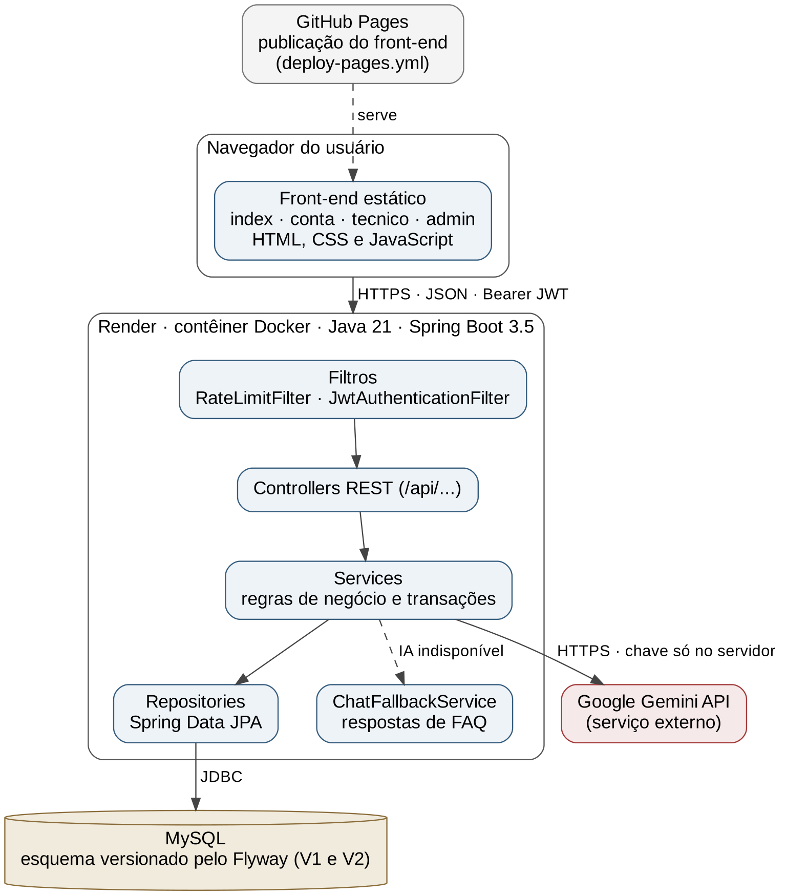{#fig-arq}

A arquitetura segue o estilo REST em camadas descrito por Fielding (2000): o cliente é separado do servidor, a comunicação é sem estado (a identidade é transportada no token JWT) e as camadas internas se comunicam em um único sentido. A Tabela 17 resume a responsabilidade de cada camada.

| Camada | Componentes | Responsabilidade |
|-------------------|---------------------------------------|------------------------------------------|
| Apresentação | `index.html`, `conta.html`, `tecnico.html`, `admin.html`, `script.js`, `dashboard-shared.js`, `os-equipe.js`, `config.js` | Interface do visitante, do cliente, do técnico e do administrador; chamadas à API; validações de conforto do usuário |
| Filtros | `RateLimitFilter`, `JwtAuthenticationFilter` | Limite de requisições por origem e rota; identificação do usuário pelo token |
| Controllers | Classes `*Controller` em `/api/...` | Receber a requisição, validar o formato (Bean Validation) e delegar ao serviço |
| Serviços | `AgendamentoService`, `OrdemServicoService`, `AuthService`, `ChatService`, `RegrasNegocioService`, `ProtocoloService` e outros | Regras de negócio, transições de estado, orquestração e transações |
| Persistência | Repositórios Spring Data JPA; entidades; migrações `V1__schema.sql` e `V2__rastreamento_os.sql` | Acesso e integridade dos dados |
| Integrações | `GeminiClient`, `ChatFallbackService` | Chamada à Google Gemini API com contingência de FAQ |
| Tratamento de erros | `GlobalExceptionHandler` | Resposta padronizada para os erros 401, 403, 404, 409, 422, 502 e 500 |

Table: Camadas da arquitetura e suas responsabilidades {#tbl-camadas}

Fonte: Elaborado pelos autores (2026), a partir do código-fonte (EQUIPE DITEC, 2026a).

As decisões de arquitetura que explicam esse desenho (API separada do front-end, JWT sem estado, regras de negócio no servidor, migrações versionadas e IA chamada pelo servidor) estão registradas, com o motivo e a consequência de cada uma, no Apêndice D.

## Modelo de casos de uso {#sec-cu}

### Diagramas

Os 22 casos de uso foram divididos em dois diagramas, para manter a legibilidade. A Figura 2 reúne os casos de uso do visitante e do cliente (CU01 a CU11), e a Figura 3, os do técnico e do administrador (CU06 e CU09, que são comuns, e CU12 a CU22). O serviço externo Google Gemini aparece como ator secundário do CU04.

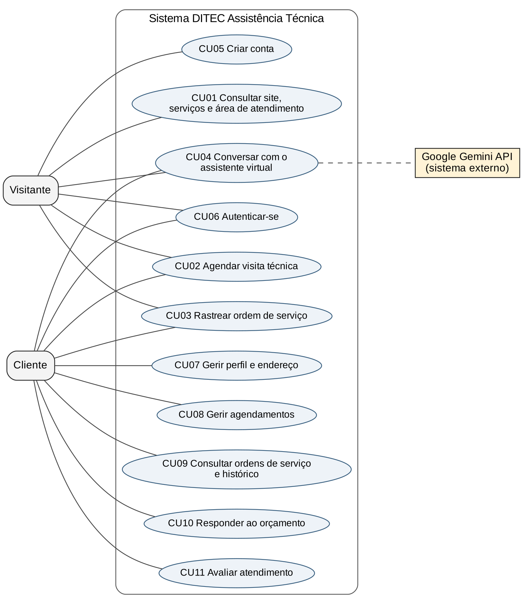{#fig-cu1}

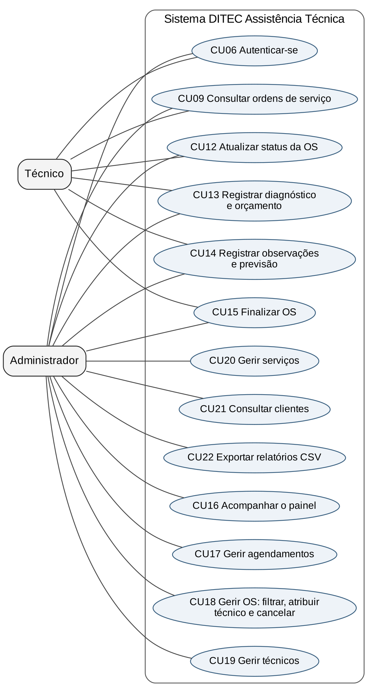{#fig-cu2}

### Catálogo de casos de uso

A Tabela 18 relaciona os casos de uso aos atores e aos requisitos funcionais que realizam. A rastreabilidade completa, até endpoint, tela, tabela e teste, está na matriz de rastreabilidade do Apêndice F.

| ID | Caso de uso | Atores | RF | Objetivo |
|--------|-------------------------|-------------------|----------|--------------------------------------|
| CU01 | Consultar o site, os serviços e a área de atendimento | Visitante, Cliente | RF14, RF23 | Conhecer o catálogo de serviços e verificar se o CEP ou bairro é atendido. |
| CU02 | Agendar visita técnica | Visitante, Cliente | RF05, RF06 | Escolher data e horário livres e solicitar a visita, com ou sem conta. |
| CU03 | Rastrear ordem de serviço | Visitante, Cliente | RF09 | Consultar o andamento da OS informando protocolo e telefone. |
| CU04 | Conversar com o assistente virtual | Visitante, Cliente, serviço externo de IA | RF15 | Obter respostas sobre serviços, garantia e agendamento. |
| CU05 | Criar conta | Visitante | RF01 | Cadastrar-se como cliente. |
| CU06 | Autenticar-se | Cliente, Técnico, Administrador | RF02, RF03 | Entrar no sistema e ser identificado pelo perfil. |
| CU07 | Gerir perfil e endereço | Cliente | RF04 | Consultar e atualizar os dados pessoais e o endereço. |
| CU08 | Gerir agendamentos | Cliente | RF07, RF08 | Listar, alterar e cancelar os próprios agendamentos. |
| CU09 | Consultar ordens de serviço e histórico | Cliente, Técnico, Administrador | RF10 | Visualizar as OS acessíveis ao perfil e a respectiva linha do tempo. |
| CU10 | Responder ao orçamento | Cliente | RF25 | Aprovar ou recusar o orçamento enviado pelo técnico. |
| CU11 | Avaliar atendimento | Cliente | RF13 | Atribuir nota e comentário a um atendimento concluído. |
| CU12 | Atualizar o status da OS | Técnico, Administrador | RF11 | Avançar a OS pelas etapas permitidas. |
| CU13 | Registrar diagnóstico e orçamento | Técnico, Administrador | RF24 | Documentar o diagnóstico e o valor a ser aprovado. |
| CU14 | Registrar observações e previsão | Técnico, Administrador | RF26, RF27 | Anotar observações (internas ou visíveis) e informar a previsão de conclusão. |
| CU15 | Finalizar OS | Técnico, Administrador | RF12 | Registrar valor, pagamento, peças e descrição e ativar a garantia. |
| CU16 | Acompanhar o painel administrativo | Administrador | RF16 | Visualizar indicadores consolidados. |
| CU17 | Gerir agendamentos da operação | Administrador | RF18 | Listar, confirmar e atribuir técnico a agendamentos. |
| CU18 | Gerir OS: filtrar, atribuir técnico e cancelar | Administrador | RF19, RF28, RF29 | Supervisionar as OS, redistribuí-las e cancelá-las com motivo. |
| CU19 | Gerir técnicos | Administrador | RF20 | Criar, editar e ativar ou inativar técnicos. |
| CU20 | Gerir serviços | Administrador | RF21 | Manter o catálogo de serviços. |
| CU21 | Consultar clientes | Administrador | RF17 | Listar os clientes cadastrados. |
| CU22 | Exportar relatórios CSV | Administrador | RF22 | Obter relatórios de agendamentos, OS, avaliações e chatbot. |

Table: Casos de uso do sistema {#tbl-cu}

Fonte: Elaborado pelos autores (2026).


### Especificação dos principais casos de uso

Os sete casos de uso abaixo foram especificados em detalhe por serem os mais críticos do fluxo principal, do agendamento à entrega. Cada especificação indica o ator, as condições, o fluxo principal, as alternativas e exceções, e as regras e requisitos associados. Os códigos HTTP são os devolvidos pela API.

| Item | Descrição |
|-------------------------|---------------------------------------------------------------------------|
| Atores | Visitante ou cliente |
| Pré-condição | Nenhuma; a conta é opcional |
| Fluxo principal | 1. O usuário informa a data na seção de agendamento. 2. O sistema lista os horários livres da grade (RF05). 3. O usuário escolhe o horário e informa nome, telefone, aparelho, defeito, endereço e bairro. 4. O sistema valida as regras (RN01 a RN05). 5. O sistema grava o agendamento PENDENTE, a OS AGENDADO e o evento de abertura, e gera o protocolo (RN08). 6. O sistema exibe o protocolo ao usuário |
| Fluxos alternativos | A1. O CEP ou o bairro não é atendido: a página avisa antes do envio (RF23). A2. O aparelho é a gás: o agendamento recebe prioridade (RN07). A3. O usuário está autenticado: o agendamento é associado ao seu cadastro |
| Exceções | E1. Bairro não atendido, domingo, horário fora da grade ou telefone inválido: 422 com a mensagem da regra. E2. Horário já ocupado: 409. E3. Mais de 10 pedidos por hora pela mesma origem: 429 (RN17) |
| Pós-condição | Agendamento PENDENTE e OS AGENDADO com o mesmo protocolo |
| Rastreabilidade | RF05, RF06, RF23; RN01 a RN08; testes T01 a T03 e T05 (RF06); RF05 e RF23 sem teste automatizado (Apêndice F) |

Table: Especificação do CU02 — Agendar visita técnica {#tbl-cu02}

Fonte: Elaborado pelos autores (2026), a partir do código-fonte (EQUIPE DITEC, 2026a).

| Item | Descrição |
|-------------------------|---------------------------------------------------------------------------|
| Atores | Visitante ou cliente |
| Pré-condição | Possuir o protocolo e o telefone do atendimento |
| Fluxo principal | 1. O usuário informa o protocolo e o telefone na seção de rastreamento. 2. O sistema valida o formato do protocolo (DITEC-AAAA-NNNNNN). 3. O sistema localiza a OS e confere os 8 últimos dígitos do telefone. 4. O sistema devolve o status, a etapa e os eventos visíveis ao cliente |
| Fluxos alternativos | A1. Há observações internas na OS: não aparecem na resposta (RN13) |
| Exceções | E1. Formato de protocolo inválido: 422. E2. Protocolo inexistente ou telefone divergente: 404 com a mesma mensagem nos dois casos, para não revelar quais protocolos existem. E3. Mais de 20 consultas em 5 minutos pela mesma origem: 429 |
| Pós-condição | Nenhuma alteração de dados |
| Rastreabilidade | RF09; RN13, RN17; testes T01, T04, T06 a T08, T24 e T34 |

Table: Especificação do CU03 — Rastrear ordem de serviço {#tbl-cu03}

Fonte: Elaborado pelos autores (2026), a partir do código-fonte (EQUIPE DITEC, 2026a).

| Item | Descrição |
|-------------------------|---------------------------------------------------------------------------|
| Atores | Cliente |
| Pré-condição | Estar autenticado e ser o dono de uma OS em AGUARDANDO_APROVACAO |
| Fluxo principal | 1. O cliente consulta a OS e vê o diagnóstico e o valor do orçamento. 2. O cliente aprova o orçamento. 3. O sistema grava orcamento_aprovado como verdadeiro, move a OS para EM_MANUTENCAO e registra o evento |
| Fluxos alternativos | A1. O cliente recusa: o sistema grava orcamento_aprovado como falso e cancela a OS sem custo, pois o diagnóstico é gratuito (RN19, RN20) |
| Exceções | E1. A OS não é do cliente: 403. E2. A OS não está em AGUARDANDO_APROVACAO: 422. E3. Mais de 10 respostas por hora: 429 |
| Pós-condição | OS em EM_MANUTENCAO (aprovação) ou CANCELADO (recusa) |
| Rastreabilidade | RF25; RN19, RN20; testes T19 e T22 |

Table: Especificação do CU10 — Responder ao orçamento {#tbl-cu10}

Fonte: Elaborado pelos autores (2026), a partir do código-fonte (EQUIPE DITEC, 2026a).

| Item | Descrição |
|-------------------------|---------------------------------------------------------------------------|
| Atores | Técnico e administrador |
| Pré-condição | Estar autenticado; a OS é atribuída ao técnico ou ainda não tem técnico (RN15) |
| Fluxo principal | 1. O usuário seleciona a OS e o novo status entre os permitidos. 2. O sistema verifica a matriz de transições (RN09). 3. O sistema verifica as exigências do destino: diagnóstico para sair de EM_DIAGNOSTICO (RN18) e valor do orçamento para AGUARDANDO_APROVACAO (RN19). 4. O sistema grava o status, registra o evento na linha do tempo e atualiza o status do agendamento |
| Fluxos alternativos | A1. O técnico atua em OS sem técnico: assume a OS (RN15). A2. O administrador cancela: informa o motivo (RN20) |
| Exceções | E1. Transição fora da matriz, inclusive pular etapa ou regredir: 422. E2. Pedido de CONCLUIDO por esta rota: 422 (RN10). E3. OS de outro técnico: 403. E4. Técnico tenta cancelar: 403. E5. Início do atendimento com o agendamento ainda PENDENTE: 422 (RN21) |
| Pós-condição | OS no novo status, com evento registrado e agendamento sincronizado |
| Rastreabilidade | RF11, RF29; RN09 a RN11, RN15, RN18 a RN21; testes T18 a T21, T30, T31 e T33 |

Table: Especificação do CU12 — Atualizar o status da OS {#tbl-cu12}

Fonte: Elaborado pelos autores (2026), a partir do código-fonte (EQUIPE DITEC, 2026a).

| Item | Descrição |
|-------------------------|---------------------------------------------------------------------------|
| Atores | Técnico e administrador |
| Pré-condição | A OS está em andamento e não concluída |
| Fluxo principal | 1. O usuário registra o diagnóstico (obrigatório), o valor do orçamento (de 0 a 999.999,99) e a previsão. 2. O sistema grava os dados e registra os eventos de diagnóstico e orçamento. 3. Para enviar o orçamento ao cliente, o usuário move a OS para AGUARDANDO_APROVACAO |
| Fluxos alternativos | A1. Não há custo adicional: o orçamento é omitido e a OS segue para a manutenção |
| Exceções | E1. Diagnóstico vazio: 422. E2. Valor fora da faixa: 422. E3. OS em AGUARDANDO_APROVACAO: o orçamento não pode ser alterado enquanto aguarda a resposta (RF24). E4. OS concluída: 422 |
| Pós-condição | OS com diagnóstico e orçamento registrados |
| Rastreabilidade | RF24; RN18, RN19; testes T19, T22 e T23 |

Table: Especificação do CU13 — Registrar diagnóstico e orçamento {#tbl-cu13}

Fonte: Elaborado pelos autores (2026), a partir do código-fonte (EQUIPE DITEC, 2026a).

| Item | Descrição |
|-------------------------|---------------------------------------------------------------------------|
| Atores | Técnico e administrador |
| Pré-condição | A OS está em EM_TESTES |
| Fluxo principal | 1. O usuário informa o valor final, a forma de pagamento e a descrição do serviço. 2. O sistema valida os dados. 3. O sistema aplica 5% de desconto se o pagamento for em Pix ou dinheiro (RN11). 4. O sistema define a garantia de 90 dias (RN12), a data de conclusão e o status CONCLUIDO, e registra o evento |
| Fluxos alternativos | A1. Concluída a OS, o usuário a move para AGUARDANDO_RETIRADA ou ENTREGUE pela rota de status |
| Exceções | E1. OS fora de EM_TESTES: 422. E2. Valor negativo, forma de pagamento inválida ou descrição ausente: 422 |
| Pós-condição | OS CONCLUIDO, com garantia, valor e desconto registrados; o cliente pode avaliar o atendimento |
| Rastreabilidade | RF12; RN10 a RN12; teste T19 |

Table: Especificação do CU15 — Finalizar OS {#tbl-cu15}

Fonte: Elaborado pelos autores (2026), a partir do código-fonte (EQUIPE DITEC, 2026a).

| Item | Descrição |
|-------------------------|---------------------------------------------------------------------------|
| Atores | Administrador |
| Pré-condição | Estar autenticado como administrador |
| Fluxo principal | 1. O administrador filtra as OS por status, técnico, protocolo ou cliente (RF19). 2. Atribui um técnico ativo a uma OS ainda não concluída (RF28). 3. O sistema grava a atribuição, registra o evento e sincroniza o agendamento |
| Fluxos alternativos | A1. Cancelamento: o administrador informa o motivo e move a OS para CANCELADO (RF29, RN20) |
| Exceções | E1. Técnico inativo: recusado (RN23). E2. OS concluída, entregue ou cancelada: troca de técnico recusada (RN23). E3. Cancelamento sem motivo: 422. E4. Perfil diferente de administrador: 403 |
| Pós-condição | OS atribuída a outro técnico ou cancelada, com o evento registrado |
| Rastreabilidade | RF19, RF28, RF29; RN20, RN23; testes T21 e T26 |

Table: Especificação do CU18 — Gerir OS: filtrar, atribuir técnico e cancelar {#tbl-cu18}

Fonte: Elaborado pelos autores (2026), a partir do código-fonte (EQUIPE DITEC, 2026a).

| Item | Descrição |
|-------------------------|---------------------------------------------------------------------------|
| Atores | Administrador |
| Pré-condição | Existe agendamento PENDENTE ou AGENDADO |
| Fluxo principal | 1. O administrador lista os agendamentos, com os aparelhos a gás primeiro (RN07). 2. Confirma um agendamento PENDENTE, que passa a AGENDADO. 3. Atribui um técnico ativo ao agendamento. 4. O sistema aplica o técnico à OS vinculada e ao agendamento |
| Fluxos alternativos | A1. Agendamento cancelado ou concluído: a atribuição é recusada |
| Exceções | E1. Confirmação de agendamento que não está PENDENTE: 422. E2. Perfil diferente de administrador: 403 |
| Pós-condição | Agendamento AGENDADO, com técnico, permitindo o início do atendimento (RN21) |
| Rastreabilidade | RF18; RN07, RN21; RF18 sem teste automatizado específico (verificado por revisão de código); T18 verifica a RN21 |

Table: Especificação do CU17 — Gerir agendamentos da operação {#tbl-cu17}

Fonte: Elaborado pelos autores (2026), a partir do código-fonte (EQUIPE DITEC, 2026a).

## Diagramas de atividades {#sec-ativ}

Os fluxos de trabalho foram divididos em três diagramas, que juntos cobrem o ciclo de vida do atendimento: agendamento (da escolha do horário à atribuição do técnico), diagnóstico e orçamento, e execução, finalização e entrega. As decisões (losangos) correspondem às regras de negócio e às respostas HTTP descritas nas especificações.

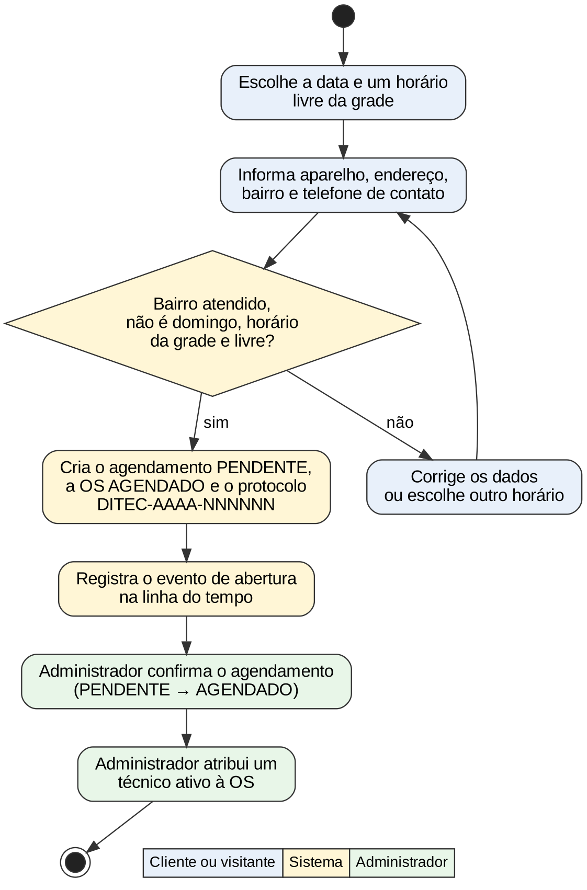{#fig-ativ1}

O fluxo da Figura 4 mostra que a validação das regras de agendamento é o ponto de decisão do processo: dados inválidos devolvem o usuário à etapa de preenchimento, sem criar registros. O administrador atua depois da criação, ao confirmar o agendamento e atribuir o técnico.

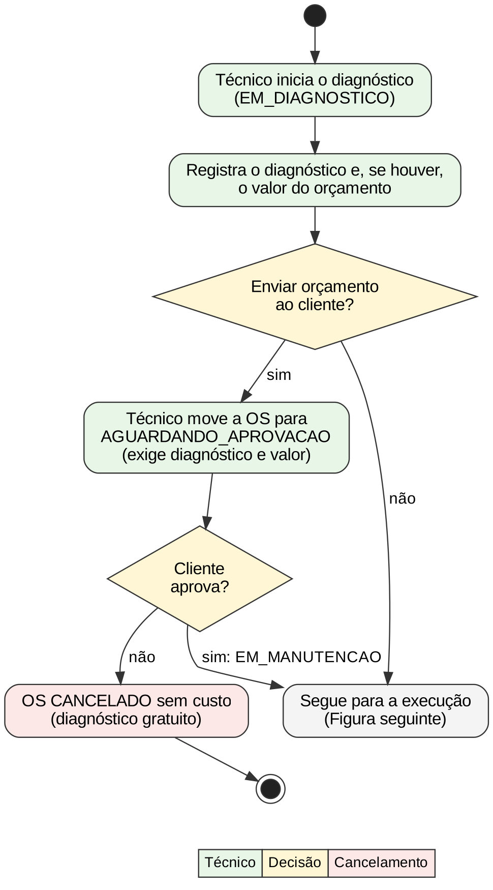{#fig-ativ2}

Na Figura 5, a decisão "Enviar orçamento ao cliente?" separa o caso sem custo adicional do caso com aprovação. A recusa do cliente encerra o atendimento sem cobrança, conforme a regra de que o diagnóstico é gratuito (RN19).

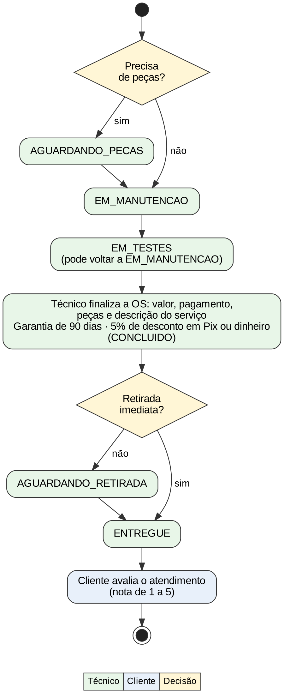{#fig-ativ3}

A Figura 6 trata do ciclo da manutenção: a OS pode alternar entre EM_MANUTENCAO e AGUARDANDO_PECAS, e entre EM_MANUTENCAO e EM_TESTES, e só pode ser finalizada a partir de EM_TESTES. Depois da conclusão, a retirada pode ser imediata ou aguardar o cliente, e a avaliação é feita ao final.

## Diagramas de sequência {#sec-seq}

Os quatro diagramas de sequência mostram a colaboração entre o usuário, o front-end, a API e o banco de dados nos cenários de maior valor para o negócio.

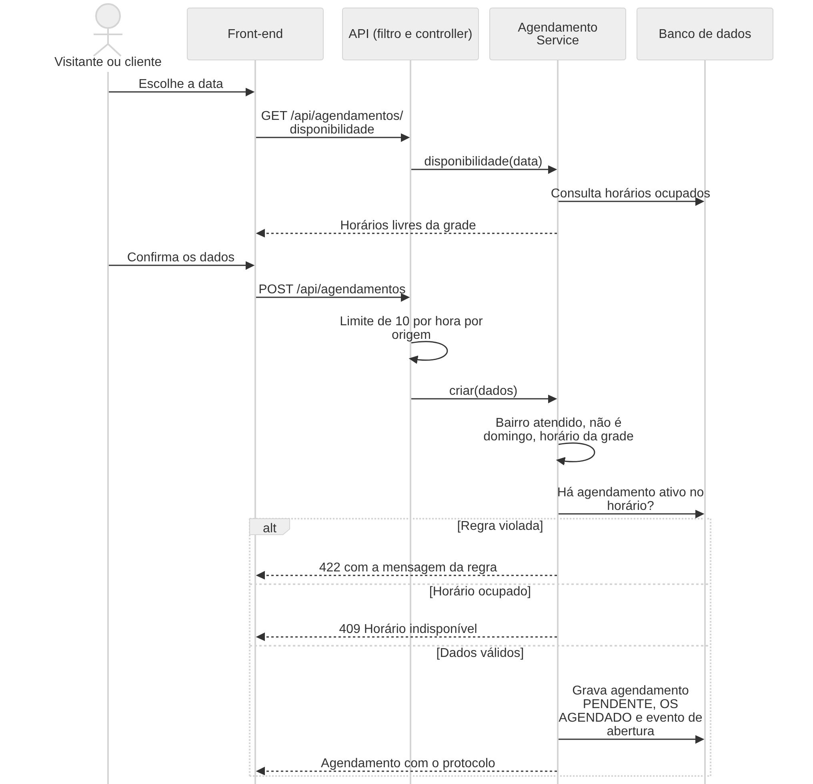{#fig-seq1}

A Figura 7 mostra as duas chamadas do agendamento: a consulta de disponibilidade e a criação. O limite de 10 pedidos por hora é verificado no filtro, antes do serviço, e as três saídas possíveis (regra violada, horário ocupado, dados válidos) correspondem aos códigos 422, 409 e à criação do protocolo.

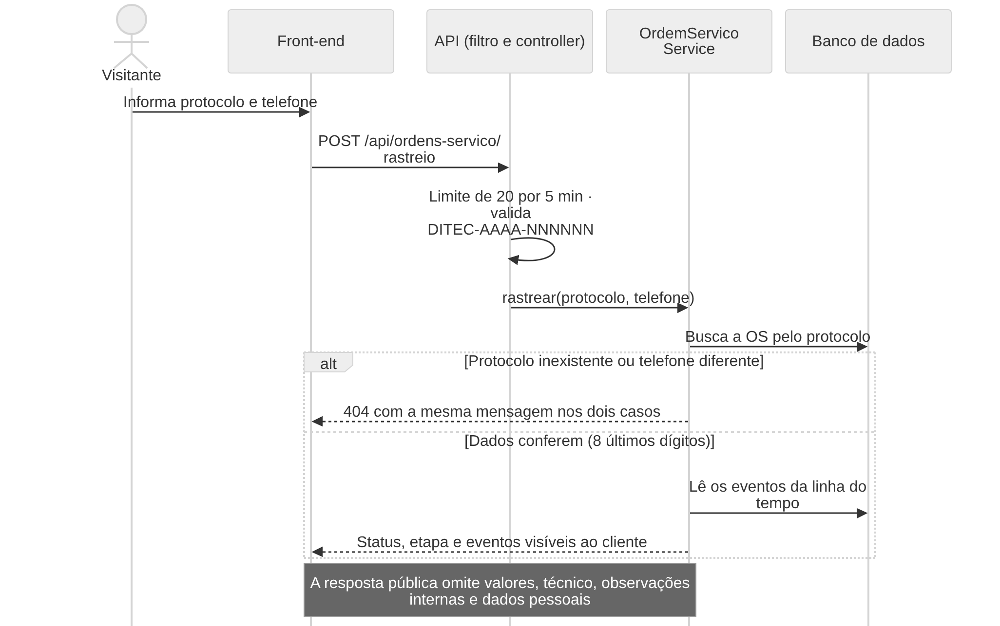{#fig-seq2}

Na Figura 8, a resposta é a mesma para protocolo inexistente e para telefone divergente (404), decisão de segurança que impede descobrir, por tentativa, quais protocolos existem (RN13).

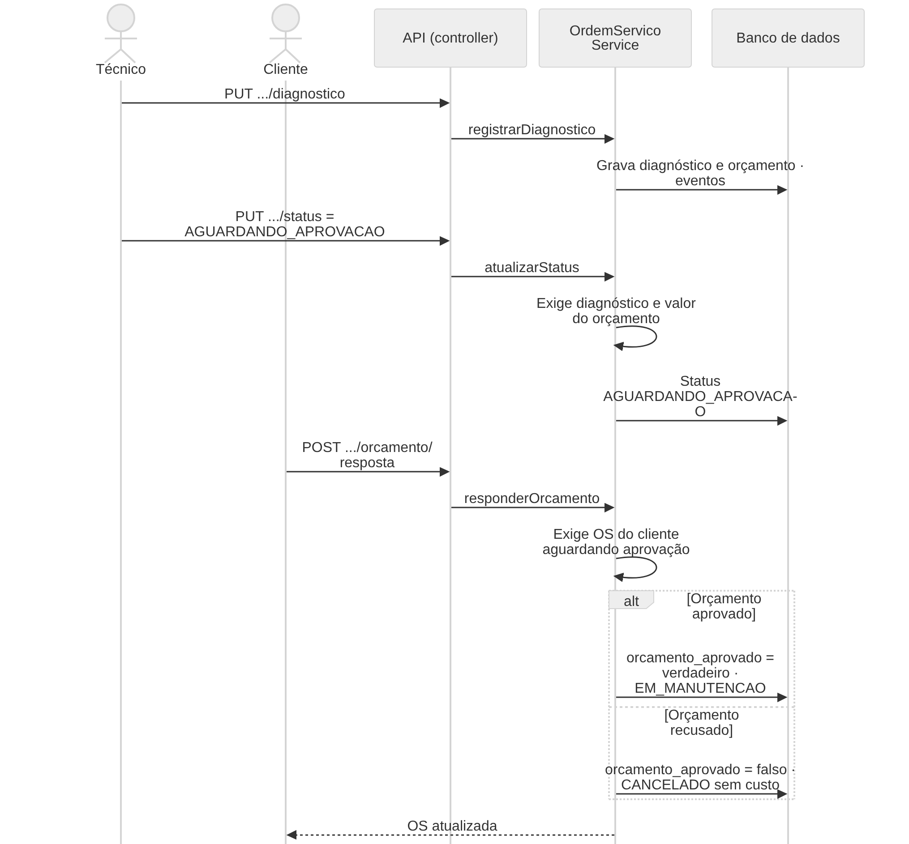{#fig-seq3}

A Figura 9 relaciona dois atores e três chamadas: o técnico registra o diagnóstico e envia o orçamento, e o cliente o aprova ou recusa. O serviço verifica, em cada passo, as pré-condições (diagnóstico, valor e dono da OS).

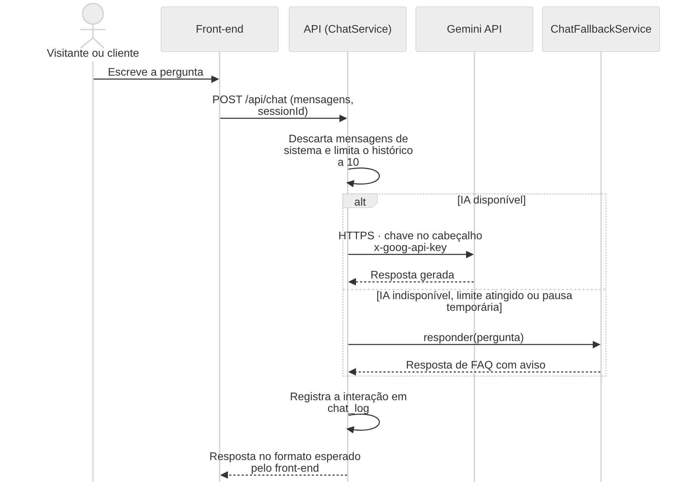{#fig-seq4}

A Figura 10 mostra que a chave da IA é usada somente pelo servidor, que também limita o histórico a 10 mensagens, descarta mensagens de sistema vindas do navegador e recorre à resposta automática de perguntas frequentes quando a IA está indisponível, o limite foi atingido ou há pausa temporária. Em qualquer caso a interação é registrada em `chat_log`.

## Diagrama de estados da ordem de serviço {#sec-est}

A OS é a entidade com o ciclo de vida mais rico do sistema: 10 estados e 19 transições, aplicados pelo método `StatusOS.podeTransicionarPara`. A Figura 11 foi gerada a partir da própria enumeração, e a Tabela 27 lista os estados, a etapa mostrada no indicador do rastreamento e o status equivalente do agendamento, mantido em sincronia a cada mudança.

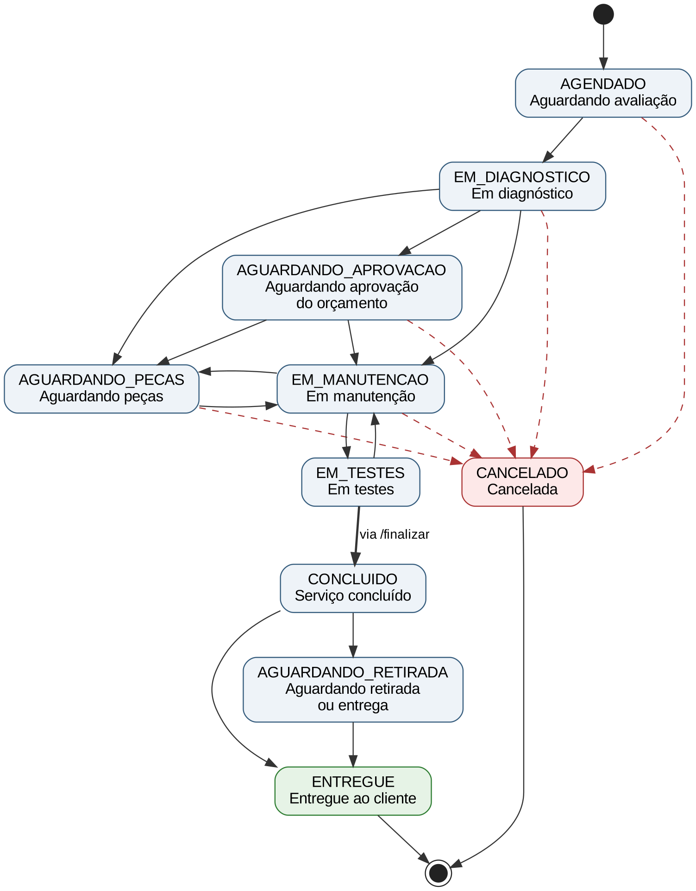{#fig-est}

| Status da OS | Rótulo exibido | Etapa | Transições permitidas | Status do agendamento |
|--------------------------|--------------|--------|-----------------------------|-----------------------|
| `AGENDADO` | Aguardando avaliação | 0 | `EM_DIAGNOSTICO`, `CANCELADO` | `AGENDADO` |
| `EM_DIAGNOSTICO` | Em diagnóstico | 1 | `AGUARDANDO_APROVACAO`, `AGUARDANDO_PECAS`, `EM_MANUTENCAO`, `CANCELADO` | `EM_ATENDIMENTO` |
| `AGUARDANDO_APROVACAO` | Aguardando aprovação do orçamento | 1 | `AGUARDANDO_PECAS`, `EM_MANUTENCAO`, `CANCELADO` | `EM_ATENDIMENTO` |
| `AGUARDANDO_PECAS` | Aguardando peças | 2 | `EM_MANUTENCAO`, `CANCELADO` | `EM_ATENDIMENTO` |
| `EM_MANUTENCAO` | Em manutenção | 2 | `AGUARDANDO_PECAS`, `EM_TESTES`, `CANCELADO` | `EM_ATENDIMENTO` |
| `EM_TESTES` | Em testes | 3 | `EM_MANUTENCAO`, `CONCLUIDO` | `EM_ATENDIMENTO` |
| `CONCLUIDO` | Serviço concluído | 4 | `AGUARDANDO_RETIRADA`, `ENTREGUE` | `CONCLUIDO` |
| `AGUARDANDO_RETIRADA` | Aguardando retirada/entrega | 4 | `ENTREGUE` | `CONCLUIDO` |
| `ENTREGUE` | Entregue ao cliente | 5 | — (estado final) | `CONCLUIDO` |
| `CANCELADO` | Cancelada | -1 | — (estado final) | `CANCELADO` |

Table: Matriz de transições do status da OS (19), etapa do indicador visual e status equivalente do agendamento {#tbl-transicoes}

Fonte: Elaborado pelos autores (2026).


As principais regras do diagrama são: (a) CONCLUIDO só é alcançado pela rota de finalização, a partir de EM_TESTES (RN10); (b) ENTREGUE e CANCELADO são estados finais (RN09); (c) o cancelamento é possível a partir de AGENDADO, EM_DIAGNOSTICO, AGUARDANDO_APROVACAO, AGUARDANDO_PECAS e EM_MANUTENCAO, mas não de EM_TESTES (AM1 do Apêndice B); e (d) sair de EM_DIAGNOSTICO exige diagnóstico registrado (RN18). A análise de alcançabilidade realizada na revisão técnica confirmou que os 10 estados são alcançáveis e que não há estado intermediário sem saída (EQUIPE DITEC, 2026c).

## Diagrama de classes {#sec-cla}

O diagrama de classes (Figura 12) representa as classes de domínio (entidades persistentes e enumerações) e não os controllers, serviços e repositórios, que pertencem à arquitetura. As entidades aparecem sem os campos de controle (datas de criação e atualização), que constam do dicionário de dados da C.8.3; a enumeração `TipoEventoOS` e a `StatusConta` são referenciadas, mas não detalhadas. Cada entidade corresponde a uma tabela do banco; os nomes de atributos são os do código, em notação de objetos (`senhaHash`, `dataHora`), e os das colunas, em notação do banco (`senha_hash`, `data_hora`).

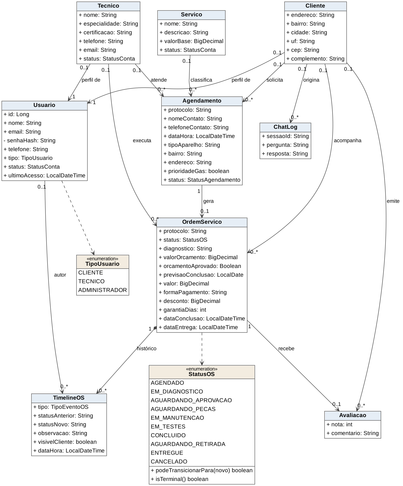{#fig-cla}

Os pontos de modelagem a destacar são:

a) `Usuario` concentra a identidade (e-mail, senha com hash e perfil) e é especializado por composição em `Cliente` e `Tecnico`, que o referenciam como perfil, e não por herança, o que simplifica o mapeamento relacional;

b) `Agendamento` gera no máximo uma `OrdemServico`, e ambos compartilham o mesmo protocolo (RN08);

c) `TimelineOS` pertence a uma única OS, em composição, e registra o histórico de status, diagnóstico, observações, atribuições e previsões, com a indicação de visibilidade ao cliente;

d) `StatusOS` encapsula a matriz de transições, de modo que a regra fica em um só lugar e é testada isoladamente (`StatusOSTest`).

## Modelo entidade-relacionamento {#sec-er}

O modelo de dados é apresentado em três níveis, conforme a disciplina: conceitual (entidades e relacionamentos, independente de tecnologia), lógico (tabelas, chaves e relacionamentos) e físico (tipos, restrições e índices no MySQL).

### Modelo conceitual {#sec-conc}

A Figura 13 mostra as nove entidades e as cardinalidades mínima e máxima de cada relacionamento. A leitura de uma linha como "Agendamento gera (1,1)–(0,1) Ordem de serviço" é: cada ordem de serviço nasce de exatamente um agendamento, e um agendamento gera no máximo uma ordem de serviço.

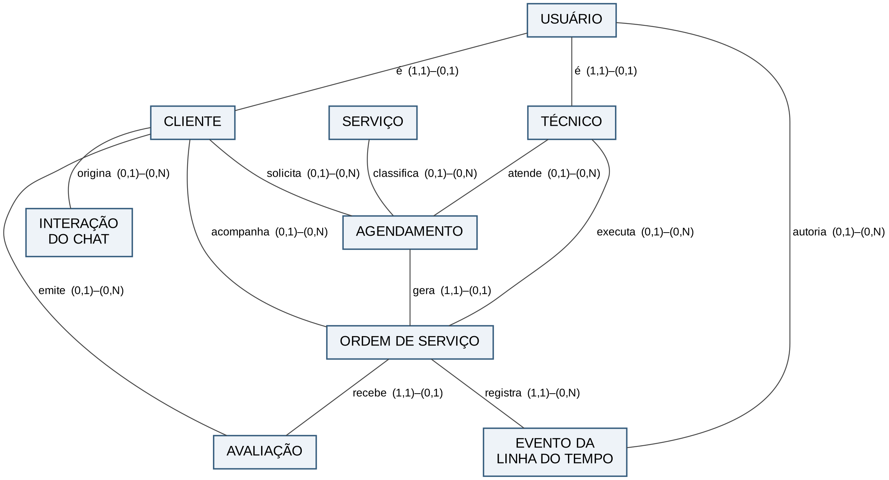{#fig-conc}

As relações com cardinalidade mínima zero (por exemplo, `Cliente` e `Agendamento`) decorrem de duas decisões do domínio: o visitante pode agendar sem conta, de modo que o agendamento pode não ter cliente, e a exclusão de um cliente, de um técnico ou de um serviço não apaga o histórico, razão pela qual essas chaves estrangeiras usam `ON DELETE SET NULL`.

### Modelo lógico {#sec-log}

A Figura 14 apresenta o modelo lógico, com as tabelas, as chaves primárias (PK), as chaves estrangeiras (FK) e as chaves únicas (UK). A Tabela 28 resume o esquema relacional.

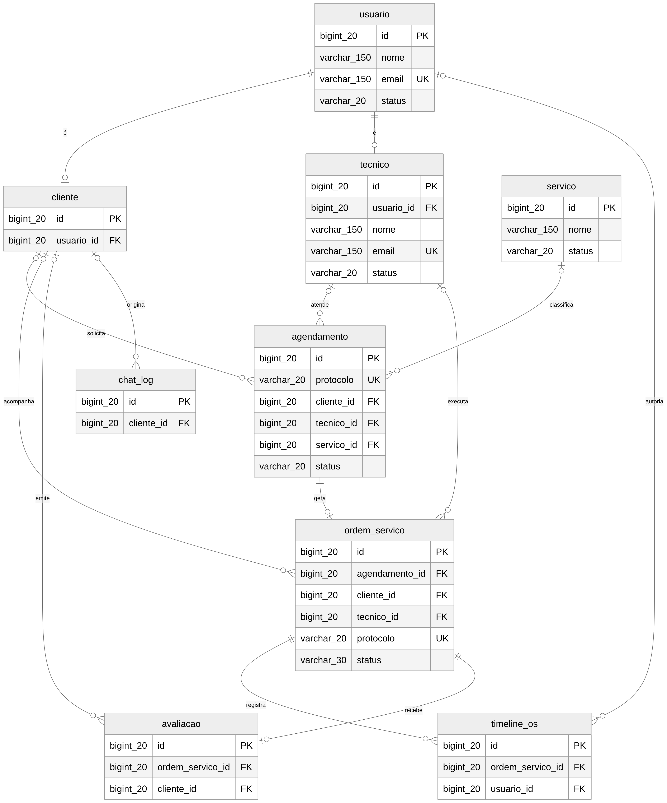{#fig-log}

| Tabela | Chave primária | Chaves estrangeiras | Chaves únicas | Colunas |
|----------------|------------|---------------------------------------|------------------------|----------|
| `agendamento` | `id` | `cliente_id → cliente(id)`; `servico_id → servico(id)`; `tecnico_id → tecnico(id)` | `protocolo` | 16 |
| `avaliacao` | `id` | `cliente_id → cliente(id)`; `ordem_servico_id → ordem_servico(id)` | `ordem_servico_id` | 6 |
| `chat_log` | `id` | `cliente_id → cliente(id)` | — | 6 |
| `cliente` | `id` | `usuario_id → usuario(id)` | `usuario_id` | 8 |
| `ordem_servico` | `id` | `agendamento_id → agendamento(id)`; `cliente_id → cliente(id)`; `tecnico_id → tecnico(id)` | `agendamento_id`, `protocolo` | 23 |
| `servico` | `id` | — | — | 5 |
| `tecnico` | `id` | `usuario_id → usuario(id)` | `email`, `usuario_id` | 8 |
| `timeline_os` | `id` | `ordem_servico_id → ordem_servico(id)`; `usuario_id → usuario(id)` | — | 10 |
| `usuario` | `id` | — | `email` | 9 |

Table: Esquema relacional do banco de dados (versões V1 e V2 aplicadas) {#tbl-esquema}

Fonte: Elaborado pelos autores (2026).


O modelo é, em geral, próximo da terceira forma normal: cada tabela descreve uma única entidade, e as listas de valores (status, tipos) são controladas por restrições CHECK, e não por tabelas auxiliares. Há, porém, três redundâncias que merecem registro: (a) `agendamento` guarda os dados de contato (`nome_contato`, `telefone_contato`) além do vínculo com `cliente`, o que é necessário porque o visitante não tem conta; (b) `ordem_servico` guarda `valor`, `desconto` e `forma_pagamento`, que são valores históricos da finalização e não devem mudar se o catálogo de serviços for alterado; e (c) `tecnico` repete `nome` e `email` de `usuario`, redundância que o grupo pode eliminar em uma evolução futura, ao custo de alterar as consultas e a migração.

### Modelo físico {#sec-fis}

O modelo físico é o definido pelas migrações Flyway `V1__schema.sql` (esquema inicial) e `V2__rastreamento_os.sql` (rastreamento completo da OS). Os dados desta seção foram extraídos de uma instância MySQL/MariaDB na qual as duas migrações foram aplicadas em sequência.

#### Resumo das migrações

A V1 cria as 9 tabelas e 83 colunas; a V2 é incremental (não recria tabelas nem apaga dados) e acrescenta 8 colunas: cinco em `ordem_servico` (`diagnostico`, `valor_orcamento`, `orcamento_aprovado`, `previsao_conclusao` e `data_entrega`) e três em `timeline_os` (`tipo`, `usuario_id` e `visivel_cliente`). A V2 também amplia o domínio de status da OS para 10 valores, converte o antigo `EM_ATENDIMENTO` em `EM_MANUTENCAO`, inclusive no histórico, e cria dois índices (`idx_os_criado_em` e `idx_timeline_os_data`). O total é de 91 colunas em 9 tabelas. As limitações conhecidas da V2 (reversão manual incompleta, falha com valor negativo preexistente e comando `DROP CHECK` específico do MySQL) estão descritas no Apêndice E.

#### Dicionário de dados

O dicionário abaixo descreve as 91 colunas, na ordem em que aparecem no banco. As colunas incluídas pela V2 estão assinaladas na descrição. As restrições CHECK de cada tabela estão indicadas abaixo da respectiva tabela e reunidas na Tabela 39.

::::: {.dic}
##### Tabela `agendamento` (16 colunas)

| Coluna | Tipo | Nulo | Padrão | Restrições | Descrição |
|---------------|----------------|------|--------------|-------------------|------------------------------|
| `id` | BIGINT | Não | — | PK; AUTO_INCREMENT | Identificador do agendamento |
| `protocolo` | VARCHAR(20) | Sim | NULL | UNIQUE | Protocolo DITEC-AAAA-NNNNNN (único) |
| `cliente_id` | BIGINT | Sim | NULL | FK → cliente(id), ON DELETE SET NULL | Cliente, quando há conta (opcional) |
| `nome_contato` | VARCHAR(150) | Sim | NULL | — | Nome informado para contato |
| `telefone_contato` | VARCHAR(20) | Sim | NULL | — | Telefone informado para contato |
| `tecnico_id` | BIGINT | Sim | NULL | FK → tecnico(id), ON DELETE SET NULL | Técnico atribuído (opcional) |
| `servico_id` | BIGINT | Sim | NULL | FK → servico(id), ON DELETE SET NULL | Serviço do catálogo (opcional) |
| `data_hora` | DATETIME | Não | — | — | Data e horário da visita |
| `tipo_aparelho` | VARCHAR(100) | Não | — | — | Aparelho a ser atendido |
| `descricao_problema` | VARCHAR(500) | Sim | NULL | — | Descrição do defeito |
| `bairro` | VARCHAR(100) | Não | — | — | Bairro do atendimento |
| `endereco` | VARCHAR(255) | Não | — | — | Endereço do atendimento |
| `status` | VARCHAR(20) | Não | 'PENDENTE' | — | PENDENTE, AGENDADO, EM_ATENDIMENTO, CONCLUIDO ou CANCELADO |
| `prioridade_gas` | TINYINT(1) | Não | 0 | — | Indica aparelho a gás (prioridade) |
| `criado_em` | DATETIME | Não | CURRENT_​TIMESTAMP | — | Data e hora de criação |
| `atualizado_em` | DATETIME | Não | CURRENT_​TIMESTAMP | — | Data e hora da última atualização |

Table: Dicionário de dados da tabela agendamento {#tbl-dic-agendamento}

Fonte: Elaborado pelos autores (2026).

::: {.cks}
Restrições CHECK: `ck_agendamento_status`: `status in ('PENDENTE','AGENDADO','EM_ATENDIMENTO','CONCLUIDO','CANCELADO')`.
:::

##### Tabela `avaliacao` (6 colunas)

| Coluna | Tipo | Nulo | Padrão | Restrições | Descrição |
|---------------|----------------|------|--------------|-------------------|------------------------------|
| `id` | BIGINT | Não | — | PK; AUTO_INCREMENT | Identificador da avaliação |
| `ordem_servico_id` | BIGINT | Não | — | FK → ordem_servico(id), ON DELETE CASCADE; UNIQUE | OS avaliada (única: uma avaliação por OS) |
| `cliente_id` | BIGINT | Sim | NULL | FK → cliente(id), ON DELETE SET NULL | Cliente autor (opcional) |
| `nota` | TINYINT | Não | — | — | Nota de 1 a 5 |
| `comentario` | VARCHAR(500) | Sim | NULL | — | Comentário opcional |
| `criado_em` | DATETIME | Não | CURRENT_​TIMESTAMP | — | Data e hora da avaliação |

Table: Dicionário de dados da tabela avaliacao {#tbl-dic-avaliacao}

Fonte: Elaborado pelos autores (2026).

::: {.cks}
Restrições CHECK: `ck_avaliacao_nota`: `nota between 1 and 5`.
:::

##### Tabela `chat_log` (6 colunas)

| Coluna | Tipo | Nulo | Padrão | Restrições | Descrição |
|---------------|----------------|------|--------------|-------------------|------------------------------|
| `id` | BIGINT | Não | — | PK; AUTO_INCREMENT | Identificador da interação |
| `cliente_id` | BIGINT | Sim | NULL | FK → cliente(id), ON DELETE SET NULL | Cliente, quando autenticado (opcional) |
| `sessao_id` | VARCHAR(64) | Não | — | — | Identificador da sessão de chat |
| `pergunta` | TEXT | Não | — | — | Pergunta do usuário |
| `resposta` | TEXT | Não | — | — | Resposta fornecida |
| `data_hora` | DATETIME | Não | CURRENT_​TIMESTAMP | — | Data e hora da interação |

Table: Dicionário de dados da tabela chat_log {#tbl-dic-chat_log}

Fonte: Elaborado pelos autores (2026).

##### Tabela `cliente` (8 colunas)

| Coluna | Tipo | Nulo | Padrão | Restrições | Descrição |
|---------------|----------------|------|--------------|-------------------|------------------------------|
| `id` | BIGINT | Não | — | PK; AUTO_INCREMENT | Identificador do cliente |
| `usuario_id` | BIGINT | Não | — | FK → usuario(id), ON DELETE CASCADE; UNIQUE | Usuário titular do perfil (relação 1:1) |
| `endereco` | VARCHAR(255) | Sim | NULL | — | Logradouro e número |
| `bairro` | VARCHAR(100) | Sim | NULL | — | Bairro |
| `cidade` | VARCHAR(100) | Sim | NULL | — | Cidade |
| `uf` | CHAR(2) | Sim | NULL | — | Unidade da federação |
| `cep` | VARCHAR(9) | Sim | NULL | — | CEP |
| `complemento` | VARCHAR(100) | Sim | NULL | — | Complemento do endereço |

Table: Dicionário de dados da tabela cliente {#tbl-dic-cliente}

Fonte: Elaborado pelos autores (2026).

##### Tabela `ordem_servico` (23 colunas)

| Coluna | Tipo | Nulo | Padrão | Restrições | Descrição |
|---------------|----------------|------|--------------|-------------------|------------------------------|
| `id` | BIGINT | Não | — | PK; AUTO_INCREMENT | Identificador da OS |
| `agendamento_id` | BIGINT | Não | — | FK → agendamento(id), ON DELETE CASCADE; UNIQUE | Agendamento de origem (único) |
| `cliente_id` | BIGINT | Sim | NULL | FK → cliente(id), ON DELETE SET NULL | Cliente titular (opcional) |
| `tecnico_id` | BIGINT | Sim | NULL | FK → tecnico(id), ON DELETE SET NULL | Técnico responsável (opcional) |
| `protocolo` | VARCHAR(20) | Não | — | UNIQUE | Protocolo da OS (único) |
| `descricao_problema` | VARCHAR(500) | Sim | NULL | — | Descrição do defeito |
| `diagnostico` | TEXT | Sim | NULL | — | Diagnóstico técnico (incluída na V2) |
| `valor_orcamento` | DECIMAL(10,2) | Sim | NULL | — | Valor do orçamento enviado ao cliente (incluída na V2) |
| `orcamento_aprovado` | TINYINT(1) | Sim | NULL | — | Resposta do cliente: verdadeiro, falso ou nulo (sem resposta) (incluída na V2) |
| `previsao_conclusao` | DATE | Sim | NULL | — | Data prevista de conclusão (incluída na V2) |
| `status` | VARCHAR(30) | Não | 'AGENDADO' | — | Um dos 10 status do ciclo de vida da OS |
| `valor` | DECIMAL(10,2) | Sim | NULL | — | Valor final cobrado, já com o desconto |
| `forma_pagamento` | VARCHAR(30) | Sim | NULL | — | Forma de pagamento registrada na finalização |
| `desconto` | DECIMAL(5,2) | Sim | 0.00 | — | Fração de desconto aplicada (0,05 equivale a 5%) |
| `pecas_utilizadas` | TEXT | Sim | NULL | — | Peças utilizadas no reparo |
| `descricao_final` | TEXT | Sim | NULL | — | Descrição do serviço realizado |
| `data_inicio` | DATETIME | Sim | NULL | — | Início do diagnóstico |
| `data_conclusao` | DATETIME | Sim | NULL | — | Data e hora da conclusão |
| `data_entrega` | DATETIME | Sim | NULL | — | Data e hora da entrega ao cliente (incluída na V2) |
| `garantia_dias` | INT | Sim | 90 | — | Prazo de garantia em dias (padrão 90) |
| `nota_fiscal_numero` | VARCHAR(50) | Sim | NULL | — | Número do comprovante (não há emissão de NF-e) |
| `criado_em` | DATETIME | Não | CURRENT_​TIMESTAMP | — | Data e hora de criação |
| `atualizado_em` | DATETIME | Não | CURRENT_​TIMESTAMP | — | Data e hora da última atualização |

Table: Dicionário de dados da tabela ordem_servico {#tbl-dic-ordem_servico}

Fonte: Elaborado pelos autores (2026).

::: {.cks}
Restrições CHECK: `ck_os_garantia`: `garantia_dias >= 0`; `ck_os_status`: `status in ('AGENDADO','EM_DIAGNOSTICO','AGUARDANDO_APROVACAO','AGUARDANDO_PECAS','EM_MANUTENCAO','EM_TESTES','CONCLUIDO','AGUARDANDO_RETIRADA','ENTREGUE','CANCELADO')`; `ck_os_valor`: `valor is null or valor >= 0`; `ck_os_valor_orcamento`: `valor_orcamento is null or valor_orcamento >= 0`.
:::

##### Tabela `servico` (5 colunas)

| Coluna | Tipo | Nulo | Padrão | Restrições | Descrição |
|---------------|----------------|------|--------------|-------------------|------------------------------|
| `id` | BIGINT | Não | — | PK; AUTO_INCREMENT | Identificador do serviço |
| `nome` | VARCHAR(150) | Não | — | — | Nome do serviço |
| `descricao` | VARCHAR(500) | Sim | NULL | — | Descrição do serviço |
| `valor_base` | DECIMAL(10,2) | Sim | NULL | — | Valor de referência |
| `status` | VARCHAR(20) | Não | 'ATIVO' | — | Situação: ATIVO ou INATIVO |

Table: Dicionário de dados da tabela servico {#tbl-dic-servico}

Fonte: Elaborado pelos autores (2026).

::: {.cks}
Restrições CHECK: `ck_servico_status`: `status in ('ATIVO','INATIVO')`.
:::

##### Tabela `tecnico` (8 colunas)

| Coluna | Tipo | Nulo | Padrão | Restrições | Descrição |
|---------------|----------------|------|--------------|-------------------|------------------------------|
| `id` | BIGINT | Não | — | PK; AUTO_INCREMENT | Identificador do técnico |
| `usuario_id` | BIGINT | Não | — | FK → usuario(id), ON DELETE CASCADE; UNIQUE | Usuário de login do técnico (1:1) |
| `nome` | VARCHAR(150) | Não | — | — | Nome do técnico |
| `especialidade` | VARCHAR(100) | Sim | NULL | — | Área de especialidade |
| `certificacao` | VARCHAR(100) | Sim | NULL | — | Certificação profissional |
| `telefone` | VARCHAR(20) | Sim | NULL | — | Telefone do técnico |
| `email` | VARCHAR(150) | Não | — | UNIQUE | E-mail do técnico (único) |
| `status` | VARCHAR(20) | Não | 'ATIVO' | — | Situação: ATIVO ou INATIVO |

Table: Dicionário de dados da tabela tecnico {#tbl-dic-tecnico}

Fonte: Elaborado pelos autores (2026).

::: {.cks}
Restrições CHECK: `ck_tecnico_status`: `status in ('ATIVO','INATIVO')`.
:::

##### Tabela `timeline_os` (10 colunas)

| Coluna | Tipo | Nulo | Padrão | Restrições | Descrição |
|---------------|----------------|------|--------------|-------------------|------------------------------|
| `id` | BIGINT | Não | — | PK; AUTO_INCREMENT | Identificador do evento |
| `ordem_servico_id` | BIGINT | Não | — | FK → ordem_servico(id), ON DELETE CASCADE | OS à qual o evento pertence |
| `tipo` | VARCHAR(20) | Não | 'STATUS' | — | Tipo do evento: ABERTURA, STATUS, DIAGNOSTICO, ORCAMENTO, OBSERVACAO, ATRIBUICAO ou PREVISAO (incluída na V2) |
| `status_anterior` | VARCHAR(30) | Sim | NULL | — | Status antes do evento |
| `status_novo` | VARCHAR(30) | Não | — | — | Status após o evento |
| `observacao` | VARCHAR(500) | Sim | NULL | — | Texto do evento |
| `alterado_por` | VARCHAR(150) | Não | — | — | Nome de quem realizou a alteração |
| `usuario_id` | BIGINT | Sim | NULL | FK → usuario(id), ON DELETE SET NULL | Usuário responsável (opcional) (incluída na V2) |
| `visivel_cliente` | TINYINT(1) | Não | 1 | — | Indica se o evento é exibido ao cliente (incluída na V2) |
| `data_hora` | DATETIME | Não | CURRENT_​TIMESTAMP | — | Data e hora do evento |

Table: Dicionário de dados da tabela timeline_os {#tbl-dic-timeline_os}

Fonte: Elaborado pelos autores (2026).

::: {.cks}
Restrições CHECK: `ck_timeline_tipo`: `tipo in ('ABERTURA','STATUS','DIAGNOSTICO','ORCAMENTO','OBSERVACAO','ATRIBUICAO','PREVISAO')`.
:::

##### Tabela `usuario` (9 colunas)

| Coluna | Tipo | Nulo | Padrão | Restrições | Descrição |
|---------------|----------------|------|--------------|-------------------|------------------------------|
| `id` | BIGINT | Não | — | PK; AUTO_INCREMENT | Identificador do usuário |
| `nome` | VARCHAR(150) | Não | — | — | Nome completo |
| `email` | VARCHAR(150) | Não | — | UNIQUE | E-mail de login (único) |
| `senha_hash` | VARCHAR(255) | Não | — | — | Hash BCrypt da senha |
| `telefone` | VARCHAR(20) | Sim | NULL | — | Telefone de contato |
| `tipo` | VARCHAR(20) | Não | — | — | Perfil: CLIENTE, TECNICO ou ADMINISTRADOR |
| `status` | VARCHAR(20) | Não | 'ATIVO' | — | Situação da conta: ATIVO ou INATIVO |
| `data_cadastro` | DATETIME | Não | CURRENT_​TIMESTAMP | — | Data e hora do cadastro |
| `ultimo_acesso` | DATETIME | Sim | NULL | — | Data e hora do último login |

Table: Dicionário de dados da tabela usuario {#tbl-dic-usuario}

Fonte: Elaborado pelos autores (2026).

::: {.cks}
Restrições CHECK: `ck_usuario_status`: `status in ('ATIVO','INATIVO')`; `ck_usuario_tipo`: `tipo in ('CLIENTE','ADMINISTRADOR','TECNICO')`.
:::


Total: 91 colunas em 9 tabelas.

:::::


#### Chaves estrangeiras, restrições e índices

A integridade referencial usa duas ações de exclusão: `CASCADE`, quando o registro filho não tem sentido sem o pai (perfis de usuário, eventos da linha do tempo, avaliação e a OS de um agendamento), e `SET NULL`, quando o histórico deve ser preservado (cliente, técnico e serviço).

| Tabela | Restrição | Coluna | Referencia | ON DELETE |
|----------------|--------------------------|-------------------|--------------------------|--------------|
| `agendamento` | `fk_agendamento_cliente` | `cliente_id` | `cliente`(`id`) | SET NULL |
| `agendamento` | `fk_agendamento_servico` | `servico_id` | `servico`(`id`) | SET NULL |
| `agendamento` | `fk_agendamento_tecnico` | `tecnico_id` | `tecnico`(`id`) | SET NULL |
| `avaliacao` | `fk_avaliacao_cliente` | `cliente_id` | `cliente`(`id`) | SET NULL |
| `avaliacao` | `fk_avaliacao_os` | `ordem_servico_id` | `ordem_servico`(`id`) | CASCADE |
| `chat_log` | `fk_chatlog_cliente` | `cliente_id` | `cliente`(`id`) | SET NULL |
| `cliente` | `fk_cliente_usuario` | `usuario_id` | `usuario`(`id`) | CASCADE |
| `ordem_servico` | `fk_os_agendamento` | `agendamento_id` | `agendamento`(`id`) | CASCADE |
| `ordem_servico` | `fk_os_cliente` | `cliente_id` | `cliente`(`id`) | SET NULL |
| `ordem_servico` | `fk_os_tecnico` | `tecnico_id` | `tecnico`(`id`) | SET NULL |
| `tecnico` | `fk_tecnico_usuario` | `usuario_id` | `usuario`(`id`) | CASCADE |
| `timeline_os` | `fk_timeline_os` | `ordem_servico_id` | `ordem_servico`(`id`) | CASCADE |
| `timeline_os` | `fk_timeline_usuario` | `usuario_id` | `usuario`(`id`) | SET NULL |

Table: Chaves estrangeiras (13) e ação referencial de exclusão {#tbl-fks}

Fonte: Elaborado pelos autores (2026).


| Tabela | Restrição | Condição |
|----------------|------------------------|------------------------------------------------------------|
| `agendamento` | `ck_agendamento_status` | `status in ('PENDENTE','AGENDADO','EM_ATENDIMENTO','CONCLUIDO','CANCELADO')` |
| `avaliacao` | `ck_avaliacao_nota` | `nota between 1 and 5` |
| `ordem_servico` | `ck_os_garantia` | `garantia_dias >= 0` |
| `ordem_servico` | `ck_os_status` | `status in ('AGENDADO','EM_DIAGNOSTICO','AGUARDANDO_APROVACAO','AGUARDANDO_PECAS','EM_MANUTENCAO','EM_TESTES','CONCLUIDO','AGUARDANDO_RETIRADA','ENTREGUE','CANCELADO')` |
| `ordem_servico` | `ck_os_valor` | `valor is null or valor >= 0` |
| `ordem_servico` | `ck_os_valor_orcamento` | `valor_orcamento is null or valor_orcamento >= 0` |
| `servico` | `ck_servico_status` | `status in ('ATIVO','INATIVO')` |
| `tecnico` | `ck_tecnico_status` | `status in ('ATIVO','INATIVO')` |
| `timeline_os` | `ck_timeline_tipo` | `tipo in ('ABERTURA','STATUS','DIAGNOSTICO','ORCAMENTO','OBSERVACAO','ATRIBUICAO','PREVISAO')` |
| `usuario` | `ck_usuario_status` | `status in ('ATIVO','INATIVO')` |
| `usuario` | `ck_usuario_tipo` | `tipo in ('CLIENTE','ADMINISTRADOR','TECNICO')` |

Table: Restrições CHECK (11) do banco de dados {#tbl-checks}

Fonte: Elaborado pelos autores (2026).


| Tabela | Índice | Colunas | Tipo |
|----------------|----------------------------------|----------------------------------|----------------|
| `agendamento` | `fk_agendamento_servico` | `servico_id` | Não único |
| `agendamento` | `fk_agendamento_tecnico` | `tecnico_id` | Não único |
| `agendamento` | `idx_agendamento_cliente` | `cliente_id` | Não único |
| `agendamento` | `idx_agendamento_data_hora` | `data_hora` | Não único |
| `agendamento` | `idx_agendamento_status` | `status` | Não único |
| `agendamento` | `idx_agendamento_telefone_contato` | `telefone_contato` | Não único |
| `agendamento` | `uq_agendamento_protocolo` | `protocolo` | Único |
| `avaliacao` | `fk_avaliacao_cliente` | `cliente_id` | Não único |
| `avaliacao` | `uq_avaliacao_os` | `ordem_servico_id` | Único |
| `chat_log` | `fk_chatlog_cliente` | `cliente_id` | Não único |
| `chat_log` | `idx_chatlog_data` | `data_hora` | Não único |
| `chat_log` | `idx_chatlog_sessao` | `sessao_id` | Não único |
| `cliente` | `idx_cliente_bairro` | `bairro` | Não único |
| `cliente` | `uq_cliente_usuario` | `usuario_id` | Único |
| `ordem_servico` | `idx_os_cliente` | `cliente_id` | Não único |
| `ordem_servico` | `idx_os_criado_em` | `criado_em` | Não único |
| `ordem_servico` | `idx_os_status` | `status` | Não único |
| `ordem_servico` | `idx_os_tecnico` | `tecnico_id` | Não único |
| `ordem_servico` | `uq_os_agendamento` | `agendamento_id` | Único |
| `ordem_servico` | `uq_os_protocolo` | `protocolo` | Único |
| `tecnico` | `uq_tecnico_email` | `email` | Único |
| `tecnico` | `uq_tecnico_usuario` | `usuario_id` | Único |
| `timeline_os` | `fk_timeline_usuario` | `usuario_id` | Não único |
| `timeline_os` | `idx_timeline_os_data` | `ordem_servico_id`, `data_hora` | Não único |
| `timeline_os` | `idx_timeline_os_id` | `ordem_servico_id` | Não único |
| `usuario` | `idx_usuario_tipo` | `tipo` | Não único |
| `usuario` | `uq_usuario_email` | `email` | Único |

Table: Índices secundários e chaves únicas (a chave primária é implícita) {#tbl-indices}

Fonte: Elaborado pelos autores (2026).


## Catálogo de telas e navegação {#sec-telas}

A interface é composta por quatro páginas estáticas, que se comunicam com a API pelo navegador. A Tabela 41 relaciona cada página ao perfil que a usa, às seções ou painéis e aos casos de uso que realiza.

| Página | Perfil | Seções ou painéis | Casos de uso |
|---------------------|---------------------|------------------------------------------|-----------------|
| `index.html` | Visitante e cliente | Apresentação, sobre, serviços, marcas, portfólio, depoimentos, pagamentos, agendamento, rastreamento, perguntas frequentes, contato, mapa da área de atendimento, política de privacidade e termos; assistente virtual | CU01, CU02, CU03, CU04 |
| `conta.html` | Visitante e cliente | Entrada e cadastro (visitante); perfil e endereço, agendamentos, ordens de serviço, orçamento e avaliação (cliente) | CU05 a CU11 |
| `tecnico.html` | Técnico | Entrada; indicadores (agendadas, em atendimento, concluídas); lista de OS atribuídas e ações de diagnóstico, status, observações e finalização | CU06, CU09, CU12 a CU15 |
| `admin.html` | Administrador | Entrada; indicadores; painéis de agendamentos, ordens de serviço (com filtros), clientes, técnicos, serviços e relatórios | CU06, CU16 a CU22 |

Table: Catálogo de telas da interface {#tbl-telas}

Fonte: Elaborado pelos autores (2026), a partir do código-fonte do front-end (EQUIPE DITEC, 2026a).

### Capturas de tela

As figuras a seguir são **capturas reais da interface estática**, obtidas de uma cópia do front-end servida localmente e sem acesso à API, de modo que mostram a estrutura, o texto e o layout das telas, mas não dados reais nem o funcionamento do back-end. As telas autenticadas (painéis do cliente, do técnico e do administrador) dependem da API e de dados de teste, e as capturas delas permanecem como pendência de evidência, listada no Apêndice F.

{#fig-tela1 fonte="Captura de tela do front-end estático, versão e58a3d2, sem acesso à API (2026)."}

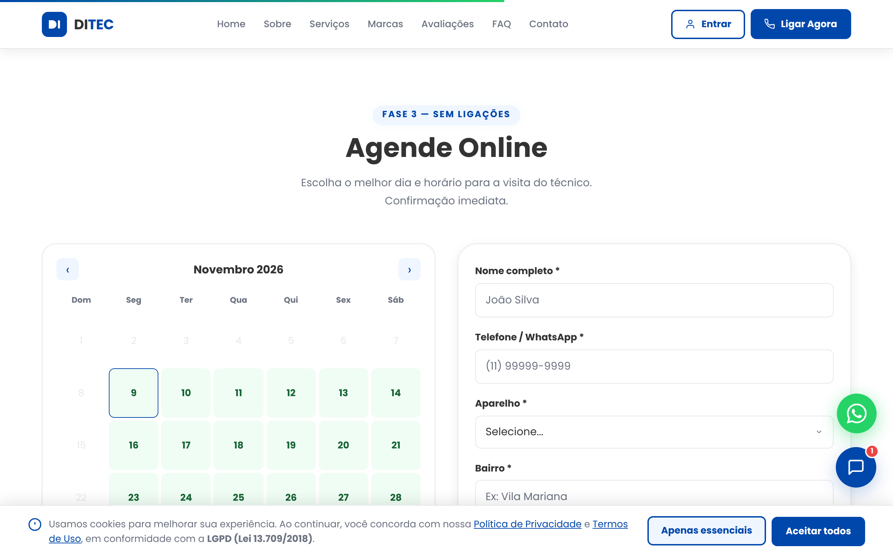{#fig-tela2 fonte="Captura de tela do front-end estático, versão e58a3d2, sem acesso à API (2026)."}

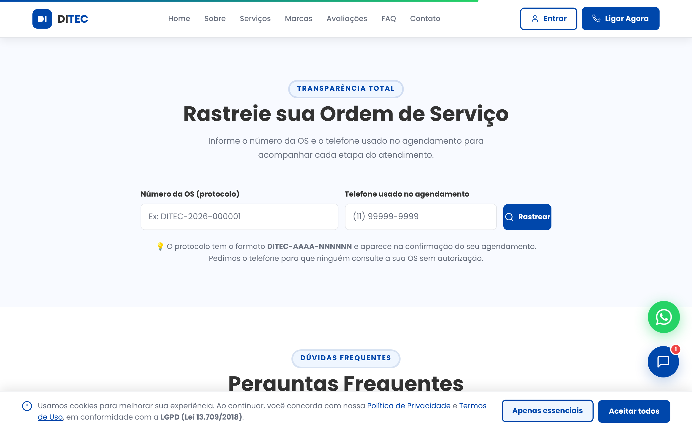{#fig-tela3 fonte="Captura de tela do front-end estático, versão e58a3d2, sem acesso à API (2026)."}

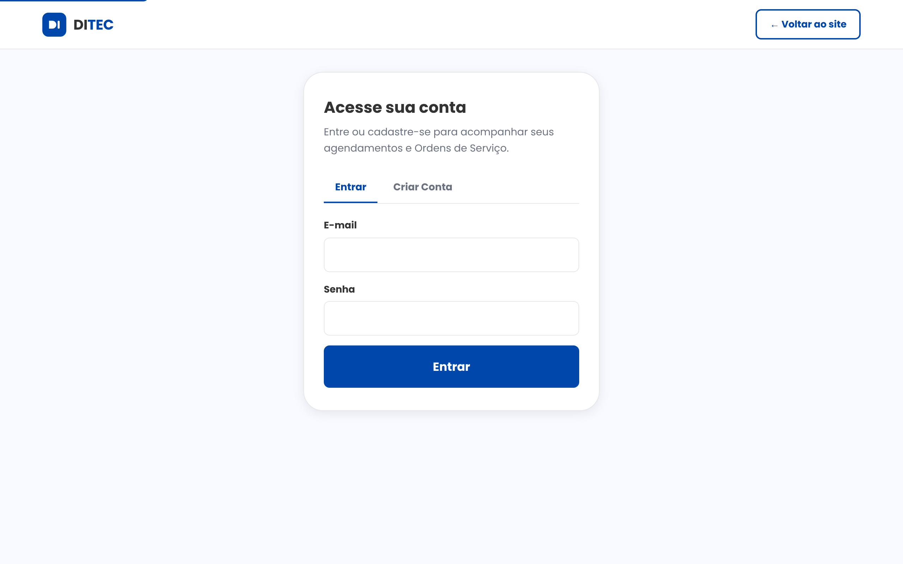{#fig-tela4 fonte="Captura de tela do front-end estático, versão e58a3d2, sem acesso à API (2026)."}

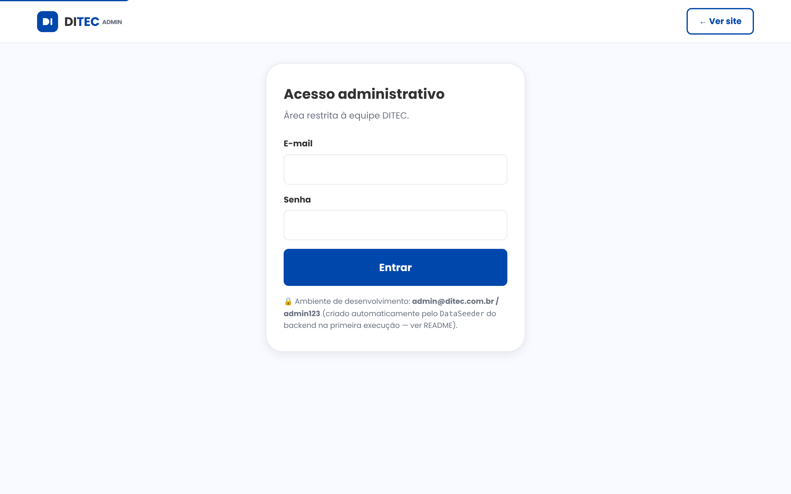{#fig-tela5 fonte="Captura de tela do front-end estático, versão e58a3d2, sem acesso à API (2026)."}

A interface é responsiva. A Figura 20 mostra a página inicial em tela de celular, o que evidencia o requisito de uso em dispositivos móveis (RNF15).

{#fig-tela6 fonte="Captura de tela do front-end estático, versão e58a3d2, em largura de 390 px, sem acesso à API (2026)."}

### Mapa de navegação

A navegação entre as páginas é simples e hierárquica. A página inicial (`index.html`) leva à área do cliente (`conta.html`) e ao acesso administrativo (`admin.html`) por links no rodapé; a entrada de técnicos e de clientes pelo formulário de login redireciona cada perfil à sua área (`tecnico.html` para o técnico), conforme o script da página inicial. Ao sair, o usuário permanece na mesma página, que volta a exibir a tela de entrada, pois o token é descartado no navegador. O perfil do usuário é sempre verificado pelo servidor, e não pela página acessada: o acesso de um perfil à área de outro resulta em 403.

## Coerência entre os modelos {#sec-coer}

A disciplina avalia a coerência dos modelos entre si e com o código. A Tabela 42 mostra como cada conceito central aparece nos diagramas, no código e no banco, e a Figura 21 resume a cadeia de rastreabilidade adotada: do requisito ao modelo, ao código e ao teste.

| Conceito | Casos de uso | Sequência e atividades | Classe | Tabela | Código |
|---------------|----------|------------------|---------------|----------------|--------------------------|
| Agendamento | CU02, CU08, CU17 | Figura 4, Figura 7 | `Agendamento` | `agendamento` | `AgendamentoService` |
| Ordem de serviço | CU03, CU09, CU12 a CU15, CU18 | Figura 5, Figura 6, Figura 8 | `OrdemServico`, `StatusOS` | `ordem_servico` | `OrdemServicoService`, `StatusOS` |
| Linha do tempo | CU03, CU09, CU14 | Figura 8, Figura 9 | `TimelineOS` | `timeline_os` | `OrdemServicoService`, `OrdemServicoMapper` |
| Orçamento | CU10, CU13 | Figura 5, Figura 9 | `OrdemServico` | `ordem_servico` | `OrdemServicoService.responderOrcamento` |
| Avaliação | CU11 | Figura 6 | `Avaliacao` | `avaliacao` | `OrdemServicoService.avaliar` |
| Assistente virtual | CU04 | Figura 10 | `ChatLog` | `chat_log` | `ChatService`, `GeminiClient` |
| Usuários e perfis | CU05 a CU07, CU19, CU21 | — | `Usuario`, `Cliente`, `Tecnico` | `usuario`, `cliente`, `tecnico` | `AuthService`, `SecurityConfig` |
| Serviços | CU01, CU20 | — | `Servico` | `servico` | `ServicoController` |

Table: Coerência dos conceitos entre os modelos, o código e o banco {#tbl-coerencia}

Fonte: Elaborado pelos autores (2026).

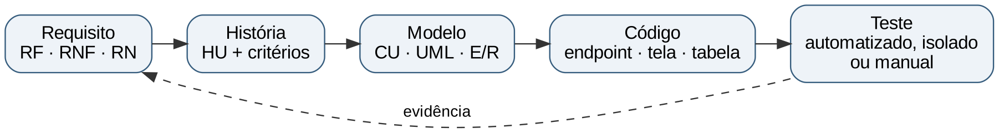{#fig-rastr}

Na verificação de coerência não foram encontradas divergências entre os diagramas e o código nos pontos modelados. As divergências localizadas pela revisão técnica estão em textos de documentação (por exemplo, o comentário do enum sobre o cancelamento, AM1 do Apêndice B) e não nos modelos, que foram gerados do próprio código.

# APÊNDICE D – Backlog priorizado e evidências de gestão


## Introdução

### Finalidade e honestidade das evidências

Este documento é o quarto entregável sugerido pela disciplina: backlog priorizado e evidências de gestão (PROJETO E DESENVOLVIMENTO DE SOFTWARE, [s. d.]). A disciplina pede que o grupo mostre como organizou o trabalho: quadro de tarefas, divisão de responsabilidades, controle de versão e acompanhamento do progresso.

As evidências de gestão que o projeto efetivamente deixou são o **histórico de versionamento** e o código. O repositório não contém registro de reuniões, de planejamento de ciclos (*sprints*), de quadro Kanban, de *issues*, de estimativas ou de retrospectivas, e não foi possível consultar, a partir do ambiente de elaboração, os recursos de gestão que a plataforma GitHub oferece (issues, projetos e pull requests), por restrição de acesso. Por isso, o **backlog e o quadro Kanban deste documento são uma reconstituição a posteriori**, feita a partir do sistema implementado e das pendências identificadas, e não o registro de um acompanhamento real. Cada item reconstituído é identificado como tal, e nenhum dado de esforço, de data de planejamento ou de reunião foi inventado.

### Organização do trabalho

A divisão de papéis entre os integrantes foi informada pelo grupo em 9 de novembro de 2026 e consta da Tabela 43: dois integrantes respondem pelo desenvolvimento e dois pelos testes. Essa divisão **não está registrada no repositório**, de modo que o histórico de versionamento não permite confirmá-la por inteiro (ver D.3.2). As reuniões e os canais de comunicação também não deixaram registro no repositório.

| Integrante | RGM | Frente de trabalho | Atribuições |
|--------------------------|--------------|------------------|-------------------------------------------|
| Henrique de Sousa Cunha | 42873134 | Desenvolvimento | Back-end, front-end, banco de dados, integração com o assistente virtual, implantação e versionamento |
| Pedro Cainan Rodrigues de Paula | 41873891 | Desenvolvimento | Back-end, front-end, banco de dados, integração com o assistente virtual, implantação e versionamento |
| Cauã De Lucca Uema | 42057019 | Testes | Plano, execução e registro dos testes e verificação dos critérios de aceitação |
| Jesús Alejandro Romero Rivero | 42772915 | Testes | Plano, execução e registro dos testes e verificação dos critérios de aceitação |

Table: Divisão de papéis entre os integrantes, conforme informado pelo grupo {#tbl-papeis}

Fonte: Elaborado pelos autores (2026), a partir da informação do grupo em 9 de novembro de 2026.

O README do projeto cita apenas dois integrantes e o histórico registra três identidades de autoria, o que é tratado na D.3.2.

## Cronograma e situação das entregas

A Tabela 44 relaciona as entregas do cronograma da disciplina, com a data de início da semana prevista, a evidência no conjunto de documentos e no repositório, e a situação. As avaliações entre integrantes (avaliações 360) do cronograma não fazem parte deste conjunto, por decisão do grupo.

| Entrega | Prevista | Evidência | Situação |
|-------------------|--------------|---------------------------------------------------|----------------|
| E1 Proposta | 10/08/2026 | Visão e escopo (Apêndice A); README do projeto. Problema, justificativa e nome oficial dependem da confirmação do grupo | PARCIAL |
| E2 Requisitos e casos de uso | 24/08/2026 | 29 requisitos funcionais, 18 não funcionais, 24 regras e 22 casos de uso (Apêndices B e C) | CONCLUÍDO |
| A1 a A3 Visão, requisitos e diagramas UML | 07/09/2026 | Apêndices A, B e C | CONCLUÍDO |
| E3 Modelagem | 14/09/2026 | Diagramas de casos de uso, atividades, sequência, estados e classes (Apêndice C) | CONCLUÍDO |
| E4, A4 e A5 Protótipo das telas e modelo do banco | 21/09/2026 | Quatro páginas do front-end; modelo E/R e dicionário de dados de 91 colunas (Apêndice C) | CONCLUÍDO |
| E5 e A6 MVP e documentação | 28/09/2026 | Front-end publicado por GitHub Pages e API configurada para o Render, com instruções de execução (Apêndice E); a disponibilidade da API em produção não foi verificada por restrição de acesso | PARCIAL |
| A7 Código funcionando | 26/10/2026 | Código versionado, com os fluxos exercitados nos testes do grupo. A configuração de produção não foi verificada (risco R01) | PARCIAL |
| E6 Testes | 02/11/2026 | 52 testes automatizados e verificações do grupo; 14 requisitos sem teste automatizado; `mvn test` não reproduzido pelos autores deste documento (Apêndice F) | PARCIAL |

Table: Entregas do cronograma, evidências e situação em 9 de novembro de 2026 {#tbl-cron}

Fonte: Elaborado pelos autores (2026), com base no cronograma da disciplina e no repositório (EQUIPE DITEC, 2026a).

A situação CONCLUÍDO nas entregas de documentação indica que o documento foi elaborado, não que tenha sido validado pelo grupo: a validação é uma das pendências da Tabela 53.

## Evidências do controle de versão {#sec-vc}

### Histórico do repositório

O repositório do projeto, na versão e58a3d2, contém **20 commits**, entre 14 de agosto e 9 de novembro de 2026, em dois ramos remotos (`main` e `atualizacao-gemini-auditoria`) e uma etiqueta (`backup-pre-troca-agente-ia`, criada antes da troca do agente de inteligência artificial do chatbot). Os commits se distribuem em 8 em agosto, 7 em setembro, 1 em outubro e 4 em novembro. Não há *merge commits* nem pull requests no histórico. A Figura 22 relaciona as entregas previstas aos commits, e a Tabela 45 lista todos eles.

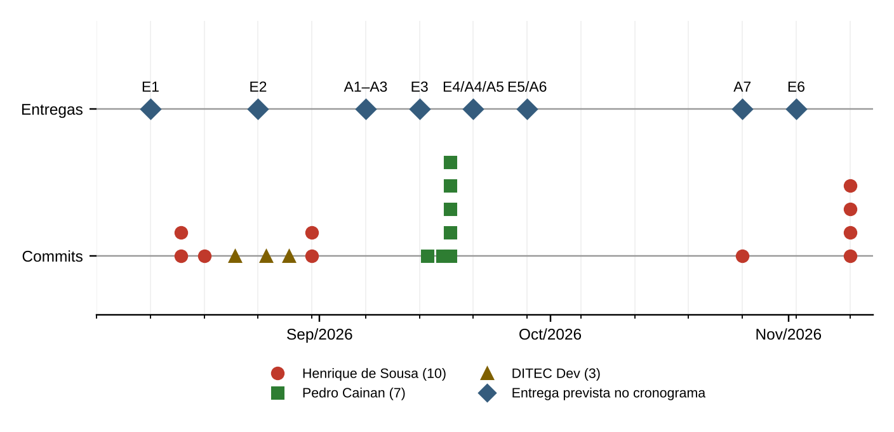{#fig-cron fonte="Elaborado pelos autores (2026), com base no cronograma da disciplina e no histórico do repositório (e58a3d2). A data de cada entrega é a segunda-feira da semana prevista."}

A leitura da Figura 22 mostra três fatos: (a) a maior parte do desenvolvimento do back-end, da autenticação e da publicação (15 dos 20 commits) ocorreu até 18 de setembro, no período das entregas de modelagem e de MVP do cronograma; (b) não há commits entre 19 de setembro e 25 de outubro; e (c) quatro commits de 9 de novembro concentram a troca do agente de inteligência artificial do chatbot, a ignorar arquivos do sistema operacional e a remoção do agente anterior.

| Data | Código | Autoria | Descrição do commit |
|---------------|------------|-----------------------|--------------------------------------------------|
| 14/08/2026 | 2f4ab3a | Henrique de Sousa | Initial commit |
| 14/08/2026 | d6e1ef0 | Henrique de Sousa | Arquivos do Semestre 2026.3 (sem mundanças) |
| 17/08/2026 | 9477be7 | Henrique de Sousa | Novas páginas de cliente e Administrador; adição de imagens das logos "Marcas que Atendemos" |
| 21/08/2026 | 8515d55 | DITEC Dev | Finalização do projeto: backend Spring Boot e MySQL, autenticação JWT, agendamento e OS reais, painel admin completo e relatórios CSV |
| 25/08/2026 | 45dab87 | DITEC Dev | Segunda rodada: corrige bug (listarMinhas usava o id de Usuario em vez de Tecnico) e implementa as três pendências |
| 28/08/2026 | 857ef3e | DITEC Dev | Auditoria e implementação de segurança completa (ver SECURITY.md) |
| 31/08/2026 | 183e64c | Henrique de Sousa | Organização do projeto `--v1` |
| 31/08/2026 | 3255531 | Henrique de Sousa | Create README.md |
| 15/09/2026 | c86a271 | Pedro Cainan | Corrige configuração de segurança e autenticação |
| 17/09/2026 | 684290c | Pedro Cainan | Prepara backend para hospedagem e login por perfil |
| 18/09/2026 | bc022ee | Pedro Cainan | Renomeia pasta do backend para compatibilidade com Render |
| 18/09/2026 | 66d3173 | Pedro Cainan | Conecta frontend ao backend público do Render |
| 18/09/2026 | 93f2d4e | Pedro Cainan | Configura publicação do frontend no GitHub Pages |
| 18/09/2026 | 60d5b66 | Pedro Cainan | Corrige habilitação do GitHub Pages no workflow |
| 18/09/2026 | f004857 | Pedro Cainan | Corrige sintaxe do workflow do GitHub Pages |
| 26/10/2026 | 15c2b99 | Henrique de Sousa | Fix brand image paths |
| 09/11/2026 | c60e962 | Henrique de Sousa | Atualiza projeto: adiciona .gitignore e remove .DS_Store do versionamento |
| 09/11/2026 | 9a7f8de | Henrique de Sousa | Backup antes da troca do agente de IA do chatbot |
| 09/11/2026 | b9e3961 | Henrique de Sousa | Integração do chatbot com Google Gemini API |
| 09/11/2026 | e58a3d2 | Henrique de Sousa | Remoção geral do antigo agente de IA (Hugging Face) |

Table: Commits do repositório, em ordem cronológica {#tbl-commits}

Fonte: Elaborado pelos autores (2026), a partir do histórico do repositório (EQUIPE DITEC, 2026a).

### Autoria dos commits e integrantes {#sec-autoria}

O grupo é formado por quatro integrantes, conforme informado por ele: Pedro Cainan Rodrigues de Paula, Henrique de Sousa Cunha, Cauã De Lucca Uema e Jesús Alejandro Romero Rivero. O histórico registra três identidades de autoria: Henrique de Sousa (10 commits), Pedro Cainan (7) e DITEC Dev (3). O README do projeto cita como equipe Henrique de Sousa Cunha e Caua Uema de Lucca. Portanto, (a) as identidades "Henrique de Sousa" e "Pedro Cainan" correspondem, presumivelmente, a dois integrantes do grupo, e Pedro Cainan Rodrigues de Paula não consta no README; (b) Cauã De Lucca Uema consta no README, com a grafia "Caua Uema de Lucca", mas não aparece com esse nome no histórico; (c) Jesús Alejandro Romero Rivero não aparece no README nem no histórico; e (d) "DITEC Dev" é uma identidade genérica, responsável por três commits de agosto, que o histórico não permite atribuir a um integrante, pois pode corresponder a mais de uma pessoa ou a uma configuração de Git comum à máquina. A ausência do nome de um integrante no histórico não indica ausência de contribuição, que pode ter ocorrido por outros meios ou com outra identidade de autoria. O grupo deve atualizar o README e conciliar as identidades (pendência P07), pois a disciplina avalia a colaboração, e a colaboração só é demonstrável quando o histórico identifica os autores.

### Práticas de versionamento observadas

A Tabela 46 compara as práticas de versionamento recomendadas pela disciplina (PROJETO E DESENVOLVIMENTO DE SOFTWARE, [s. d.]) com as observadas no repositório.

| Prática recomendada | Observação no repositório | Situação |
|----------------------------|----------------------------------------------------|-------------------|
| Repositório remoto compartilhado | Repositório no GitHub, com ramo `main` | CONCLUÍDO |
| Commits pequenos e com mensagens claras | Mensagens descritivas em português na maior parte; há mensagens em inglês e uma com redação genérica ("Create README.md") | PARCIAL |
| Ramos por funcionalidade | Há um ramo de atualização (`atualizacao-gemini-auditoria`); o desenvolvimento ocorreu, em geral, direto em `main` | PARCIAL |
| Pull requests e revisão por outro integrante | Nenhum pull request ou merge no histórico | NÃO IMPLEMENTADO |
| Etiquetas (*tags*) em marcos | Uma etiqueta de backup antes da troca do agente de IA | PARCIAL |
| Arquivos sensíveis fora do versionamento | `.gitignore` e `.env.example`; varredura do histórico sem credencial real | CONCLUÍDO |
| Integração contínua | Há fluxo de publicação do front-end (`deploy-pages.yml`); não há fluxo de compilação e testes | PARCIAL |

Table: Práticas de versionamento recomendadas e observadas {#tbl-git}

Fonte: Elaborado pelos autores (2026), a partir do repositório (EQUIPE DITEC, 2026a).

## Backlog do produto

### Critério de priorização

O backlog do produto é a lista ordenada do que o produto deve ter. A ordenação adotada considera, em primeiro lugar, a prioridade MoSCoW (*Must*, *Should*, *Could*), e, dentro de cada faixa, as dependências entre os itens: um item só pode ser entregue depois daquele de que depende. Os itens são as 20 histórias de usuário do Apêndice B, e a rastreabilidade de cada uma até os requisitos funcionais consta da coluna RF. Não há estimativas de esforço, e as técnicas de estimativa e de priorização numérica, como *planning poker* e matriz valor × esforço, citadas pela disciplina, não foram utilizadas pelo grupo, nem foram inventadas para este documento.

### Backlog reconstituído

Como o sistema já está implementado, todas as 20 histórias estão atendidas. A Tabela 47 apresenta o backlog na ordem de priorização. A coluna "Situação" reflete o estado do código e dos testes em 9 de novembro de 2026, e não o registro de um acompanhamento real.

| ID | Item | MoSCoW | RF | Depende de | Situação |
|--------|------------------------------------------|-----------|-----------|-------------|---------------|
| HU02 | Como visitante, quero escolher um horário livre e solicitar uma visita técnica sem criar conta | Must | RF05, RF06 | — | CONCLUÍDO |
| HU03 | Como visitante, quero consultar o andamento da minha ordem de serviço com o protocolo e o telefone | Must | RF09 | RF06 | CONCLUÍDO |
| HU05 | Como visitante, quero criar uma conta de cliente | Must | RF01 | — | CONCLUÍDO |
| HU08 | Como cliente, quero aprovar ou recusar o orçamento | Must | RF25 | RF24 | CONCLUÍDO |
| HU09 | Como cliente, quero consultar minhas ordens de serviço e o histórico de cada uma | Must | RF10 | RF06 | CONCLUÍDO |
| HU11 | Como técnico, quero ver as ordens de serviço atribuídas a mim | Must | RF10 | RF06 | CONCLUÍDO |
| HU12 | Como técnico, quero atualizar o status da OS seguindo o fluxo previsto | Must | RF11 | RF06 | CONCLUÍDO |
| HU13 | Como técnico, quero registrar o diagnóstico e o orçamento | Must | RF24 | RF11 | CONCLUÍDO |
| HU15 | Como técnico, quero finalizar a OS com valor, pagamento, peças e descrição | Must | RF12 | RF11 | CONCLUÍDO |
| HU16 | Como administrador, quero confirmar agendamentos e atribuir técnico | Must | RF18, RF28 | RF06, RF20 | CONCLUÍDO |
| HU19 | Como administrador, quero gerir técnicos e serviços | Must | RF20, RF21 | RF02 | CONCLUÍDO |
| HU06 | Como cliente, quero entrar na minha conta e manter o endereço atualizado | Should | RF02, RF03, RF04 | RF01 | CONCLUÍDO |
| HU07 | Como cliente, quero listar, alterar e cancelar meus agendamentos ainda não iniciados | Should | RF07, RF08 | RF06 | CONCLUÍDO |
| HU10 | Como cliente, quero avaliar o atendimento concluído | Should | RF13 | RF12 | CONCLUÍDO |
| HU14 | Como técnico, quero registrar observações e a previsão de conclusão | Should | RF26, RF27 | RF10 | CONCLUÍDO |
| HU17 | Como administrador, quero acompanhar o painel e filtrar todas as ordens de serviço | Should | RF16, RF19 | RF02, RF06 | CONCLUÍDO |
| HU18 | Como administrador, quero cancelar uma OS informando o motivo | Should | RF29 | RF11 | CONCLUÍDO |
| HU01 | Como visitante, quero verificar se o meu CEP ou bairro é atendido | Could | RF23 | — | CONCLUÍDO |
| HU04 | Como visitante, quero tirar dúvidas com um assistente virtual | Could | RF15 | — | CONCLUÍDO |
| HU20 | Como administrador, quero consultar clientes e exportar relatórios em CSV | Could | RF17, RF22 | RF02 | CONCLUÍDO |

Table: Product Backlog priorizado (reconstruído a posteriori) {#tbl-backlog}

Fonte: Elaborado pelos autores (2026).


A distribuição é de 11 histórias *Must*, 6 *Should* e 3 *Could*. Os itens de evolução futura e as pendências que ainda exigem trabalho estão nas seções de pendências e de evolução futura, abaixo.

### Quadro Kanban reconstituído

O Kanban organiza o trabalho em colunas que representam o fluxo, limitando o que está em andamento. A Tabela 48 reconstitui, para 9 de novembro de 2026, a posição de cada item nas colunas. Foi montada a partir do estado do sistema e das pendências, e não de um quadro real, razão pela qual as colunas "Em andamento" e "Em revisão" estão vazias: não há registro de trabalho em curso nem de revisões.

| Backlog (futuro) | A fazer (pendências) | Em andamento | Em revisão | Concluído |
|----------------------|-------------------------|--------------|-------------|--------------------------|
| F01 Recuperação de senha; F02 Notificações; F03 Pagamento online; F04 Nota fiscal; F05 Aplicativo móvel | P01 a P14 (ver Tabela 53) | Nenhum item registrado | Nenhum item registrado | HU01 a HU20 (20 histórias de usuário) |

Table: Quadro Kanban reconstituído em 9 de novembro de 2026 {#tbl-kanban}

Fonte: Elaborado pelos autores (2026), reconstituição a partir do sistema implementado e das pendências.

Para que o quadro deixe de ser reconstituição, o grupo pode adotar o recurso de projetos do GitHub, com as cinco colunas acima, um limite de itens simultâneos por integrante e a vinculação de cada cartão a uma *issue* e a um pull request. Essa adoção é uma recomendação e não está implementada.

### Elementos do Scrum e evidências

O Guia do Scrum define três artefatos (backlog do produto, backlog do ciclo e incremento), cada um com um compromisso (meta do produto, meta do ciclo e definição de pronto), e cinco eventos (o próprio ciclo, o planejamento, a reunião diária, a revisão e a retrospectiva) (SCHWABER; SUTHERLAND, 2020). A disciplina apresenta o Scrum e o Kanban como referências de organização do trabalho. A Tabela 49 indica o que o projeto evidencia de cada elemento.

| Elemento do Scrum | Evidência no projeto | Situação |
|----------------------------|----------------------------------------------------|-------------------|
| Backlog do produto | Reconstituído neste documento (20 histórias priorizadas) | PARCIAL |
| Backlog do ciclo | Sem registro | NÃO IMPLEMENTADO |
| Incremento | O sistema em hospedagem pública e o código versionado | CONCLUÍDO |
| Meta do produto | Proposta no Apêndice A, a confirmar pelo grupo | PARCIAL |
| Definição de pronto | Proposta na D.5, ainda não adotada | PARCIAL |
| Ciclos, planejamento, reunião diária, revisão e retrospectiva | Sem registro; o ritmo de entregas foi o do cronograma semanal da disciplina | NÃO IMPLEMENTADO |

Table: Elementos do Scrum e evidências no projeto {#tbl-scrum}

Fonte: Elaborado pelos autores (2026), com base em Schwaber e Sutherland (2020) e no repositório (EQUIPE DITEC, 2026a).

## Definição de pronto {#sec-dod}

A definição de pronto é o critério comum que um item deve atender para ser considerado concluído. A lista abaixo é uma **proposta** deste documento para adoção pelo grupo, redigida a partir das práticas que o sistema já demonstra e das lacunas encontradas. A Tabela 50 confronta cada critério com a situação atual.

a) O código compila e a suíte automatizada executa sem falhas (`mvn test`).
b) Os critérios de aceitação da história de usuário foram verificados e registrados.
c) Mudanças de esquema entram por migração Flyway versionada, com roteiro de reversão testado.
d) Nenhuma credencial, chave ou dado pessoal real é versionado; a varredura de segredos não encontra ocorrências.
e) Entradas são validadas e a autorização é verificada no servidor.
f) A interface não apresenta violações automatizadas de acessibilidade (axe-core) nos fluxos alterados.
g) A documentação (requisitos, modelos, instruções de execução) reflete o comportamento implementado.
h) A mudança é revisada por outro integrante e integrada ao ramo principal por pull request.

| Critério | Situação atual | Evidência ou lacuna | Situação |
|----------------------|--------------------------------|---------------------------|-------------------|
| a) Compila e a suíte passa | 52 testes, aprovados segundo o relatório do grupo; execução não reproduzida pelos autores deste documento | Pendência P02 | PARCIAL |
| b) Critérios de aceitação verificados | 15 dos 29 requisitos funcionais têm teste automatizado | Pendência P08 | PARCIAL |
| c) Migração versionada e reversão testada | Migrações Flyway V1 e V2 em uso; o roteiro de reversão da V2 não cobre dois índices e não foi testado | Achado N-03 (pendência P04) | PARCIAL |
| d) Sem credenciais versionadas | Varredura sem ocorrência real; uma ocorrência é texto de exemplo | Pendência P03 (revogação de chaves antigas) | CONCLUÍDO |
| e) Validação e autorização no servidor | Bean Validation, tratamento padronizado de erros e autorização por perfil | RNF08 e RNF03 | CONCLUÍDO |
| f) Sem violações de acessibilidade automatizadas | Zero violações em 22 cenários, segundo o relatório do grupo | RNF16 (revisão manual pendente, P10) | CONCLUÍDO |
| g) Documentação reflete o comportamento | Há divergências textuais conhecidas (README, SECURITY, regra de cancelamento) | Achados N-02 e N-08 | PARCIAL |
| h) Revisão por outro integrante e pull request | Nenhum pull request no histórico | Seção D.3 deste documento | NÃO IMPLEMENTADO |

Table: Definição de pronto proposta e situação atual de cada critério {#tbl-dod}

Fonte: Elaborado pelos autores (2026), a partir do repositório (EQUIPE DITEC, 2026a) e da revisão técnica (EQUIPE DITEC, 2026c).

## Riscos

A gestão de riscos identifica, para cada ameaça ao projeto, a probabilidade, o impacto e a resposta. A Tabela 51 registra os riscos identificados na revisão técnica do código (EQUIPE DITEC, 2026c). A escala de probabilidade e impacto (baixa, média, alta) é qualitativa e foi atribuída pelos autores deste documento, para validação do grupo.

| ID | Risco | Prob. | Impacto | Mitigação | Situação |
|------|-----------------------------|-------|---------|----------------------------------|---------------|
| R01 | A API pública inicia com perfil de desenvolvimento e contas de demonstração, por ausência de DITEC_PROFILE=prod no contêiner. | Média | Alta | Definir DITEC_PROFILE=prod e DITEC_SEED_ENABLED=false no serviço de hospedagem e verificar /actuator/health (achado N-01). | PENDENTE |
| R02 | Exposição de credenciais (chaves de IA, senha de banco, segredo JWT). | Média | Alta | .gitignore e .env.example; varredura do histórico sem ocorrência real; revogar chaves antigas ou compartilhadas. | PARCIAL |
| R03 | Indisponibilidade ou limite de uso do provedor de IA. | Alta | Baixa | Resposta automática de FAQ, pausa temporária das chamadas, modelo alternativo e novas tentativas limitadas. | CONCLUÍDO |
| R04 | Falha parcial da migração V2 em banco com dados (valor de OS negativo ou SGBD sem DROP CHECK). | Baixa | Média | Pré-checagem, backup e roteiro de reversão corrigido, propostos em patch ainda não aplicado. | PENDENTE |
| R05 | Acesso indevido a OS de visitante por vinculação por telefone no cadastro (janela de 24 h). | Baixa | Média | Decisão do grupo: exigir o protocolo ou confirmar a posse do telefone (achado N-06). | PENDENTE |
| R06 | Política de privacidade não menciona o envio do conteúdo do chat à Google nem o armazenamento em chat_log. | Média | Média | Revisar o texto da política (achado N-07). | PENDENTE |
| R07 | Descontinuação do modelo de IA configurado. | Média | Baixa | Modelo e modelo alternativo configuráveis por variável de ambiente. | CONCLUÍDO |
| R08 | Requisitos sem teste automatizado regridem sem serem percebidos. | Média | Média | Ampliar a suíte para os requisitos sem cobertura; executar regressão a cada mudança (Apêndice F). | PENDENTE |
| R09 | Documentação divergente do código (por exemplo, referências residuais ao provedor de IA anterior). | Alta | Baixa | Patch de documentação preparado e validado, aguardando autorização para aplicação. | PENDENTE |
| R10 | Limitação de requisições em memória, por janela fixa, não distribuída entre instâncias. | Baixa | Baixa | Decisão técnica registrada no código; revisar ao escalar para mais de uma instância. | CONCLUÍDO |

Table: Registro de riscos {#tbl-riscos}

Fonte: Elaborado pelos autores (2026).


## Decisões técnicas

As decisões abaixo são as que o código e os comentários evidenciam. A coluna de observação registra o motivo e a consequência de cada uma. Quando o motivo não consta no repositório, isso é dito, e não foi inventada justificativa.

| ID | Decisão | Justificativa | Evidência |
|------|-----------------------------|------------------------------------|----------------------------|
| D01 | Autenticação por JWT sem estado, com CSRF desabilitado. | Não há cookie de autenticação; a credencial trafega no cabeçalho Authorization. A decisão deve ser revista caso se adote cookies. | Comentário em SecurityConfig |
| D02 | Limitação de requisições por contador de janela fixa, em memória. | Simplicidade para instância única; registrada como decisão técnica. | Comentário em RateLimitFilter |
| D03 | Migrações incrementais (V2) em vez de recriar o esquema. | Preserva os dados existentes; converte EM_ATENDIMENTO em EM_MANUTENCAO. | V2__rastreamento_os.sql |
| D04 | Troca do provedor de IA do chatbot (Hugging Face para Google Gemini), mantendo o contrato com o front-end. | A conta do provedor anterior estava sem créditos (HTTP 402). | Relatório do grupo; commit b9e3961 |
| D05 | Resposta automática de FAQ quando a IA não está disponível. | Mantém o chat funcional a qualquer hora. | ChatFallbackService; relatório do grupo |
| D06 | Emissão de nota fiscal eletrônica fora do escopo. | Apenas o número do comprovante é registrado na OS. | Relatório do grupo (seção 4) |
| D07 | Páginas internas (conta, técnico, admin) com noindex. | Evita a indexação de painéis privados; reduz a nota de SEO no Lighthouse. | Relatório do grupo (seção 7) |
| D08 | Front-end estático no GitHub Pages e API em contêiner no Render. | Publicação simples e separação entre apresentação e regras de negócio. | deploy-pages.yml; Dockerfile; commits de 17 e 18/09/2026 |
| D09 | Rastreamento por protocolo e telefone, via POST; rota antiga apenas por protocolo removida. | Evita que terceiros consultem OS apenas pelo protocolo. | AgendamentoFlowIT.endpointAntigoDeRastreioSoComProtocoloFoiRemovido |
| D10 | CONCLUIDO apenas pela finalização, exigindo EM_TESTES. | Garante valor, pagamento e descrição do serviço na conclusão. | StatusOS; OrdemServicoService |

Table: Registro de decisões técnicas e de escopo {#tbl-decisoes}

Fonte: Elaborado pelos autores (2026).


## Pendências

A Tabela 53 reúne as pendências para as quais o trabalho ainda é necessário. Nenhuma delas foi executada de forma unilateral: as que alteram o repositório, o serviço de hospedagem ou as chaves de acesso dependem da autorização do grupo.

| ID | Item | Origem | Prior. | Situação |
|------|---------------------------------------------------|---------------|--------|-------------------|
| P01 | Conferir a configuração de produção no serviço de hospedagem (perfil, semeador, CORS, segredos). | N-01 | Alta | PENDENTE |
| P02 | Reproduzir `mvn test` (52 testes) em ambiente com acesso ao Maven Central e anexar a saída. | Limitação da revisão | Alta | PENDENTE |
| P03 | Revogar a chave antiga do provedor anterior e qualquer chave de IA compartilhada fora do arquivo .env. | Varredura de segredos | Alta | PENDENTE |
| P04 | Aplicar, após autorização do grupo, o patch de documentação (README, SECURITY e roteiro de reversão da V2). | N-02 a N-05 | Média | PENDENTE |
| P05 | Decidir a regra de vinculação de agendamentos de visitante por telefone. | N-06 | Média | PENDENTE |
| P06 | Atualizar a política de privacidade (envio do chat à Google; data de atualização). | N-07 | Média | PENDENTE |
| P07 | Conciliar a autoria dos commits com os quatro integrantes do grupo e atualizar o README, que cita dois. | A-10 | Média | PENDENTE |
| P08 | Ampliar os testes automatizados aos requisitos sem cobertura: RF03, RF04, RF05, RF07, RF08, RF13, RF14, RF16, RF17, RF18, RF20, RF21, RF22, RF23. | Cobertura de testes | Média | PENDENTE |
| P09 | Implantar pipeline de integração contínua (compilação e testes a cada push), conforme proposta do Apêndice E. | Disciplina (CI) | Média | NÃO IMPLEMENTADO |
| P10 | Realizar avaliação manual de acessibilidade com leitor de tela. | Relatório do grupo | Média | PENDENTE |
| P11 | Harmonizar textos divergentes (modelo de IA padrão; regra de cancelamento em EM_TESTES). | N-08 | Baixa | PENDENTE |
| P12 | Remover index.html.bak do versionamento, revisar a versão do pom.xml e localizar o DRS citado no código. | A-09, A-11 | Baixa | PENDENTE |
| P13 | Capturar telas autenticadas (cliente, técnico e administrador) com dados de teste, como evidência de demonstração. | Evidências | Baixa | PENDENTE |
| P14 | Documentar a implantação no Render e a criação do primeiro administrador em produção, procedimentos que o repositório não traz. | Instruções de execução | Média | PENDENTE |

Table: Pendências técnicas e documentais do backlog {#tbl-pend}

Fonte: Elaborado pelos autores (2026).


## Evolução futura

As funcionalidades abaixo não existem no código nem fazem parte do escopo declarado. São candidatas a versões futuras, sem prioridade nem estimativa definidas.

| ID | Funcionalidade | Constatação |
|------|--------------------------------------------|--------------------------------------------------|
| F01 | Recuperação de senha | Não há endpoint nem tela correspondentes. |
| F02 | Notificações ao cliente (e-mail ou mensagem) a cada mudança de status | Não há integração de envio no código. |
| F03 | Pagamento online | A forma de pagamento é apenas registrada na OS. |
| F04 | Emissão de nota fiscal eletrônica | Declarada fora do escopo pelo grupo. |
| F05 | Aplicativo móvel | Não há projeto móvel no repositório. |

Table: Funcionalidades não implementadas, candidatas a versões futuras {#tbl-futuro}

Fonte: Elaborado pelos autores (2026).


## Evolução a partir de revisões e *feedback*

A disciplina avalia a evolução do projeto a partir do *feedback*. O repositório e os documentos mostram os seguintes ciclos de revisão e de correção:

a) a **auditoria de segurança** interna de 28/08/2026 (commit 857ef3e, que resultou no arquivo SECURITY.md) e a correção da configuração de segurança e de autenticação de 15/09/2026 (commit c86a271);

b) a **segunda rodada** de 25/08/2026 (commit 45dab87), que corrigiu um defeito identificado (a listagem de OS do técnico usava o identificador do usuário em vez do do técnico);

c) o **ciclo de correções do grupo**, documentado no relatório de 9 de novembro de 2026 (EQUIPE DITEC, 2026b), com os resultados de testes, de acessibilidade, de desempenho e do chatbot;

d) a **troca do agente de inteligência artificial** em 9/11/2026 (commits 9a7f8de, b9e3961 e e58a3d2), com a etiqueta de backup que permite reverter a mudança;

e) a **revisão técnica** do código atualizado (EQUIPE DITEC, 2026c), que gerou os achados N-01 a N-08 e A-09 a A-11, em grande parte convertidos nas pendências da Tabela 53.

Não há registro de *feedback* de usuários finais nem de professores no repositório.

# APÊNDICE E – Código, banco de dados e instruções de execução


## Introdução

### Finalidade

Este documento é o quinto entregável sugerido pela disciplina: o código versionado, o banco de dados e as instruções para executar o projeto (PROJETO E DESENVOLVIMENTO DE SOFTWARE, [s. d.]). O objetivo é que uma pessoa que não participou do desenvolvimento consiga obter o código, preparar o banco, configurar o ambiente, executar o sistema e verificar que ele funciona.

### Limites e convenções

As informações foram extraídas do repositório na versão e58a3d2 (EQUIPE DITEC, 2026a). Os comandos reproduzem o que o próprio repositório documenta (README, `run-local.sh`, `Dockerfile` e `deploy-pages.yml`). **Não foi possível executar `mvn test` nem a compilação do back-end no ambiente de elaboração deste documento**, que não alcançava o repositório central de dependências do Maven; a execução dos testes é, portanto, uma pendência (P02 do Apêndice D), e os resultados citados no Apêndice F são os relatados pelo grupo. O serviço publicado no Render também não pôde ser consultado, de modo que a configuração de produção é apresentada como lista de verificação (seção E.6), e não como fato comprovado.

Nenhum valor de credencial (senha de banco, segredo JWT, chave de IA) aparece neste documento: as variáveis de ambiente são descritas por nome e finalidade, e os exemplos usam marcadores entre sinais de menor e maior, como <SENHA-DO-BANCO>.

## Código versionado

### Estrutura do repositório

O repositório do projeto reúne o front-end, o back-end, os arquivos do banco de dados, a automação de testes de qualidade e a documentação, conforme a Tabela 55.

| Pasta ou arquivo | Conteúdo |
|-------------------------------------|---------------------------------------------------------------|
| `Código-fonte/` | Front-end estático: `index.html`, `conta.html`, `tecnico.html`, `admin.html`, `styles.css`, scripts (`script.js`, `conta.js`, `tecnico.js`, `admin.js`, `dashboard-shared.js`, `os-equipe.js`, `config.js`), imagens e documentos do front-end (`README.md`, `SECURITY.md`) |
| `Prototipos/backend/` | Back-end Spring Boot: `pom.xml`, `Dockerfile`, `run-local.sh`, `.env.example` e o código em `src/main` e `src/test` |
| `Banco de Dados/database/` | Cópias de leitura do esquema (`schema.sql`, `V2__rastreamento_os.sql`), o script de criação do banco e do usuário e o README do banco |
| `.github/workflows/` | `deploy-pages.yml`, que publica o front-end no GitHub Pages |
| `qa/` | Scripts de qualidade do grupo (acessibilidade, teclado, interface, Lighthouse, fluxo da OS e latência do chat) e seus relatórios |
| `docs/` | Documentação do projeto, inclusive o relatório de correções do grupo |
| `README.md` | Apresentação do projeto |

Table: Estrutura do repositório {#tbl-pastas}

Fonte: Elaborado pelos autores (2026), a partir do repositório (EQUIPE DITEC, 2026a).

As migrações que o Flyway executa estão em `Prototipos/backend/src/main/resources/db/migration/` (`V1__schema.sql` e `V2__rastreamento_os.sql`). Os arquivos da pasta `Banco de Dados/database/` são cópias para leitura; **a fonte de verdade é a pasta de migrações do back-end**.

### Estrutura do back-end

O pacote principal `com.ditec.assistencia` organiza o código em camadas, conforme a Tabela 56. Os números correspondem aos arquivos Java de produção; os 10 arquivos de teste ficam em `src/test`.

| Pacote | Arquivos | Responsabilidade |
|------------------------|--------------|-------------------------------------------------------------|
| `controller` | 7 | Rotas REST: `AuthController`, `ClienteController`, `AgendamentoController`, `OrdemServicoController`, `ServicoController`, `ChatController`, `AdminController` |
| `service` | 15 | Regras de negócio, mapeadores, relatórios CSV e, no subpacote `ia`, o cliente da Gemini API |
| `repository` | 9 | Acesso a dados (Spring Data JPA) |
| `entity` | 9 | Entidades persistentes, que correspondem às tabelas |
| `enums` | 5 | Enumerações, entre elas `StatusOS`, que concentra a matriz de transições |
| `security` | 6 | Filtros de JWT e de limite de requisições, utilitário de token e detalhes do usuário |
| `config` | 4 | Segurança, CORS, propriedades da IA e cliente HTTP |
| `exception` | 7 | Exceções de domínio e tratamento global de erros |
| `seed` | 1 | `DataSeeder`, que cria dados de demonstração em desenvolvimento |
| `dto` | — | Objetos de requisição e resposta |

Table: Pacotes do back-end e responsabilidades {#tbl-pacotes}

Fonte: Elaborado pelos autores (2026), a partir do código-fonte (EQUIPE DITEC, 2026a).

### Tecnologias e versões

A Tabela 57 relaciona as tecnologias do projeto e as versões declaradas no repositório.

| Componente | Tecnologia | Versão ou observação |
|-------------------|-----------------------------------|----------------------------------------------|
| Linguagem | Java | 21 (`pom.xml` e `Dockerfile`) |
| Framework | Spring Boot | 3.5.16 (`spring-boot-starter-parent`) |
| Web, persistência e validação | Spring Web, Spring Data JPA e Bean Validation | Gerenciadas pelo Spring Boot |
| Segurança | Spring Security e JJWT | JJWT 0.12.7; senhas com BCrypt |
| Banco de dados | MySQL | 8.x (mínimo 8.0.16, por causa do `DROP CHECK` da migração V2) |
| Migrações | Flyway (`flyway-core` e `flyway-mysql`) | Gerenciado pelo Spring Boot |
| Monitoramento | Spring Boot Actuator | Somente `health` exposto |
| Testes | JUnit 5, Spring Boot Test, Spring Security Test e H2 | Testes de integração com MockMvc e banco em memória |
| Contêiner | Docker | Estágio de compilação com Maven 3.9.11 e Temurin 21; execução com a imagem JRE 21 |
| Front-end | HTML, CSS e JavaScript | Sem framework e sem Node para executar |
| Hospedagem | Render (API) e GitHub Pages (front-end) | Planos gratuitos |
| IA do chatbot | Google Gemini API | Modelo padrão `gemini-3.5-flash-lite`, alternativo `gemini-2.5-flash-lite` |

Table: Tecnologias e versões {#tbl-tec}

Fonte: Elaborado pelos autores (2026), a partir do `pom.xml`, do `Dockerfile` e das configurações (EQUIPE DITEC, 2026a).

### Catálogo da API

A API expõe 42 rotas, sob o prefixo `/api`, mais a rota de saúde `/actuator/health`. A Tabela 58 as agrupa por controller; o detalhe de cada rota, com perfil, requisitos, regras e testes, está na matriz de rastreabilidade do Apêndice F, e os critérios de resposta (códigos HTTP), no Apêndice B.

| Controller | Rotas | Perfil de acesso | Requisitos |
|-------------------------|------------------------------|---------------------------|------------------|
| `AuthController` | 3 (`/api/auth/register`, `login`, `me`) | Público (cadastro e entrada); autenticado (`me`) | RF01 a RF03 |
| `ClienteController` | 3 (`/api/clientes/me` e agendamentos) | Cliente | RF04, RF08 |
| `AgendamentoController` | 5 (`/api/agendamentos`) | Público (disponibilidade e criação); dono ou administrador (consulta, alteração e cancelamento) | RF05 a RF07 |
| `OrdemServicoController` | 10 (`/api/ordens-servico`) | Público (rastreio); cliente, técnico e administrador conforme a rota | RF09 a RF13, RF24 a RF27, RF29 |
| `ServicoController` | 1 (`/api/servicos`) | Público | RF14 |
| `ChatController` | 1 (`/api/chat`) | Público, com limite de requisições | RF15 |
| `AdminController` | 19 (`/api/admin`) | Administrador | RF16 a RF22, RF28 |

Table: Rotas da API por controller {#tbl-api}

Fonte: Elaborado pelos autores (2026), a partir dos controllers (EQUIPE DITEC, 2026a).

## Pré-requisitos

Para executar o sistema localmente são necessários: Java 21 (JDK); Maven 3.9 ou superior; MySQL 8.0.16 ou superior; um navegador moderno; e um servidor estático para o front-end (por exemplo, a extensão Live Server do VS Code), pois o front-end é HTML, CSS e JavaScript e não requer Node. A chave da Google Gemini API é **opcional**: sem ela, o chatbot responde em modo automático, com texto de perguntas frequentes. Para executar em contêiner, é necessário o Docker.

## Execução local

### Passo 1: obter o código

```bash
git clone https://github.com/wikimiwi/DITEC-Landing-Page-main--v2.git
cd DITEC-Landing-Page-main--v2
```

### Passo 2: criar o banco de dados e o usuário

Com o MySQL em execução, o script do repositório cria o banco `ditec_assistencia` (conjunto de caracteres `utf8mb4`) e o usuário de acesso. **Antes de executar, abra o script e troque a senha de exemplo por uma senha própria**, que deverá ser a mesma da variável `DB_PASSWORD`.

```bash
mysql -u root -p < "Banco de Dados/database/00-criar-banco-e-usuario.sql"
```

Não é necessário executar `schema.sql`: o Flyway cria as tabelas na primeira execução do back-end.

### Passo 3: configurar as variáveis de ambiente

```bash
cd Prototipos/backend
cp .env.example .env
# edite o arquivo .env e preencha, no mínimo, DB_PASSWORD e JWT_SECRET
```

O arquivo `.env` não é versionado (consta do `.gitignore`). O segredo do JWT deve ter no mínimo 32 caracteres e pode ser gerado com `openssl rand -base64 48`. A Tabela 59 descreve as variáveis; os valores não são reproduzidos.

| Variável | Obrigatória | Padrão (quando há) | Finalidade |
|--------------------------|-------------|--------------------------|-----------------------------------|
| `DITEC_PROFILE` | Não | `dev` | Perfil ativo: `dev` (local) ou `prod` (hospedagem) |
| `DB_URL` | Não | MySQL local, banco `ditec_assistencia` | URL JDBC do banco |
| `DB_USERNAME` | Não | `ditec_user` | Usuário do banco |
| `DB_PASSWORD` | **Sim** | Nenhum | Senha do banco; a aplicação não inicia sem ela |
| `JWT_SECRET` | **Sim** | Nenhum | Segredo de assinatura do token (mínimo 32 caracteres) |
| `JWT_EXPIRATION_MINUTES` | Não | 120 | Validade do token, em minutos |
| `FRONTEND_URL` | Em produção | Origens locais (portas 5500 e 5501) | URL pública do front-end, liberada no CORS |
| `DITEC_ALLOWED_ORIGINS` | Não | — | Lista de origens separadas por vírgula; tem prioridade sobre `FRONTEND_URL` |
| `GEMINI_API_KEY` | Não | Vazia | Chave da Gemini API; vazia, o chatbot usa respostas automáticas |
| `GEMINI_MODEL` | Não | `gemini-3.5-flash-lite` | Modelo principal da IA |
| `GEMINI_FALLBACK_MODEL` | Não | `gemini-2.5-flash-lite` | Modelo alternativo |
| `GEMINI_API_URL`, `GEMINI_READ_TIMEOUT_MS` e outras `GEMINI_*` | Não | Ver `application.yml` | Endereço, tempos limite e parâmetros de geração |
| `DITEC_SEED_ENABLED` | Não | `true` | Cria dados de demonstração quando não há administrador (desativado no perfil `prod`) |
| `DITEC_RATELIMIT_ENABLED` | Não | `true` | Limite de requisições por origem e rota |
| `DITEC_TRUST_PROXY` | Não | `false` (padrão), `true` no perfil `prod` | Considera o cabeçalho `X-Forwarded-For`; só deve ser verdadeiro atrás de proxy confiável |
| `PORT` e `JAVA_OPTS` | Não | `PORT` 8080 | Usadas pelo `Dockerfile` (porta e opções da JVM) |

Table: Variáveis de ambiente do back-end {#tbl-env}

Fonte: Elaborado pelos autores (2026), a partir de `.env.example`, `application.yml`, `application-prod.yml` e `Dockerfile` (EQUIPE DITEC, 2026a).

### Passo 4: iniciar o back-end

A forma mais simples é o script do repositório, que carrega o `.env`, compila sem executar os testes e inicia uma cópia do arquivo JAR:

```bash
./run-local.sh
```

Alternativamente, com as variáveis já exportadas no ambiente:

```bash
mvn spring-boot:run
```

Na primeira execução, o Flyway aplica as migrações V1 e V2 e, no perfil de desenvolvimento, o `DataSeeder` cria dados de demonstração (administrador, técnico, cliente, serviços, agendamento e OS de exemplo) se ainda não houver administrador. As credenciais das contas de demonstração estão no README do projeto e não são reproduzidas aqui. O back-end fica disponível em `http://localhost:8080`.

Para verificar, a rota de saúde deve responder com o estado `UP`:

```bash
curl http://localhost:8080/actuator/health
```

### Passo 5: iniciar o front-end

O front-end deve ser servido por um servidor estático, e não aberto como arquivo, para que as chamadas à API e o CORS funcionem. Com o Live Server, abra a pasta `Código-fonte` e inicie o servidor na porta 5500 ou 5501, que são as origens liberadas por padrão no CORS. O arquivo `config.js` detecta o ambiente: em `localhost` ou `127.0.0.1`, a API é `http://localhost:8080`; em qualquer outro endereço, é a API publicada no Render. Qualquer outro servidor estático pode ser usado, desde que sua origem seja informada em `DITEC_ALLOWED_ORIGINS`.

### Passo 6: executar os testes automatizados

```bash
cd Prototipos/backend
mvn test
```

O Maven executa as classes `*Test`, `*Tests` e `*IT` (configuração do `maven-surefire-plugin` no `pom.xml`), com banco H2 em memória e o perfil de teste, que desliga o limite de requisições. O grupo relata 52 testes aprovados (Apêndice F). Esta execução **não foi reproduzida** pelos autores deste documento, por falta de acesso ao repositório de dependências.

### Execução em contêiner

O `Dockerfile` compila o projeto em um estágio com Maven e Java 21 e executa o JAR em uma imagem JRE 21, na porta indicada por `PORT` (padrão 8080). As variáveis da Tabela 59 são fornecidas no comando de execução. Exemplo, sem valores:

```bash
cd Prototipos/backend
docker build -t ditec-api .
docker run --rm -p 8080:8080 \
  -e DITEC_PROFILE=prod \
  -e DB_URL="<URL-JDBC-DO-BANCO>" -e DB_USERNAME="<USUARIO>" -e DB_PASSWORD="<SENHA-DO-BANCO>" \
  -e JWT_SECRET="<SEGREDO-COM-32-CARACTERES-OU-MAIS>" \
  -e FRONTEND_URL="<URL-PUBLICA-DO-FRONT-END>" \
  ditec-api
```

O `Dockerfile` não define `DITEC_PROFILE`; sem a variável, o perfil é `dev` (achado N-01, tratado na seção E.6).

## Migrações do banco de dados {#sec-migr}

O esquema é versionado pelo Flyway, que registra as migrações aplicadas na tabela `flyway_schema_history` e executa, em ordem, as que ainda não foram aplicadas. As migrações do projeto são duas:

a) `V1__schema.sql` cria as 9 tabelas, com 83 colunas, as chaves primárias e estrangeiras, as restrições CHECK e os índices;

b) `V2__rastreamento_os.sql` é incremental e preserva os dados: acrescenta 8 colunas (diagnóstico, orçamento, previsão e data de entrega em `ordem_servico`; tipo, usuário e visibilidade em `timeline_os`), amplia o domínio de status da OS para 10 valores, converte `EM_ATENDIMENTO` em `EM_MANUTENCAO` e cria dois índices.

O modelo resultante (91 colunas, 13 chaves estrangeiras, 11 restrições CHECK) está no Apêndice C. Foram identificadas três limitações da V2, com a respectiva orientação (achados N-03 a N-05 da revisão técnica, EQUIPE DITEC, 2026c).

### Antes de aplicar a V2 em um banco com dados

1. **Versão do servidor:** MySQL 8.0.16 ou superior. A V2 usa `ALTER TABLE ... DROP CHECK`, sintaxe exclusiva do MySQL; no MariaDB a migração falha por erro de sintaxe (N-05).
2. **Cópia de segurança:** gerar um *dump* completo antes de migrar. O DDL do MySQL não é transacional, de modo que, se a V2 falhar no meio, as alterações já executadas permanecem e o Flyway registra a falha. A recuperação segura é restaurar a cópia, corrigir os dados e aplicar a V2 novamente (N-04).
3. **Pré-checagem de dados:** a V1 não impedia valores negativos em `ordem_servico.valor`, e a V2 cria a restrição `ck_os_valor` (`valor >= 0`). A consulta abaixo deve devolver `0`; caso contrário, os registros devem ser corrigidos antes (N-04).

```sql
SELECT COUNT(*) FROM ordem_servico WHERE valor < 0;
```

```bash
mysqldump --single-transaction ditec_assistencia > backup.sql
```

### Roteiro de reversão da V2 corrigido

O roteiro de reversão do README do banco não removia os índices `idx_os_criado_em` e `idx_timeline_os_data`, e reaplicar a V2 depois da reversão falhava com erro de nome de índice duplicado (N-03). Esse defeito foi reproduzido e a correção foi validada em uma instância MariaDB de teste, com adaptação do comando `DROP CHECK` (42 verificações aprovadas, ver Apêndice F). O roteiro corrigido é o do README, acrescido de duas linhas antes da última instrução:

```sql
-- ... instruções do README, até o ADD CONSTRAINT / DROP COLUMN de ordem_servico ...
DROP INDEX idx_os_criado_em ON ordem_servico;
DROP INDEX idx_timeline_os_data ON timeline_os;
DELETE FROM flyway_schema_history WHERE version = '2';
```

A reversão apaga os dados das colunas criadas pela V2. A correção do README consta de um patch de documentação preparado pelos autores (arquivo `patches/correcoes-documentacao-pos-gemini.patch`, que acompanha esta entrega) e **ainda não aplicado ao repositório**, por depender de autorização do grupo (P04 do Apêndice D).

## Implantação em produção {#sec-prod}

### Arquitetura de implantação

O front-end é publicado no GitHub Pages e a API é executada em contêiner Docker no Render, conectada a um banco MySQL (ver a figura de arquitetura do Apêndice C). A API publicada está configurada em `config.js` como `https://ditec-api.onrender.com`.

### Publicação do front-end

O fluxo `deploy-pages.yml` é executado a cada *push* no ramo `main` (ou manualmente): faz o *checkout*, copia a pasta `Código-fonte` para uma pasta de publicação, remove os arquivos `.bak`, `README.md` e `SECURITY.md` e publica o resultado no GitHub Pages. O fluxo usa o segredo `PAGES_TOKEN` do repositório, cujo valor não consta do código. Se a URL da API mudar, é preciso atualizar `config.js` e a diretiva `connect-src` da política de segurança de conteúdo (`meta CSP`) das quatro páginas HTML.

### Publicação da API

No Render, o serviço é um contêiner construído a partir do `Dockerfile` de `Prototipos/backend`, com as variáveis da Tabela 59 cadastradas no painel do serviço, e a rota `/actuator/health` pode ser usada como verificação de saúde da hospedagem. O repositório **não documenta** a configuração do serviço no Render nem o procedimento de criação do primeiro administrador em produção, já que o semeador fica desativado nesse perfil; esses pontos são a pendência P14 do Apêndice D.

### Lista de verificação da configuração de produção

A configuração do serviço no Render **não pôde ser consultada** durante a elaboração deste documento. A Tabela 60 é a lista que o grupo deve percorrer no painel do serviço. O item mais importante é o primeiro (achado N-01): como o `Dockerfile` não define o perfil, um serviço sem a variável `DITEC_PROFILE=prod` inicia no perfil de desenvolvimento, com o semeador de dados de demonstração ativo e a regra de CORS de desenvolvimento.

| Item | Valor esperado | Por quê |
|----------------------------------|-------------------------------|----------------------------------|
| `DITEC_PROFILE` | `prod` | O perfil de produção desativa o semeador, ativa o tratamento de cabeçalhos de proxy e reduz o nível de registro de eventos |
| `DITEC_SEED_ENABLED` | `false` | Redundante no perfil `prod`, mas protege caso o perfil não seja aplicado; o semeador só roda se não houver administrador |
| `JWT_SECRET` | Valor aleatório de 32 caracteres ou mais, exclusivo da produção | Segredo de assinatura dos tokens |
| `DB_PASSWORD` | Senha própria, diferente da de desenvolvimento | Acesso ao banco |
| `FRONTEND_URL` ou `DITEC_ALLOWED_ORIGINS` | URL pública do front-end, sem barra final | CORS restrito à origem do site |
| `DITEC_TRUST_PROXY` | `true` (padrão do perfil `prod`) | O Render é um proxy confiável; sem isso, todas as requisições aparecem com o endereço do proxy e dividem o mesmo limite |
| `GEMINI_API_KEY` | Chave própria do projeto, nunca a de outra pessoa | Habilita a IA; deve estar apenas no painel do serviço |
| Saúde | `GET /actuator/health` responde `UP` | Confirma que a aplicação e o banco estão operantes |
| Contas de demonstração | Inexistentes | Verificar que não é possível entrar com as contas do README |

Table: Lista de verificação da configuração de produção {#tbl-prod}

Fonte: Elaborado pelos autores (2026), a partir de `application-prod.yml`, `Dockerfile` e da revisão técnica (EQUIPE DITEC, 2026c).

## Integração contínua (proposta)

A disciplina apresenta a integração e a entrega contínuas como práticas de manutenção (PROJETO E DESENVOLVIMENTO DE SOFTWARE, [s. d.]). O repositório tem o fluxo de publicação do front-end, mas não tem fluxo que compile e teste o back-end a cada alteração. O arquivo abaixo é uma **proposta**, a ser adicionada como `.github/workflows/ci.yml` **após a autorização do grupo**; ela não foi aplicada ao repositório nem executada. Ela usa o JDK 21 e o mesmo comando de testes da seção de execução.

```yaml
name: CI do back-end
on:
  push:
    branches: [main]
  pull_request:
jobs:
  testes:
    runs-on: ubuntu-latest
    defaults:
      run:
        working-directory: Prototipos/backend
    steps:
      - uses: actions/checkout@v6
      - uses: actions/setup-java@v4
        with:
          distribution: temurin
          java-version: "21"
          cache: maven
      - name: Compilar e executar os testes
        run: mvn -B test
```

Com esse fluxo e a proteção do ramo `main` exigindo a aprovação do fluxo e a revisão de um segundo integrante antes do *merge*, o critério h da definição de pronto (Apêndice D) passaria a ser atendido.

## Solução de problemas

A Tabela 61 relaciona os problemas mais prováveis na execução e a verificação sugerida, com base no comportamento descrito no código e na documentação do projeto.

| Sintoma | Causa provável | Verificação |
|------------------------------|----------------------------------|-----------------------------------|
| A aplicação não inicia e reclama de senha ou segredo | `DB_PASSWORD` ou `JWT_SECRET` ausente (ou segredo com menos de 32 caracteres) | Conferir o arquivo `.env` e se o script o carregou |
| Erro de conexão ao banco | Banco ou usuário não criado, senha diferente, MySQL parado | Executar o script do Passo 2 e conferir `DB_URL`, `DB_USERNAME` e `DB_PASSWORD` |
| Erro de sintaxe na migração V2 | Servidor MariaDB ou MySQL anterior à 8.0.16 | Usar MySQL 8.0.16 ou superior |
| Falha na V2 por restrição de valor | OS com valor negativo preexistente | Executar a pré-checagem e corrigir os registros |
| O navegador bloqueia as chamadas à API (CORS) | Origem do front-end não liberada | Informar a origem em `DITEC_ALLOWED_ORIGINS` ou servir o front-end nas portas 5500 ou 5501 |
| Resposta 429 | Limite de requisições por origem excedido | Aguardar a janela do limite (ver a regra RN17 do Apêndice B) |
| O chatbot responde com texto de perguntas frequentes | Chave da IA ausente ou inválida, limite do plano atingido ou pausa temporária | Conferir `GEMINI_API_KEY` e `GEMINI_MODEL`; o modo automático é o comportamento previsto nesse caso |
| Login como administrador não funciona em produção | O semeador está desativado (comportamento correto em produção) e o repositório não documenta como criar o primeiro administrador | Pendência P14 do Apêndice D |

Table: Problemas comuns na execução e verificações sugeridas {#tbl-prob}

Fonte: Elaborado pelos autores (2026), a partir do código e da documentação do projeto (EQUIPE DITEC, 2026a).

# APÊNDICE F – Plano e relatório de testes e demonstração funcional


## Introdução

### Finalidade

Este documento é o sexto e último entregável sugerido pela disciplina: o plano e o relatório de testes e a demonstração funcional (PROJETO E DESENVOLVIMENTO DE SOFTWARE, [s. d.]). Ele responde a quatro perguntas: o que foi testado, como, com que resultado, e o que ainda não foi testado. A rastreabilidade entre requisito, modelo, código e teste, que a disciplina pede explicitamente, está na F.6.

### Três classes de evidência

Para que nenhum resultado seja apresentado com mais certeza do que tem, cada resultado deste documento pertence a uma de três classes:

a) **relatado pelo grupo:** resultado registrado no relatório de correções do grupo (EQUIPE DITEC, 2026b) ou nos arquivos de `qa/relatorios` do repositório, que os autores deste documento não reexecutaram; quando o repositório tem o arquivo de evidência, a coerência interna dele foi conferida, mas isso não comprova a autenticidade da execução original;

b) **verificado de forma independente:** verificação executada pelos autores deste documento, com o escopo e o limite indicados em cada caso;

c) **não reproduzido ou pendente:** o que não pôde ser executado ou depende de ação do grupo.

Nenhum resultado de teste foi inventado, e os roteiros de teste manual propostos neste documento estão marcados como **não executados**.

## Estratégia e plano de testes

### Níveis de teste

A disciplina apresenta os níveis de teste de software: unidade, integração, sistema e aceitação, além dos testes não funcionais e de regressão (PROJETO E DESENVOLVIMENTO DE SOFTWARE, [s. d.]). A Tabela 62 mostra como cada nível é tratado no projeto.

| Nível | Objetivo | Como é tratado no projeto | Situação |
|----------------|---------------------------------|-------------------------------------|---------------|
| Unidade | Verificar regras isoladas, sem banco nem servidor | 23 testes JUnit: matriz de status da OS (4), regras auxiliares (2) e cliente da IA (17); execução não reproduzida pelos autores | CONCLUÍDO |
| Integração | Verificar a colaboração entre controllers, serviços, segurança e banco | 29 testes de integração com MockMvc e banco H2 em memória, sobre agendamento, autenticação, OS, chat e limite de requisições | CONCLUÍDO |
| Sistema | Verificar o sistema completo, de ponta a ponta | Script de fluxo da OS e testes de interface do grupo (relatados); roteiros manuais propostos para os requisitos sem teste | PARCIAL |
| Aceitação | Verificar se o sistema atende ao usuário | Roteiro de demonstração (seção F.7); não há registro de validação por usuários reais | PARCIAL |
| Não funcionais | Segurança, acessibilidade, desempenho e usabilidade | Testes de segurança e de limite no JUnit; axe-core, teclado, Lighthouse e latência do chat nos scripts de `qa/`, relatados pelo grupo | PARCIAL |
| Regressão | Detectar quebras após mudanças | A suíte automatizada serve de regressão; falta o fluxo de integração contínua (Apêndice E) | PARCIAL |

Table: Níveis de teste e tratamento no projeto {#tbl-niveis}

Fonte: Elaborado pelos autores (2026), com base em Projeto e Desenvolvimento de Software ([s. d.]) e no repositório (EQUIPE DITEC, 2026a).

### Escopo, ambiente e critérios

O **escopo** do plano é o conjunto de 29 requisitos funcionais, 24 regras de negócio e 18 requisitos não funcionais do Apêndice B. Ficam **fora** do escopo as funcionalidades não implementadas (Apêndice D) e o desempenho sob carga, pois não há requisito de capacidade definido.

Os **ambientes** são três: (a) o perfil `test` do back-end, com banco H2 em memória e limite de requisições desligado, usado pela suíte JUnit; (b) o ambiente local completo (MySQL, back-end e front-end estático), com os dados de demonstração, usado nos roteiros manuais e na demonstração; e (c) os scripts de qualidade da pasta `qa/`, executados sobre o front-end servido localmente.

Segundo o grupo, os responsáveis pelos testes são Cauã De Lucca Uema e Jesús Alejandro Romero Rivero (Apêndice D). Os **papéis** internos (quem executa, quem registra e quem aprova os testes) e o **cronograma** de execução não deixaram registro. A entrega dos testes (E6) estava prevista para 02/11/2026.

Os **critérios de saída** propostos, ou seja, as condições para considerar a fase de testes encerrada, e a situação de cada um estão na Tabela 63.

| Critério de saída | Situação atual | Situação |
|-----------------------------------|-------------------------------------------------|---------------|
| Todos os testes automatizados passam | 52 aprovados segundo o grupo; execução não reproduzida | PARCIAL |
| Todos os requisitos *Must* têm teste automatizado | 10 de 13 (faltam RF05, RF18 e RF20) | PARCIAL |
| Nenhum defeito de severidade alta em aberto | O achado N-01 (alta, condicional) depende de verificação da configuração de produção | PENDENTE |
| Zero violações automatizadas de acessibilidade | Zero violações em 22 cenários, segundo o grupo | CONCLUÍDO |
| Resposta do chat em menos de 2 s (meta do grupo) | Média de 1,04 s e p95 de 1,43 s em 12 chamadas, segundo o grupo | CONCLUÍDO |
| Roteiros manuais dos requisitos sem teste executados | Propostos; nenhum executado | PENDENTE |

Table: Critérios de saída propostos e situação {#tbl-saida}

Fonte: Elaborado pelos autores (2026).

## Casos de teste automatizados

### Suíte por classe

A suíte automatizada contém 52 métodos de teste em 9 classes. A Tabela 64 os distribui por classe e nível. Os testes de unidade verificam regras sem o contexto do Spring, e os de integração sobem o contexto da aplicação com MockMvc e banco H2 em memória, exercitando filtros, segurança, controllers, serviços e persistência.

| Classe de teste | Nível | Métodos |
|--------------------------------------------------|---------------------------------|-----------------|
| AgendamentoFlowIT | Integração | 8 |
| AuthFlowIT | Integração | 3 |
| ChatGeminiIT | Integração | 5 |
| DitecApplicationTests | Integração | 1 |
| OrdemServicoFlowIT | Integração | 10 |
| RateLimitIT | Integração | 2 |
| StatusOSTest | Unitário | 4 |
| RegrasAuxiliaresTest | Unitário | 2 |
| GeminiClientTest | Unitário | 17 |
| **Total** |  | 52 |

Table: Suíte automatizada por classe {#tbl-classes-teste}

Fonte: Elaborado pelos autores (2026).


### Casos de teste

A Tabela 65 lista os 52 casos, com o requisito, a regra ou o requisito não funcional que cada um verifica. A coluna "Verifica" foi preenchida a partir do nome do método e do comportamento descrito no código, e não de documentação do grupo, que não existe para cada teste.

| ID | Classe | Método | Nível | Verifica |
|------|------------------------|--------------------------------------|------------|-------------------|
| T01 | AgendamentoFlowIT | criarAgendamentoGeraProtocoloERastreiaPorProtocolo | Integração | RF06, RF09, RN08 |
| T02 | AgendamentoFlowIT | criarDoisAgendamentosNoMesmoHorarioRetorna409 | Integração | RF06, RN05 |
| T03 | AgendamentoFlowIT | criarAgendamentoEmBairroNaoAtendidoRetorna422 | Integração | RF06, RN01 |
| T04 | AgendamentoFlowIT | protocoloInexistenteRetorna404 | Integração | RF09, RN13 |
| T05 | AgendamentoFlowIT | telefoneInvalidoNoAgendamentoRetorna422 | Integração | RF06 |
| T06 | AgendamentoFlowIT | rastreioComProtocoloMalformadoRetorna422 | Integração | RF09 |
| T07 | AgendamentoFlowIT | endpointAntigoDeRastreioSoComProtocoloFoiRemovido | Integração | RF09, RN13 |
| T08 | AgendamentoFlowIT | rastreamentoPublicoNuncaExpoeDadosSensiveis | Integração | RF09, RN13 |
| T09 | AuthFlowIT | registrarNovoClienteRetornaToken | Integração | RF01 |
| T10 | AuthFlowIT | registrarComEmailJaExistenteRetorna409 | Integração | RF01, RN16 |
| T11 | AuthFlowIT | loginComSenhaErradaRetorna401 | Integração | RF02 |
| T12 | ChatGeminiIT | respondeComIaNoMesmoContratoDoFrontEMantemContexto | Integração | RF15 |
| T13 | ChatGeminiIT | chaveInvalidaRespondeAutomaticamenteEPausaAsChamadas | Integração | RF15, RNF10 |
| T14 | ChatGeminiIT | limiteDoPlanoGratuitoResultaEmRespostaAmigavel | Integração | RF15, RNF10 |
| T15 | ChatGeminiIT | conteudoBloqueadoRecebeMensagemEducada | Integração | RF15 |
| T16 | ChatGeminiIT | validacoesDoEndpointContinuamAtivas | Integração | RF15, RNF08 |
| T17 | DitecApplicationTests | contextLoads | Integração | RNF13 |
| T18 | OrdemServicoFlowIT | naoIniciaAtendimentoComAgendamentoPendente | Integração | RF11, RN21 |
| T19 | OrdemServicoFlowIT | cicloCompletoAteEntregaComHistoricoEDesconto | Integração | RF11, RF12, RF24, RF25, RN09, RN10, RN11, RN12 |
| T20 | OrdemServicoFlowIT | naoPermitePularEtapa | Integração | RF11, RN09 |
| T21 | OrdemServicoFlowIT | somenteAdminCancelaEExigeMotivo | Integração | RF29, RN20 |
| T22 | OrdemServicoFlowIT | clienteRecusaOrcamentoECancelaSemCusto | Integração | RF24, RF25, RN19 |
| T23 | OrdemServicoFlowIT | aguardandoAprovacaoExigeOrcamento | Integração | RF24, RN19 |
| T24 | OrdemServicoFlowIT | observacaoInternaNaoApareceNoRastreioMasApareceParaEquipe | Integração | RF09, RF26, RN13 |
| T25 | OrdemServicoFlowIT | permissoesDeAcessoAOS | Integração | RF10, RNF03 |
| T26 | OrdemServicoFlowIT | adminFiltraEAtribuiTecnicoAtivo | Integração | RF19, RF28, RN23 |
| T27 | OrdemServicoFlowIT | previsaoNoPassadoERecusada | Integração | RF27, RN22 |
| T28 | RateLimitIT | bloqueiaAposMuitasTentativasDeLoginEmSequencia | Integração | RF02, RN17, RNF04 |
| T29 | RateLimitIT | naoAceitaXForwardedForForjadoParaBurlarOLimite | Integração | RNF04 |
| T30 | StatusOSTest | fluxoPrincipalPermitido | Unitário | RF11, RN09 |
| T31 | StatusOSTest | transicoesInvalidas | Unitário | RF11, RN09 |
| T32 | StatusOSTest | estadosTerminaisNaoMudam | Unitário | RN09 |
| T33 | StatusOSTest | sincronizaComStatusDoAgendamento | Unitário | RF11 |
| T34 | RegrasAuxiliaresTest | telefoneConfereIgnorandoMascaraEDdi | Unitário | RF09, RN13 |
| T35 | RegrasAuxiliaresTest | chatbotAutomaticoRespondeRegrasDeNegocio | Unitário | RF15, RNF10 |
| T36 | GeminiClientTest | enviaFormatoCorretoComChaveNoHeaderENaoNaUrl | Unitário | RF15, RNF07 |
| T37 | GeminiClientTest | mantemOContextoDaConversaComPapeisDoGemini | Unitário | RF15 |
| T38 | GeminiClientTest | modelosGemini3UsamThinkingLevelESemTemperature | Unitário | RF15, RNF10 |
| T39 | GeminiClientTest | repeteApos429ETemSucesso | Unitário | RF15, RNF10 |
| T40 | GeminiClientTest | tentativasSaoLimitadasNo429 | Unitário | RF15, RNF10 |
| T41 | GeminiClientTest | limiteComEsperaLongaNaoERepetido | Unitário | RF15, RNF10 |
| T42 | GeminiClientTest | converteDuracaoDoGoogle | Unitário | RF15, RNF10 |
| T43 | GeminiClientTest | repeteApos503ETemSucesso | Unitário | RF15, RNF10 |
| T44 | GeminiClientTest | chaveInvalidaNaoERepetidaENaoVazaNaMensagem | Unitário | RF15, RNF07, RNF10 |
| T45 | GeminiClientTest | erros401E403E402SaoClassificados | Unitário | RF15, RNF10 |
| T46 | GeminiClientTest | modeloIndisponivelUsaOAlternativoUmaVez | Unitário | RF15, RNF10 |
| T47 | GeminiClientTest | depoisDeTrocarVaiDiretoAoAlternativo | Unitário | RF15, RNF10 |
| T48 | GeminiClientTest | modeloIndisponivelSemAlternativoFalha | Unitário | RF15, RNF10 |
| T49 | GeminiClientTest | timeoutNaoTravaENaoERepetido | Unitário | RF15, RNF10 |
| T50 | GeminiClientTest | respostasInvalidasOuBloqueadas | Unitário | RF15, RNF10 |
| T51 | GeminiClientTest | ignoraPartesDeRaciocinioInterno | Unitário | RF15, RNF10 |
| T52 | GeminiClientTest | semChaveNaoChamaAApi | Unitário | RF15, RNF07, RNF10 |

Table: Casos de teste automatizados existentes (52) {#tbl-testes}

Fonte: Elaborado pelos autores (2026).


### Modelo de caso de teste

Para os testes manuais e para a documentação dos automatizados, adota-se o modelo da Tabela 66, que contém os campos que a disciplina recomenda: identificação, requisito, pré-condição, passos, resultado esperado e resultado obtido. O exemplo preenche o caso T02, automatizado.

| Campo | Conteúdo |
|-----------------------------|-----------------------------------------------------------------------|
| Identificação | T02 — `AgendamentoFlowIT.criarDoisAgendamentosNoMesmoHorarioRetorna409` |
| Requisito e regra | RF06; RN05 |
| Pré-condição | Banco de teste vazio; horário da grade livre em dia útil; bairro atendido |
| Passos | 1. Criar um agendamento no horário. 2. Criar outro agendamento no mesmo horário |
| Resultado esperado | O primeiro cria o agendamento; o segundo é recusado com 409 |
| Resultado obtido | Aprovado, segundo o relatório do grupo (execução não reproduzida) |
| Nível | Integração |

Table: Modelo de caso de teste, preenchido com o caso T02 {#tbl-modelo-ct}

Fonte: Elaborado pelos autores (2026), a partir do código-fonte dos testes (EQUIPE DITEC, 2026a).

## Roteiros de teste manual propostos

Quatorze requisitos funcionais não têm teste automatizado (**RF03, RF04, RF05, RF07, RF08, RF13, RF14, RF16, RF17, RF18, RF20, RF21, RF22, RF23**). A Tabela 67 propõe, para cada um, um roteiro de teste manual, derivado dos critérios de aceitação do Apêndice B. **Nenhum deles foi executado**: a coluna de situação indica NÃO EXECUTADO, e os roteiros devem ser percorridos no ambiente local, registrando o resultado obtido. Segundo o grupo, a frente de testes cabe a Cauã De Lucca Uema e Jesús Alejandro Romero Rivero, a quem se propõe a execução e o registro; o desenvolvimento (Henrique de Sousa Cunha e Pedro Cainan Rodrigues de Paula) corrige os defeitos encontrados. A F.7 mostra um percurso que exercita vários deles em sequência.

| ID | RF | Procedimento | Resultado esperado | Situação |
|-----------|--------|------------------------------------|-------------------------------|---------------|
| CT-M01 | RF03 | Entrar com uma conta e consultar `GET /api/auth/me` com o token; repetir sem token | Devolve os dados do usuário do token; sem token válido, 401 | NÃO EXECUTADO |
| CT-M02 | RF04 | Entrar como cliente, alterar o endereço na área da conta, salvar e recarregar a página; tentar o mesmo endpoint com perfil de técnico | O endereço alterado permanece; o técnico recebe 403 | NÃO EXECUTADO |
| CT-M03 | RF05 | Na seção de agendamento, escolher uma segunda-feira futura; depois um domingo; depois a data de hoje, em um horário já passado | Segunda: horários livres da grade de 9 horários; domingo e datas passadas: nenhum horário; hoje: sem horários já decorridos | NÃO EXECUTADO |
| CT-M04 | RF07 | Como cliente, alterar a data de um agendamento PENDENTE e depois cancelá-lo; tentar alterar um agendamento em atendimento; tentar acessar o agendamento de outro cliente | A alteração e o cancelamento são aceitos e a OS vinculada é cancelada; os demais casos são recusados | NÃO EXECUTADO |
| CT-M05 | RF08 | Com dois clientes que têm agendamentos, listar os agendamentos de cada um | Cada cliente vê apenas os seus | NÃO EXECUTADO |
| CT-M06 | RF13 | Como cliente, avaliar uma OS concluída com nota 5 e comentário; repetir; tentar avaliar uma OS não concluída e informar nota fora de 1 a 5 | A primeira avaliação é aceita; a repetição é recusada com 409; os demais casos são recusados | NÃO EXECUTADO |
| CT-M07 | RF14 | Consultar a seção de serviços do site; inativar um serviço no painel administrativo e consultar de novo | Só os serviços ativos aparecem; o serviço inativado deixa de aparecer | NÃO EXECUTADO |
| CT-M08 | RF16 | Entrar como administrador e abrir o painel; tentar o mesmo endpoint como cliente | O administrador vê os indicadores; o cliente recebe 403 | NÃO EXECUTADO |
| CT-M09 | RF17 | Como administrador, abrir o painel de clientes; tentar como técnico | O administrador vê a lista de clientes; o técnico recebe 403 | NÃO EXECUTADO |
| CT-M10 | RF18 | Como administrador, abrir os agendamentos, confirmar um PENDENTE, tentar confirmá-lo de novo e atribuir um técnico ativo | Aparelhos a gás vêm primeiro; a confirmação leva a AGENDADO; a segunda confirmação é recusada (422); o técnico é atribuído | NÃO EXECUTADO |
| CT-M11 | RF20 | Como administrador, criar um técnico com senha de 8 caracteres ou mais, editá-lo, inativá-lo e entrar com a conta criada | O técnico é criado e consegue entrar; após a inativação não recebe novas OS | NÃO EXECUTADO |
| CT-M12 | RF21 | Como administrador, criar um serviço, editá-lo e inativá-lo | As alterações são persistidas e refletidas no catálogo público | NÃO EXECUTADO |
| CT-M13 | RF22 | Como administrador, baixar os relatórios de agendamentos, OS, avaliações e chatbot | Quatro arquivos CSV, com as colunas e os registros esperados | NÃO EXECUTADO |
| CT-M14 | RF23 | Na página inicial, informar o CEP 01310-100, o CEP 30140-071, o bairro Moema e o bairro Campinas | CEP 01310-100 e bairro Moema: atendidos; CEP 30140-071 e bairro Campinas: fora da área | NÃO EXECUTADO |

Table: Roteiros de teste manual propostos para os requisitos sem teste automatizado {#tbl-manuais}

Fonte: Elaborado pelos autores (2026), a partir dos critérios de aceitação do Apêndice B.

As regras de negócio de CEP e de bairro (RN01 e RN02) foram verificadas de forma independente em isolamento (seção F.5.2), mas a regra espelhada no navegador (`script.js`, RF23) não foi exercitada.

## Relatório de testes

### Resultados relatados pelo grupo (classe a)

A Tabela 68 reúne os resultados que o grupo relata e o arquivo de evidência existente no repositório.

| Verificação | Resultado relatado | Evidência no repositório | Situação |
|------------------------|----------------------------|---------------------------------|---------------|
| Testes automatizados (`mvn test`) | 52 de 52 aprovados | Nenhum arquivo de saída versionado | PARCIAL |
| Fluxo ponta a ponta da OS (`teste-fluxo-os.sh`) | 17 de 17 verificações | O script existe; sem arquivo de resultado | PARCIAL |
| Testes de interface (`teste-interface.mjs`) | 22 de 22 verificações | O script existe; sem arquivo de resultado | PARCIAL |
| Navegação por teclado (`teclado.mjs`) | 10 de 10 verificações | O script existe; sem arquivo de resultado | PARCIAL |
| Acessibilidade automatizada (axe-core) | 0 violações em 22 cenários | `axe-resultado.json`: 22 cenários, 0 violações (conferido) | CONCLUÍDO |
| Lighthouse | Desempenho em celular de 98 a 100 e em computador de 82 a 89; acessibilidade 100 e boas práticas 100 em todas as páginas; SEO 100 na página inicial e 60 nas demais | `lighthouse-resumo.json` (conferido) | CONCLUÍDO |
| Latência do chat com IA (meta de menos de 2 s) | Média de 1.038 ms e p95 de 1.428 ms em 12 chamadas | `benchmark-chat-*.json` (conferido) | CONCLUÍDO |

Table: Resultados relatados pelo grupo e evidências {#tbl-rel-grupo}

Fonte: Elaborado pelos autores (2026), a partir do relatório do grupo (EQUIPE DITEC, 2026b) e da pasta `qa/relatorios` (EQUIPE DITEC, 2026a).

Duas observações sobre essas evidências: (a) "conferido" significa que os números do relatório coincidem com os do arquivo de evidência, o que verifica a coerência dos dados, mas não prova a autenticidade da execução original; e (b) na execução anterior do teste de latência, a primeira resposta levou 1.969 ms, próxima do limite de 2.000 ms, e o relatório do grupo cita a execução mais recente, na qual a primeira resposta levou 1.428 ms. A meta de 2 s é, portanto, atendida na média, mas a primeira chamada, que inclui a abertura da conexão, tem pouca folga.

### Verificações independentes (classe b) {#sec-indep}

Os autores deste documento executaram as verificações da Tabela 69, com os limites indicados. Os arquivos de resultado acompanham esta entrega, na pasta `evidencias`, junto com os scripts de apoio que foram mantidos (matriz de transições, integridade do banco, migrações e comparação de entidades), que dependem de um servidor MariaDB local e de uma cópia do repositório; a verificação das regras auxiliares e a varredura de segredos constam apenas como arquivos de resultado.

| Verificação | Escopo | Resultado | Limite |
|-----------------------|--------------------------|------------------------|---------------------------|
| Matriz de transições da OS | `StatusOS` e `StatusAgendamento`, compilados isoladamente, com réplica dos 4 testes do grupo e análise do grafo | 42 verificações aprovadas; 19 transições; os 10 estados são alcançáveis a partir de AGENDADO; nenhum estado sem saída; só EM_TESTES leva a CONCLUIDO | Sem o contexto do Spring |
| Regras de negócio auxiliares | Bairro, CEP, dia, horário e aparelho a gás, em isolamento | 15 de 15 aprovadas | Não exercita os serviços nem o banco |
| Migrações V1 e V2 | Aplicação em sequência, reversão do README, reversão corrigida e nova aplicação | 42 de 42 verificações aprovadas, inclusive a reprodução do defeito N-03 e a validação da correção | Instância MariaDB, com adaptação do comando `DROP CHECK` (exclusivo do MySQL) |
| Integridade do banco | Chaves, unicidade, CHECK e regras de exclusão (CASCADE e SET NULL) nas 9 tabelas | 35 de 35 aprovadas | Instância MariaDB |
| Entidades e banco | Comparação entre os campos das 9 entidades JPA e as colunas do banco após a V1 e a V2 | 9 de 9 entidades coincidem com as tabelas; 91 campos conferidos | Comparação textual; não substitui a validação do Hibernate na inicialização |
| Varredura de segredos | Histórico completo (20 commits) e árvore atual | Nenhuma credencial real; uma ocorrência é texto de exemplo (prefixo com `x` repetido); nenhum arquivo sensível versionado; `.env` ignorado | Padrões conhecidos de chaves |
| Coerência dos relatórios de QA | Números do relatório do grupo contra os arquivos JSON | Coincidem | Não prova a autenticidade da execução |

Table: Verificações independentes realizadas na elaboração deste documento {#tbl-indep}

Fonte: Elaborado pelos autores (2026).

### Não reproduzido ou pendente (classe c)

A Tabela 70 lista o que não foi reproduzido, com o motivo e o encaminhamento.

| Item | Motivo | Encaminhamento |
|---------------------------------|------------------------------------|-------------------------------|
| Execução de `mvn test` (52 testes) | O ambiente de elaboração não alcança o repositório central de dependências do Maven | Pendência P02: executar em máquina com acesso e anexar a saída |
| Configuração de produção no Render | O serviço não pôde ser consultado | Pendência P01: percorrer a lista de verificação do Apêndice E |
| Telas autenticadas (cliente, técnico e administrador) | Dependem da API e de dados de teste | Pendência P13: capturar com dados de teste |
| Avaliação de acessibilidade com leitor de tela | Exige revisão humana | Pendência P10 |
| Reexecução dos scripts de `qa/` (axe, teclado, interface, Lighthouse, latência) | Exigem o sistema completo no ar e o navegador | Executar no ambiente local do grupo e anexar os resultados |
| Roteiros de teste manual propostos | Não executados | Pendência P08 (testes automatizados) e execução dos roteiros da Tabela 67 |

Table: Itens não reproduzidos ou pendentes {#tbl-nao-repro}

Fonte: Elaborado pelos autores (2026).

### Defeitos e achados

Os defeitos e riscos encontrados na revisão técnica do código (EQUIPE DITEC, 2026c) estão na Tabela 71, com a severidade atribuída na revisão e a situação em 9 de novembro de 2026.

| Código | Severidade | Achado | Situação |
|---------|-------------------|-------------------------------------------------|-----------------------|
| N-01 | Alta (condicional) | O `Dockerfile` não define `DITEC_PROFILE`; sem a variável, o serviço inicia no perfil `dev`, com o semeador de contas de demonstração | PENDENTE |
| N-02 | Média | README e SECURITY do front-end ainda citam o provedor de IA anterior | CORRIGIDO no patch (não aplicado) |
| N-03 | Baixa | O roteiro de reversão da V2 não remove dois índices | CORRIGIDO no patch (validado) |
| N-04 | Baixa (probabilidade) e média (impacto) | A V2 falha se houver OS com valor negativo, deixando o banco parcialmente migrado | CORRIGIDO no patch (pré-checagem documentada) |
| N-05 | Informativa | A V2 usa `DROP CHECK`, exclusivo do MySQL | CORRIGIDO no patch (documentado) |
| N-06 | Baixa a média | Vínculo de agendamento de visitante à conta por telefone, sem verificar a posse do número | PENDENTE |
| N-07 | Média | A política de privacidade não menciona o envio do chat à Google | PENDENTE |
| N-08 | Informativa | Divergências textuais (modelo de IA padrão; cancelamento em EM_TESTES) | PENDENTE |

Table: Achados da revisão técnica e situação {#tbl-achados}

Fonte: Elaborado pelos autores (2026), a partir da revisão técnica (EQUIPE DITEC, 2026c).

## Cobertura e rastreabilidade {#sec-rastr}

### Cobertura dos requisitos pelos testes automatizados

A Tabela 72 mostra quantos requisitos têm pelo menos um teste automatizado que os verifica, por associação explícita. Essa medida é de **cobertura de requisitos**, e não de cobertura de código (linhas ou ramos), que não foi medida porque a ferramenta de cobertura não faz parte do projeto.

| Conjunto | Total | Com teste automatizado | Sem teste automatizado | Cobertura |
|----------------------------------|------------|--------------------|--------------------|--------------|
| RF *Must* | 13 | 10 | 3 | 77% |
| RF *Should* | 12 | 4 | 8 | 33% |
| RF *Could* | 4 | 1 | 3 | 25% |
| **RF, total** | 29 | 15 | 14 | 52% |
| Regras de negócio | 24 | 15 | 9 | 63% |
| Requisitos não funcionais | 18 | 6 | 12 | 33% |

Table: Cobertura dos requisitos por testes automatizados (associação explícita do teste ao requisito) {#tbl-cobertura}

Fonte: Elaborado pelos autores (2026).


Os requisitos funcionais sem teste automatizado são RF03, RF04, RF05, RF07, RF08, RF13, RF14, RF16, RF17, RF18, RF20, RF21, RF22, RF23, e as regras de negócio sem associação explícita são RN02, RN03, RN04, RN06, RN07, RN14, RN15, RN18, RN24; algumas dessas regras são exercitadas indiretamente por outros testes, como o ciclo completo da OS (T19), que passa pelo diagnóstico (RN18). Dos 12 requisitos não funcionais sem teste JUnit, parte é verificada por outros meios: acessibilidade (axe-core), usabilidade (testes de interface e de teclado) e desempenho (latência do chat), relatados pelo grupo. Os demais são verificados por revisão de código, na coluna de evidências do Apêndice B.

### Cadeia de rastreabilidade

A Figura 23 mostra a cadeia adotada neste conjunto de documentos: cada requisito é ligado ao caso de uso que o realiza, ao modelo (diagramas e tabelas), ao código (endpoint, serviço e tela) e ao teste que o verifica. A matriz completa está na Tabela 73.

{#fig-cadeia}

### Matriz de rastreabilidade

A matriz liga os 29 requisitos funcionais ao caso de uso (Apêndice C), ao endpoint e à tela (código), às tabelas (modelo de dados) e aos testes (esta seção). Quando não há teste automatizado, a coluna "Teste" indica "Revisão de código", e o requisito consta da lista de pendências do Apêndice D.

| RF | CU | Endpoint | Tela | Tabelas | Teste |
|--------|--------|----------------------------|------------------|------------------------|--------------|
| RF01 | CU05 | POST /api/auth/register | conta.html (Criar Conta) | usuario, cliente, agendamento, ordem_servico | T09, T10 |
| RF02 | CU06 | POST /api/auth/login | conta, tecnico, admin | usuario | T11, T28 |
| RF03 | CU06 | GET /api/auth/me | áreas logadas | usuario | Revisão de código |
| RF04 | CU07 | GET/PUT /api/clientes/me | conta.html | cliente, usuario | Revisão de código |
| RF05 | CU02 | GET /api/agendamentos/disponibilidade | index.html (#agendamento) | agendamento | Revisão de código |
| RF06 | CU02 | POST /api/agendamentos | index.html (#agendamento) | agendamento, ordem_servico, timeline_os | T01, T02, T03, T05 |
| RF07 | CU08 | GET/PUT/DELETE /api/agendamentos/{id} | conta.html | agendamento, ordem_servico | Revisão de código |
| RF08 | CU08 | GET /api/clientes/me/agendamentos | conta.html | agendamento | Revisão de código |
| RF09 | CU03 | POST /api/ordens-servico/rastreio | index.html (#rastreamento) | ordem_servico, timeline_os | T01, T04, T06, T07 e mais 3 |
| RF10 | CU09 | GET /api/ordens-servico; GET /api/ordens-servico/{id} | conta, tecnico | ordem_servico, timeline_os | T25 |
| RF11 | CU12 | PUT /api/ordens-servico/{id}/status | tecnico.html, admin.html | ordem_servico, timeline_os, agendamento | T18, T19, T20, T30 e mais 2 |
| RF12 | CU15 | POST /api/ordens-servico/{id}/finalizar | tecnico.html, admin.html | ordem_servico, timeline_os | T19 |
| RF13 | CU11 | POST /api/ordens-servico/{id}/avaliacao | conta.html | avaliacao | Revisão de código |
| RF14 | CU01 | GET /api/servicos | index.html (#servicos) | servico | Revisão de código |
| RF15 | CU04 | POST /api/chat | index.html (chatbot) | chat_log | T12, T13, T14, T15 e mais 19 |
| RF16 | CU16 | GET /api/admin/dashboard | admin.html | consultas agregadas | Revisão de código |
| RF17 | CU21 | GET /api/admin/clientes | admin.html | cliente, usuario | Revisão de código |
| RF18 | CU17 | GET /api/admin/agendamentos; PUT .../{id}/confirmar; PUT .../{id}/tecnico | admin.html | agendamento, ordem_servico | Revisão de código |
| RF19 | CU18 | GET /api/admin/ordens-servico | admin.html | ordem_servico | T26 |
| RF20 | CU19 | GET/POST/PUT /api/admin/tecnicos; PUT .../{id}/status | admin.html | tecnico, usuario | Revisão de código |
| RF21 | CU20 | GET/POST/PUT /api/admin/servicos; PUT .../{id}/status | admin.html | servico | Revisão de código |
| RF22 | CU22 | GET /api/admin/relatorios/{agendamentos\|os\|avaliacoes\|chatbot} | admin.html | agendamento, ordem_servico, avaliacao, chat_log | Revisão de código |
| RF23 | CU01 | (navegador) | index.html | — | Revisão de código |
| RF24 | CU13 | PUT /api/ordens-servico/{id}/diagnostico | tecnico.html, admin.html | ordem_servico, timeline_os | T19, T22, T23 |
| RF25 | CU10 | POST /api/ordens-servico/{id}/orcamento/resposta | conta.html | ordem_servico, timeline_os | T19, T22 |
| RF26 | CU14 | POST /api/ordens-servico/{id}/observacoes | tecnico.html, admin.html | timeline_os | T24 |
| RF27 | CU14 | PUT /api/ordens-servico/{id}/previsao | tecnico.html, admin.html | ordem_servico, timeline_os | T27 |
| RF28 | CU18 | PUT /api/admin/ordens-servico/{id}/tecnico | admin.html | ordem_servico, agendamento | T26 |
| RF29 | CU18 | PUT /api/ordens-servico/{id}/status = CANCELADO | admin.html | ordem_servico, timeline_os | T21 |

Table: Matriz de rastreabilidade requisito → caso de uso → código → teste {#tbl-rastr}

Fonte: Elaborado pelos autores (2026).


## Demonstração funcional {#sec-demo}

A disciplina prevê a demonstração funcional do sistema como parte da entrega. O roteiro da Tabela 74 percorre, em ordem, o ciclo completo de um atendimento, passando pelos quatro perfis de usuário e por 19 dos 29 requisitos funcionais, e termina com a consulta pública do andamento. Ele foi elaborado para o ambiente local com os dados de demonstração e **não foi executado pelos autores deste documento**; o grupo deve ensaiá-lo antes da apresentação e registrar o tempo total.

**Preparação.** Iniciar o banco, o back-end (`./run-local.sh`) e o front-end (servidor estático nas portas 5500 ou 5501), conforme o Apêndice E; ter à mão as contas de demonstração do README e uma data útil futura; abrir quatro abas do navegador, uma para cada perfil (visitante, administrador, técnico e cliente).

| Etapa | Perfil e tela | Ação | Resultado esperado | Requisitos |
|-------|------------------|-----------------------------|---------------------------------|------------|
| 1 | Visitante, página inicial | Verificar um CEP atendido e consultar o catálogo de serviços | Mensagem de área atendida; serviços ativos listados | RF14, RF23 |
| 2 | Visitante, seção de agendamento | Escolher uma data útil e um horário livre, preencher os dados e confirmar | Agendamento criado; protocolo `DITEC-AAAA-NNNNNN` exibido | RF05, RF06 |
| 3 | Visitante, seção de rastreamento | Informar o protocolo e o telefone | Status AGENDADO, sem dados sensíveis | RF09 |
| 4 | Administrador, painel | Abrir agendamentos, confirmar o novo (PENDENTE para AGENDADO) e atribuir um técnico | Agendamento AGENDADO, com técnico | RF18, RF28 |
| 5 | Técnico, painel | Abrir a OS atribuída, iniciar o diagnóstico, registrar o diagnóstico e o orçamento e enviar ao cliente | OS em AGUARDANDO_APROVACAO | RF11, RF24 |
| 6 | Cliente, área da conta | Entrar, abrir a OS e aprovar o orçamento | OS em EM_MANUTENCAO | RF10, RF25 |
| 7 | Técnico, painel | Registrar uma observação visível e a previsão; avançar a OS para EM_TESTES | Eventos na linha do tempo | RF26, RF27, RF11 |
| 8 | Técnico, painel | Finalizar a OS com valor, forma de pagamento Pix e descrição | OS CONCLUIDO, com 5% de desconto e garantia de 90 dias | RF12 |
| 9 | Cliente, área da conta | Avaliar o atendimento com nota e comentário | Avaliação registrada | RF13 |
| 10 | Visitante, seção de rastreamento | Consultar novamente o protocolo | Status final e linha do tempo com os eventos visíveis ao cliente | RF09 |
| 11 | Administrador, painel | Mostrar o painel, os filtros de OS e o download de um relatório CSV | Indicadores atualizados e arquivo CSV | RF16, RF19, RF22 |
| 12 | Visitante, assistente virtual | Fazer uma pergunta sobre garantia | Resposta da IA ou, sem chave, resposta automática | RF15 |

Table: Roteiro da demonstração funcional {#tbl-demo}

Fonte: Elaborado pelos autores (2026), a partir dos requisitos e do comportamento do código (EQUIPE DITEC, 2026a).

Em caso de falha durante a demonstração, as alternativas são: usar as capturas de tela do Apêndice C; mostrar a execução dos testes automatizados; e, para o chatbot, usar a resposta automática, que é o comportamento previsto quando a IA está indisponível. As telas autenticadas ainda precisam ser capturadas (pendência P13) para servir de reserva.

## Conclusão sobre o estado dos testes

Em 9 de novembro de 2026, o projeto tem uma suíte automatizada de 52 testes, em dois níveis, com cobertura de requisitos de 77% nos requisitos funcionais *Must*, de 52% nos requisitos funcionais em geral e de 63% nas regras de negócio, e evidências de acessibilidade, desempenho e latência do chat relatadas pelo grupo e coerentes com os arquivos do repositório. As verificações independentes dos autores deste documento confirmaram a matriz de transições da OS, as regras auxiliares, as migrações e a integridade do banco, em isolamento. Faltam: reproduzir a execução de `mvn test`; testar os 14 requisitos funcionais sem teste, a começar por RF05, RF18 e RF20, que são *Must*; verificar a configuração de produção; e registrar as evidências das telas autenticadas. Esses pontos estão na lista de pendências do Apêndice D.